**报告范围。** 本文以20年平均实际侵蚀为主要暴露，围绕温县耕地土壤健康的总体响应、环境条件下的比较、空间异质性与作用路径展开。分析框架贯通全域相关、环境匹配、非线性曲线、局部空间模型、空间机器学习和路径模型，并将各模块置于共同的科学问题之下。

**摘要。** 研究关注温县耕地中侵蚀梯度与土壤健康预测格局之间的关系，以及这种关系如何随环境背景和地理位置变化。全域分析中，土壤含水量（SW）、土壤健康指数（SHI）和有机质（OM）呈现最突出的负向排序关系；环境近邻配对保留了三者的负向差值关系。GAM识别出SHI、SW和OM的非线性响应，GWR、MGWR及局部空间统计刻画了关联强度的空间分布，路径模型则在核心环境控制后估计出侵蚀与SHI的负向条件路径。

本研究将环境匹配与多尺度空间分析组织为一条连贯研究链：以全域关系确定重点指标，以环境近邻构造可比较对象，以曲线和局部模型揭示非线性及区域差异，再以路径模型整合健康维度与综合指数。九项健康结果呈现不同的关联强度和空间分布，SW、OM及SHI构成最清楚的结果主线。报告在结果章节给出完整数字，并在附录逐图解释120幅附录图件；正文另列19幅核心图。

# 第一章 研究基础、研究方法与实验探索过程

## 1.1 研究问题与理论逻辑

土壤侵蚀使表层土壤颗粒发生迁移，并改变养分和有机质在地表的空间分布。土壤健康综合体现水分保持、碳与养分循环、酸碱状态和生物活性（Doran & Parkin, 1994）。本研究围绕温县耕地的侵蚀梯度，分析综合健康指数与八项土壤属性的空间响应，并进一步考察这种响应如何随环境背景和地理位置变化。

本研究将侵蚀—健康关系分解为五个递进问题：全县耕地范围的总体方向如何，环境条件相近的位置之间有何差异，关系形态是否弯曲并随土壤或地形改变，相邻位置的空间依赖如何分布，以及多个健康指标与综合指数如何联系。各层分析分别估计总体排序、条件差值、响应形态及空间局部关系，统计量含义和分析单位相应不同。

本研究围绕五个问题展开：环境背景相近时侵蚀与健康是否仍有关联；这种联系是否随环境背景改变；物理、化学和生物指标是否呈现不同响应；环境匹配结果如何与既有PCNM分析衔接；空间分析如何转化为分层实测设计。前四项分别由全域关联、环境匹配、九项指标和既有空间控制成果回答，现场采样方案承接第五项。

项目既有空间结构控制采用PCNM空间特征向量，作为本报告环境匹配结果的对照基础（Borcard & Legendre, 2002）。

**表1　研究问题与本报告采用的证据**

| 科学问题 | 主要分析证据与章节 |
|---|---|
| 环境相近时侵蚀与健康是否仍有关联 | 环境匹配与配对差值（2.3） |
| 关联如何随环境和地点变化 | 土类斜率、交互检验与局部系数（2.5—2.6） |
| 九项健康结果有何差异 | 全域相关、GAM、配对分析和局部回归（2.2—2.6） |
| 环境匹配与PCNM结果如何衔接 | 共同指标和空间支持下的结果比较（2.11） |
| 空间发现如何转化为现场设计 | 土类分层、局部系数与候选区画像（2.8、2.12） |

## 1.2 研究区与空间数据结构

研究区为河南省焦作市温县耕地，基础空间单元为30米×30米栅格，每个格网约代表900平方米。侵蚀、健康和环境变量均按地理位置组织，使全域关联、环境匹配和局部模型能够在统一空间框架下开展。

环境与健康栅格各约有392,527个候选像元记录。按完整变量筛选后，全域分析中SHI有效像元为384,737个，SW、OM等多项单指标为388,092个；主路径模型使用293,145个完整案例。各模型依据响应变量和协变量确定有效样本。

综合健康指数采用现有SHI_candidate预测图层；AN、OM、CEC、pH、SW、BD、MBC、RESP为八项单独指标。健康预测图层按其地图位置参与分析，现场独立样点作为另一类研究单位，用于后续实测比较。

八项健康指标的既有空间预测面由随机森林制图流程生成（Breiman, 2001）；本报告沿用已保存的预测结果，不在本阶段重新拟合预测模型。

本报告中CEC按以下定义计算：

$$
Erosion=\frac{Aa_{20yr}}{\max_{\mathrm{all}}(Aa_{20yr})}+
\frac{Aa_{2020}}{\max_{\mathrm{all}}(Aa_{2020})},\qquad
CEC=\frac{CEC_{\mathrm{input}}-20\times Erosion}{2.9}+18.
$$

两幅完整对齐栅格的全域最大值分别为143.0050354和48.7655754；CEC在共同有效范围内为16.725814—26.836542。所有图表的指标名称统一写作CEC。由于该定义含侵蚀项，CEC与侵蚀的统计关系按这一变量构造解释。

分析还使用240米局部空间单元、环境匹配对、5公里空间块和770个空间均衡位置。240米单元用于汇总局部模型结果；匹配对用于比较环境近邻的高低侵蚀端；5公里空间块用于重复留出和区间估计，这类分块验证用于更清楚地区分空间邻近位置上的拟合与跨区域表现（Roberts et al., 2017）；770个均衡位置用于标准GWR与MGWR的同点比较。

**表2　主要变量及其分析功能**

| 类别与指标 | 用途 |
|---|---|
| 暴露：20年平均实际侵蚀 Aa_20yr | 描述侵蚀梯度并建立配对 |
| 综合健康：SHI预测图层 | 概括土壤健康空间格局 |
| 单项健康：AN、OM、CEC、pH、SW、BD、MBC、RESP | 描述养分、碳、水分及生物属性 |
| 环境背景：高程、曲率、TWI、地表温度、植被、土类 | 匹配、分组、控制及空间解释 |
| 空间尺度：30米网格、240米单元、配对、5公里块 | 支持全域、局部及区域分析 |
| 既有控制：PCNM结果 | 与环境匹配结果对照 |

## 1.3 数据对齐与分析支持尺度

所有栅格按统一空间模板对齐，使用相同坐标系、分辨率、覆盖范围和地理变换。连续变量按数值型栅格参与分析，土壤类型以类别代码保留。每项模型根据所需变量生成有效像元集合，NoData与有效零值分别处理；侵蚀零值进入低端分布诊断和两部分响应比较。

健康结果栅格表示现有空间预测面，现场测量结果作为独立观测记录。全域相关使用有效像元，配对分析使用匹配两端，局部空间模型使用汇总单元或均衡位置，路径分析使用共同完整案例。各项估计按对应模型列示样本量和空间单位。

## 1.4 研究设计与探索模式

本报告汇总的模型与分组分析属于EXPLORATORY_ORACLE探索模式。研究在用户授权下使用健康结果比较多个环境组、匹配方案和模型设定，并记录选择目标、候选方案数量、保留样本及空间留出表现。报告据此组织全域关联、配对差值、非线性曲线、局部空间系数和条件路径，归纳跨分析对象重复出现的主要响应，并为后续独立实测提出优先指标和分层区域。

## 1.5 环境匹配设计

环境匹配在同类土壤及相近环境条件中构造高、低侵蚀位置的比较对。主匹配距离使用非RUSLE环境协变量，并排除R、K、LS、C、P等直接侵蚀因子（Renard et al., 1997）；连续环境变量统一尺度后计算环境距离，土类作为分类限制条件。

本项目比较两类主要匹配方式。M3先在同一土类内依据环境变量划分六个组，再于组内寻找近邻；M4保留同土类条件，直接按环境相似程度寻找最近邻。候选规则还包括环境距离卡尺、最大地理距离、侵蚀百分位差和像元复用规则。代表性设计使用0.35环境距离卡尺、1,000米地理半径及至少0.50的侵蚀百分位差，以覆盖、环境平衡和暴露差异共同评价配对质量。

早期环境设计共比较243组参数，其中39组进入多指标非劣候选集合。不同非劣方案在覆盖率、环境平衡、地理距离与侵蚀差异之间各有优势。十个固定空间留出种子下，分组匹配的覆盖率中位数为0.505、最大绝对标准化均差中位数为0.010；直接近邻相应为0.483和0.012。

当前20年平均实际侵蚀匹配结果形成111,289对。每一对包括高、低侵蚀端，分别计算侵蚀差和健康结果差，再以秩相关概括配对差值的共同变化顺序。各指标按有效配对数汇报；图件结合环境距离、地理距离和侵蚀差呈现匹配对象的空间与环境特征。

**表3　环境匹配的主要参数及解释**

| 设计要素 | 代表设置 | 估计中的作用 |
|---|---|---|
| 土类条件 | 同一土类内匹配 | 使比较限于相同土壤类型 |
| 环境距离 | 标准化协变量距离卡尺0.35 | 控制匹配两端的环境差异 |
| 地理半径 | 最大距离1,000米 | 构造空间上相邻的比较对象 |
| 侵蚀差 | 百分位秩差至少0.50 | 保留高低侵蚀对照梯度 |
| 端点使用 | 不重复使用像元 | 保持配对成员唯一 |
| 设计诊断 | 覆盖率、SMD、环境距离和暴露差 | 比较各方案的匹配特征 |

标准化均差（SMD）将环境变量差异转换到统一尺度；数值接近零表示配对两端在该变量上的平均差异较小。覆盖率表示目标位置中成功找到配对的比例，侵蚀差衡量匹配后保留的暴露对照幅度。三项指标与地理距离共同描述设计表现。

### 1.5.1 配对构造与设计评价的阅读顺序

配对设计先界定可比较范围，再确定两端位置。土类限制把比较留在同类土壤背景内；环境距离阈值要求配对两端在高程、曲率、湿度、温度和植被等协变量上接近；地理距离上限使两端处于邻近空间；侵蚀秩差要求高低端之间保留足够的暴露对照。四项规则共同决定一对位置能否进入主匹配样本，参数变化则会改变样本量和对照幅度。

匹配质量由四个可直接解释的指标共同呈现：覆盖率回答“目标位置中有多少进入比较”，SMD回答“已匹配位置在环境变量上有多接近”，地理距离描述配对空间跨度，侵蚀差描述暴露区分程度。覆盖率增加通常会纳入环境范围更宽的位置；更严格的环境卡尺会提高相似程度，同时缩小可成功配对的范围；提高侵蚀差门槛则会保留更清晰的高低暴露对照，同时改变候选数量。

本项目通过243组参数组合观察这些指标的联动，再用空间整块留出比较设计在不同区域划分下的覆盖和环境平衡。39组候选形成多指标前沿，意味着它们分别代表覆盖、距离、平衡和暴露差方面的不同取舍。当前111,289对用于统一展示九项健康结果的配对关系；读者可沿匹配位置图、质量图和结果差值图依次理解“比较在哪里发生、两端有多相似、健康结果如何分化”。

## 1.6 侵蚀分布与零值结构

20年平均实际侵蚀呈现零值与右偏正值并存的分布。294,243个有效像元中，98,560个为精确零值，占33.5%；其余正值从低到高延伸，少数位置构成长尾。分析使用log(1+Aa_20yr)压缩长尾，同时保留零值。

项目并列检查经验累计分布（CDF）、核密度估计（KDE）、高斯混合模型（GMM）和Otsu分箱阈值。CDF识别的候选折点为5.0502，折点以下或相等的有效像元约137,000个，占46.6%。100次5公里空间块重抽样均识别该折点，重抽样中位数为5.114，变异系数约3.6%。KDE未识别稳定谷值；GMM成分数随随机初始化在2与3之间变化；Otsu候选值随直方图分箱改变。

**表4　20年平均实际侵蚀的零值与低值分布**

| 诊断项目 | 结果 | 统计含义 |
|---|---:|---|
| 有效像元 | 294,243 | 进入侵蚀分布统计的地图单元 |
| 精确零值 | 98,560（33.5%） | 有效值中的零侵蚀像元 |
| CDF折点 | 5.0502 | 经验累计分布低端的候选转折位置 |
| 折点以下或相等 | 137,000（46.6%） | 按候选折点划分的低端位置 |
| 空间重抽样 | 100次均识别；中位数5.114 | 5公里空间块下折点的重复分布 |
| KDE | 未识别稳定谷值 | 核密度曲线未形成清晰低谷 |
| GMM | K为2或3 | 随机初始化下的混合成分数量 |

主分析保留全部有效侵蚀值，并以零侵蚀状态、正侵蚀强度和全范围平滑曲线补充描述。候选折点用于低值分布和样本敏感性比较，完整侵蚀梯度仍是后续总体分析的主要暴露。

## 1.7 总体关联、配对差值与响应曲线

Pearson相关描述两个变量的线性共同变化，Spearman相关描述高低次序的共同变化。相关系数的正负表示方向，绝对值描述关系强弱。标准化回归斜率以标准差为单位，便于比较不同量纲的健康指标；各指标的实际单位仍在结果表中保留。

配对差值分析先在每对中计算高侵蚀端减低侵蚀端的暴露差和健康差，再检验两类差值是否排序一致。负向配对相关表示侵蚀差较大的配对倾向伴随更负的健康差。负差比例统计健康差小于零的配对占比，两项统计量分别表达差值排序与方向覆盖。

Gaussian广义加性模型（GAM）使用平滑函数估计侵蚀与健康结果之间的曲线关系。曲线斜率随侵蚀水平改变时，表示平均响应速率存在区间差异；95%区间显示曲线估计范围。GAM与线性斜率配合，分别呈现平均方向和关系形状。

### 1.7.1 不同统计量在结果链中的分工

相关、回归、配对差值和曲线分别回答不同层次的问题。Pearson相关关注两个连续数值是否沿直线共同变化，对极端数值较敏感；Spearman相关把数值转换成秩次，重点关注高值位置与低值位置的整体排序是否同步。两者都可用于全域扫描，前者对应线性共变，后者对应单调排序。标准化回归系数则把不同量纲的暴露与结局放在标准差尺度上，适于比较九项指标中的相对响应幅度。

配对分析改变了数据的表示方式：它不再直接比较县域所有位置，而是先在每一对中取高侵蚀端减低侵蚀端，再比较暴露差和结果差。配对相关反映差值排序之间的联系，负差比例反映有多少配对的结局差为负。前者强调差值梯度，后者强调方向覆盖。二者的组合能辨认“多数配对同向但幅度不按侵蚀差排序”与“幅度随侵蚀差形成清楚梯度”这两类图景。

GAM平滑项进一步放宽固定直线假设，使曲线斜率能够随侵蚀位置改变。以log(1+Aa_20yr)为暴露时，零值映射到0，正值按递增但压缩长尾的尺度展开；低值区、中位区和高值区的曲线形状因此可以直接比较。模型输出的拟合值表示各侵蚀位置对应的健康预测水平；结合横轴位置、曲线斜率和区间带，可以读取不同范围内的变化幅度。报告依次用相关与标准化斜率建立结果顺序、用配对差值呈现环境近邻中的方向，再用GAM描述这种关系随侵蚀区间的变化。

## 1.8 环境分组与异质性识别

环境分组用于比较不同土类、地形湿度和连续环境背景下的侵蚀响应。土类编码为26号冲积土、27号潮土和42号脱潮土；地形湿度指数（TWI）概括地形汇水倾向。分组方法包括环境变量分位组、K均值、Ward层次聚类及同土类内分组，结果以组内样本量、空间覆盖和斜率变化共同呈现。

当前探索结果中，主匹配候选的126项环境组交互检验有123项BH调整后q值小于0.05；另一早期环境设计有94项通过调整。按环境变量从低到高分组的交互图、土类分层斜率和局部系数地图共同定位响应差异突出的环境组合。

### 1.8.1 环境分组结果怎样构成空间解释

分组分析把连续的县域环境梯度转成容易比较的背景层次。TWI分组按地形湿度从低到高排列，便于观察汇水条件改变时侵蚀斜率是否同步变化；植被、温度等连续变量也可按分位形成梯度组；土类则保留其类别边界，以组内斜率描述相同土壤类型中的关联。分组后的结果包括每组样本量、斜率、区间和空间覆盖，四项信息共同呈现估计位置和幅度。

交互项检验的是组间斜率是否具有系统差异。其含义与“某一组的斜率是否显著”不同：前者比较不同组之间的变化幅度，后者只评估一个组内的估计值。经过Benjamini–Hochberg调整后仍保留的组间差异，说明这些环境变量与侵蚀响应变化存在较稳定的统计对应。空间图再把组别落到具体区域，展示高湿、低湿和不同土类分别出现在哪些空间位置。

环境组用于形成可解释的比较层次，并与连续环境变量的梯度结果相互补充。报告把土类分层作为主要可读结构，把TWI和连续环境组作为补充梯度，并将局部系数地图作为不依赖组界的空间画像。三种表达共同回答“关系在哪些背景中更强”，也可为后续采样提供组内高低侵蚀配对的候选框架。

## 1.9 局部空间模型与空间机器学习

地理加权回归（GWR）在每个位置的邻域内拟合局部回归，使邻近观测对该位置的估计贡献更大（Brunsdon et al., 1996）。GWR-LCR在局部回归中加入岭惩罚，压缩高度相关变量下的系数幅度。多尺度GWR（MGWR）允许每个解释变量使用不同空间带宽（Fotheringham et al., 2017）。本项目在770个空间均衡位置上，以相同的高斯自适应核和AICc搜索比较标准GWR与MGWR。SHI的侵蚀带宽中位距离约2.64公里，OM与SW约23.78公里，显示不同健康属性的局部平滑尺度存在差异。

空间机器学习进一步刻画非线性和变量交互。地理加权随机森林（GRF）在369个局部中心分别以最近300个240米单元拟合森林模型，并以局地留出样本评估；SHAP解释模型预测中各变量的贡献方向和幅度（Lundberg & Lee, 2017）。空间变系数GAM（SVC-GAM）将侵蚀响应与地图坐标结合，并以5公里空间块留出评估跨区域表现。GWR、MGWR、GRF和SVC-GAM分别刻画局部线性、变量专属空间尺度、非线性预测和空间平滑响应。

空间统计包括局部秩相关、双变量LISA和Gi*热点。局部秩相关检验邻域内两个变量的排序关系；双变量LISA识别某位置与周围位置的高低组合（Anselin, 1995）；Gi*定位邻域内高值或低值的集中区域。本项目把30米输入汇总至约240米局部单元，九项结果各有约7,387—7,408个有效估计单元；另在770个共同位置比较GWR与MGWR，并使用100近邻或八邻域等权重定义开展局部空间统计。

### 1.9.1 局部地图与模型对照的解释层次

局部模型把局部估计组织成彼此补充的空间表达。局部系数地图呈现每个空间单元的估计方向与大小；系数分布图概括全区局部估计的中位数、四分位范围和尾部；负系数占比图统计局部方向覆盖；局部秩相关图则比较邻域中的数值排序。它们分别回答“在哪里较强”“整体分布多宽”“方向覆盖多少”和“邻域排序怎样”，并与全域估计形成不同尺度的结果表达。

GWR-LCR的局部岭收缩将相关环境变量同时放入局部模型，借由惩罚项限制局部系数的极端摆动，因此适于形成覆盖较广的系数图。标准GWR与MGWR比较的重点则是变量带宽：标准GWR让所有变量共用空间尺度，MGWR允许各变量分别选择邻域。SHI较小的典型带宽与OM、SW较大的带宽，表明三项结局的空间平滑特征不同；系数排序相关可进一步说明两个模型是否把同一地点排在相似强弱位置。

GRF和SVC-GAM强调预测结构而非单一局部斜率。GRF让局地森林拟合非线性和变量交互，并以局地留出表现比较SHI、OM、SW；SVC-GAM则让侵蚀响应随地图位置平滑改变，使用5公里整块留出衡量空间迁移表现。它们分别提供局部预测精度和空间变化曲线。LISA与Gi*再将局地关系转成邻域高低组合或热点，帮助判断若干负向系数区是否形成空间集聚。四类输出一同构成从局部斜率、尺度差异、非线性预测到空间集聚的连续解释。

## 1.10 路径建模与多尺度结果整合

结构方程模型（SEM）把多个回归关系组织为一组相互联系的方程，用于比较侵蚀、土壤健康维度和综合指数之间的条件路径（Kline, 2016）。标准化路径系数便于比较不同结局的相对关联；R²表示结局方程的整体拟合；条件ΔR²表示在既定环境变量基础上加入侵蚀后的拟合变化。

维度路径沿用项目既有构念：物理维度由SW与BD表征，化学维度由OM与AN表征，生物活动维度由MBC与RESP表征；CEC与pH作为单项结局，SHI作为综合结局。核心模型使用293,145个共同完整案例，覆盖35个5公里空间块。控制层级依次包括无环境控制、核心环境变量、环境主成分，以及核心环境和空间趋势组合；路径区间通过空间块聚类估计。

**表5　研究问题、模型设置与主要产出**

| 模块 | 方法 | 核心问题与主要结果 |
|---|---|---|
| 全域关联 | Pearson、Spearman、线性回归 | 总体方向与排序；九项指标表和排序图 |
| 环境匹配 | 同土类近邻、距离约束、配对差值 | 近似背景下两端差异；配对量、平衡和差值 |
| 非线性 | Gaussian GAM平滑曲线 | 响应形态变化；全样本及重点指标曲线 |
| 环境差异 | 土类、湿度、环境组交互 | 背景间斜率差别；分组系数和环境图 |
| 局部回归 | GWR、GWR-LCR、MGWR | 地点间关系变化；局部系数图与分布 |
| 局部空间 | 秩相关、双变量LISA、Gi* | 邻域高低组合；类别、热点和重叠图 |
| 空间机器学习 | GRF、SHAP、SVC-GAM | 非线性与交互；边际效应和局部曲线 |
| 路径模型 | 分段路径、SEM、PLS-PM | 条件关系结构；路径、R²和ΔR² |
| 空间评价 | 5公里整块留出、空间块区间 | 跨区表现；测试结果与区间 |

术语说明：GAM以平滑函数表示曲线关系；GWR以邻近位置加权估计局部斜率；MGWR为不同变量选择不同空间带宽；LISA表示位置与邻域间的局部空间关联；SEM联合估计多条条件路径。各类模型在结果章节按估计目标和空间单位分别报告。

### 1.10.1 模型的估计顺序与空间单位

分析按由总体到局部的顺序组织。全域关联首先以Aa_20yr描述每项健康结果的排序关系，并用log(1+Aa_20yr)构造标准化斜率和GAM曲线；接着在同一土类与近似环境背景中形成高低侵蚀配对，计算配对暴露差和健康差；随后按土类和连续环境变量分组，比较组内斜率；局部模型再把总体结果映射至240米单元或770个共同空间位置；路径模型最终将健康维度、综合指数和环境控制放在同一组方程内。

该顺序让不同统计量具有清晰的估计目标。Spearman ρ表示地图位置间的秩次共变；标准化β表示暴露变化一个标准差时结局的平均变化尺度；配对ρ描述高低端差值的排序；GAM呈现平滑平均曲线；GWR/MGWR局部系数给出估计值在空间上的分布；路径β描述控制变量后的条件联系。正文按照这些对象分别汇报数字，使方法间的共性和分工可以同时阅读。

空间模型按数据结构设置不同验证单位。全域栅格分析以有效像元形成横截面；5公里空间块用于整块留出及聚类区间；局部收缩GWR汇总到约240米单元；标准GWR与MGWR比较使用相同的770个空间均衡位置；局地随机森林则在369个中心按最近300个240米单元训练，并以四分之一局部样本评估。空间支持的对应关系使每类输出均能落回具体地图尺度。

路径模型以293,145个共同完整案例构成分析总体，覆盖35个5公里空间块。控制变量按无环境、核心环境、环境主成分和核心环境加空间趋势逐步组织；核心环境含高程、曲率、TWI、地表温度、植被指数和土类。模型比较同时报告路径系数、方程R²和条件ΔR²，为总体关联、环境解释及侵蚀变量增量提供分层结果。

### 1.10.2 多指标结果的解释顺序

综合指数和单项指标承担不同的解释任务。SHI概括整体健康预测格局，八项指标分别呈现水分、碳与养分、酸碱和生物活动属性。若只看SHI，SW和OM所显示的功能差异会被合并；若只看单项指标，综合空间状态又缺少统一参照。报告因此在每个主要分析模块中保留SHI和九项单项结局，重点讨论强度较突出的SW、SHI和OM，并展示其余结果的相对位置。

全域、配对、曲线、局部和路径层次共同形成主线。全域分析确定指标排序；匹配分析在相似环境背景下形成对照；GAM揭示平均响应是否弯曲；土类与TWI分组描述关联强度的条件差异；GWR、LISA和Gi*定位空间关系；SEM将维度与综合指数纳入共同结构。研究贡献由这些设计的衔接体现，既描述县域平均方向，也识别可以用于实地采样的环境组合和局部区域。

### 1.10.3 路径模型的层级解释

路径模型的读取从方程和路径两部分开始。每个结局方程都有一个R²，表示该方程纳入的环境、侵蚀和健康维度共同解释了多少结局变化；每条箭头对应一个标准化路径系数，表示控制同一方程其他变量后的条件关联。加入侵蚀前后的R²差值单独呈现侵蚀的模型增量，与整模型R²分别解读。区间以35个5公里空间块为基础，体现系数在区域划分下的变动范围。

本项目沿用物理、化学和生物活动三个健康维度。物理维度由SW与BD表征，化学维度由OM与AN表征，生物活动维度由MBC与RESP表征；CEC、pH和SHI作为单独结果进入相应路径分析。构念组成让路径图能把多项属性归并到功能维度，同时保留单项属性的结果，便于比较“综合维度的平均联系”与“某一个具体性质的响应”。报告重点阅读侵蚀到各维度及SHI的路径，维度到SHI的路径则补充综合指标与组成信息的联系。

控制层级从无环境变量开始，依次加入核心环境变量、环境主成分及核心环境与空间趋势。逐层对照路径系数，可以看到环境信息加入后侵蚀系数怎样收敛；对照R²和条件ΔR²，则可分别看到整体拟合和侵蚀增量。这样组织模型结果，避免只按R²排序，而能直接回答本项目的两个问题：环境背景与健康空间格局有多大联系，以及侵蚀在该背景下还能提供多少额外的统计解释。

## 1.11 从模型组合到研究贡献

本研究的分析架构将环境可比性、响应形态、空间异质性和多指标结构放到同一条研究链中。首先以非RUSLE环境变量组织比较背景；其次通过匹配构造高低侵蚀端的局部对照；随后从全域、分组和局部尺度估计健康响应；最后以路径模型整理SHI及健康维度之间的关系。这种组织方式把“是否关联”“关联如何变化”“不同健康方面是否同向”逐级分解，使不同统计方法的结果可以围绕同一个科学问题彼此参照。

方法贡献主要体现在三个层面。其一，以环境距离、土类条件和地理邻近共同描述可比对象，使空间匹配不只依赖一种距离定义。其二，将全域秩相关、配对差值、非线性曲线、局部回归和空间块评价并列，形成由总体排序到区域差异的多尺度刻画。其三，将综合指数与八项健康指标同时纳入结果体系，突出SW、OM、CEC等单项指标和SHI之间的不同表现，避免综合分数遮蔽指标间差异。

研究的主线是从地图上的共同变化推进到条件比较，再从平均关联推进到空间位置与健康维度。由此得到的重点结论既有可比较的总体统计量，也有环境组、局部单元和路径结构所提供的空间细节；候选区域画像进一步把统计发现转化为可操作的抽样框架。项目因而建立了一套面向温县耕地、以环境匹配为枢纽的侵蚀—健康空间分析流程，为后续独立实测研究提供了明确的指标重点和区域分层依据。

### 1.11.1 项目阶段如何汇入本报告

项目最初从A—E阶段的数据与环境准备开始：统一空间模板，连接侵蚀、健康和环境变量，并以土类、地形湿度和连续环境梯度形成候选背景结构。这一步的作用是建立共同的地图空间，使后续每项统计量都有对应的地理位置和环境条件。阶段性成果包括栅格数据库、环境变量相关和分布图，以及多套环境分区地图，为环境匹配和异质性分析提供输入框架。

F阶段集中处理环境近邻匹配和空间稳定性，比较分组匹配与直接最近邻的覆盖、平衡和空间留出表现。243组设计候选、39组多指标非劣方案以及十个固定空间留出种子，帮助把匹配规则从抽象距离转成可比较的参数组合。当前主匹配形成111,289对，沿用同一配对结构呈现九项健康指标差值，令项目从全域共变推进到环境相似位置之间的比较。

G、H阶段分别扩展到环境响应差异和低侵蚀分布结构。环境分组结果描述土类、TWI及其他背景下的斜率变化；侵蚀分布分析区分零值与正值强度，并比较CDF、KDE、GMM、Otsu等分布表征。CDF折点和空间块重抽样为低值样本提供了可阅读的统计位置，GAM则以全样本曲线连接零值与连续侵蚀范围。两类工作分别补充“哪些环境中关系更强”及“曲线在侵蚀范围内怎样变化”。

I阶段把研究重点推进到SHI与八项健康属性的局部空间关系，形成CEC、SHI、SW、OM等结局的相关、GWR、局部秩相关和LISA图件。CEC按第一章定义进入当前全域、配对、分组和局部分析，图面统一标注CEC。J阶段进一步汇总环境匹配、响应曲线、空间系数及路径结构，并以全域、匹配端点和局部单元对照估计对象的差异。

K阶段将20年平均实际侵蚀固定为当前主分析暴露，整合九项指标的全域秩相关、匹配差值、土类斜率、局部回归、空间机器学习和SEM路径。L阶段在这些保存结果上完成核心图、逐图附录和报告输出：正文以19幅核心图组织研究主线，附录以120幅图补足项目各阶段的统计图件。至此，项目成果从基础空间数据、比较设计和响应模型，汇入可按问题顺序阅读的综合报告。

# 第二章 土壤侵蚀—土壤健康关系的研究结果、空间异质性及作用路径

## 2.1 分析总体与空间支持尺度

本章以20年平均实际侵蚀为主要暴露，按全域像元、匹配配对、约240 m局部空间单元、770个共同GWR/MGWR位置和5 km空间块分别汇报。各类统计单位对应不同问题：像元相关描述县域总体排序，配对差值描述环境近邻对照，局部空间单元用于绘制平滑的空间系数，空间块用于评估区域层面的不确定性与迁移表现。

**表6　主要结果的分析单位与样本规模**

| 对象 | 空间单位与样本量 | 用途 |
|---|---|---|
| 数据库记录 | 30米耕地像元，约392,527 | 连接侵蚀、健康、环境 |
| 有效侵蚀 | 30米像元，294,243 | 统计侵蚀值和零值 |
| 健康关联 | 30米像元，约384,737—388,092 | 相关和响应曲线 |
| 匹配设计 | 高低侵蚀配对，111,289对 | 端点差值与排序关联 |
| 局部回归 | 约240米单元，SHI 7,387、其余约7,408 | 绘制局部系数 |
| GWR/MGWR | 均衡空间点，770 | 同点比较模型 |
| 路径模型 | 293,145个像元、35个5公里块 | 条件路径和区间 |

SHI和八项指标采用项目现有的空间预测结果；不同指标的完整有效范围略有差异，因此每张表均按相应结局报告样本数。正文在统一口径下比较结果方向、相对强度与空间形态，图件附录则进一步说明每种空间支持尺度的图面编码。

## 2.2 全域关联结构与九项指标排序

先看全域像元的Spearman秩相关。SW为−0.584，是九项中负向排序关系最明显的指标；SHI为−0.469；OM为−0.415。CEC为−0.286，紧随其后；RESP为−0.272，碱解氮AN为−0.233，土壤容重BD为−0.200，微生物量碳MBC为−0.118，pH为−0.109。九项指标均呈负向，强度从SW、SHI、OM三个突出结果，延伸到CEC和RESP，再到较弱的AN、BD、MBC与pH。这个排序凸显出水分、综合健康、有机质三条主线，也让CEC进入总体负向关联较明显的一组。

Spearman ρ=−0.584表示侵蚀排序较高的位置通常伴随较低的SW排序。相关系数描述排序关系，标准化回归斜率描述暴露每增加一个标准差时结局的平均变化尺度；两者分别补充总体关系的方向和幅度。

**表7　20年平均实际侵蚀与九项健康结果的全域关联**

| 结果 | 有效像元 | Spearman ρ | 方向与简要读法 |
|---|---:|---:|---|
| 土壤含水量（SW） | 388,092 | −0.584 | 最明显的负向排序关系 |
| 土壤健康指数（SHI） | 384,737 | −0.469 | 综合指数为中等负向关系 |
| 有机质（OM） | 388,092 | −0.415 | 负向关系较明显 |
| 土壤呼吸（RESP） | 388,092 | −0.272 | 较弱至中等负向关系 |
| 碱解氮（AN） | 387,906 | −0.233 | 较弱负向关系 |
| 土壤容重（BD） | 388,092 | −0.200 | 较弱负向关系 |
| 微生物量碳（MBC） | 388,092 | −0.118 | 较弱负向关系 |
| pH | 387,906 | −0.109 | 排序关系较弱，需结合pH适宜范围解释 |
| CEC | 387,448 | −0.286 | 中等负向关系，强于RESP、AN、BD、MBC与pH |

图1按强度展示九项结果的总体排序，图2转向环境匹配后的配对差值，使总体关系与条件对照形成衔接。全域相关里的零值比例约34%，且SHI样本稍少于其他结果；因此，解释时还要连同每项有效样本量、低值分布和后续匹配结果一起看。

**图1　九项健康结果的全域秩相关排序**

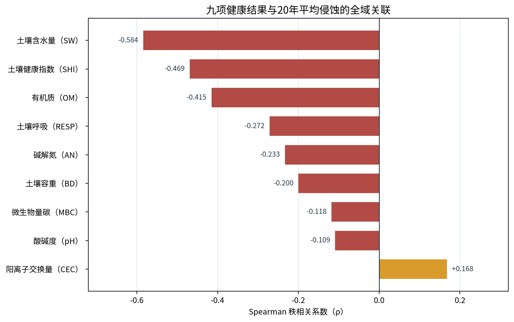{width=95%}

**读图说明。** 条形从零线向左表示负向秩相关，长度表示关联强弱。全域排序为SW −0.584、SHI −0.469、OM −0.415；CEC −0.286和RESP −0.272居中，其余四项较弱。该排序明确了后续匹配、曲线和局部分析的重点。

单暴露线性模型的标准化斜率也显示同一主序：SHI为−0.472（35个5公里空间块、399次重抽样的95%区间−0.531至−0.412），SW为−0.595（−0.630至−0.555），OM为−0.421（−0.459至−0.377）。秩相关刻画排序变化，标准化斜率刻画标准差尺度的平均响应，区间呈现空间块重抽样下的估计范围。

结果以效应方向、标准化幅度、空间块区间和健康指标含义共同呈现。对连续栅格的关系，报告同时给出像元层秩相关与空间块重抽样区间，使全域强弱排序和区域尺度变动范围分别清晰可读。

全域九项结果呈现出清晰的强弱梯度。SW（ρ=−0.584）、SHI（ρ=−0.469）和OM（ρ=−0.415）是最突出的三项；CEC（ρ=−0.286）和RESP（ρ=−0.272）构成第二层；AN、BD、MBC和pH的总体关系较弱。有效像元数约为384,737至388,092，CEC为387,448。这个顺序是当前预测地图上的空间排序强度，为后续重点分析提供依据。

SW在全域相关、空间块标准化斜率及匹配分析中均呈现较强负向关系，指向侵蚀较高区域的预测含水量整体较低。SHI汇总多项健康属性，表示综合分数随侵蚀梯度的共同变化；OM与SW和SHI方向一致，为综合结果补充了有机质维度的空间信息。

CEC与RESP的总体关联强度接近，均位于九项结果的中间层；AN、BD、MBC和pH的全域关系较弱。匹配和局部分析进一步显示，这些指标的方向和强度会随分析对象及空间位置改变。因此，结果显示，九项指标形成强度清晰的总体主线，同时保留各自不同的空间响应画像。

Pearson相关、Spearman相关和标准化线性斜率分别呈现线性关系、秩次关系和标准差尺度的平均变化。重点指标在三种表达中的方向和强弱排序相互呼应。

### 2.2.1 从匹配试验到本报告：每段工作增加了什么

项目先比较环境分组、直接近邻、配对差值和空间分块表现，再在多种环境向量、距离卡尺、地理半径和侵蚀秩差组合中评价243组设计，其中39组进入多指标非劣候选。十个固定空间留出种子下，分组匹配覆盖率中位数为0.505、最大绝对SMD中位数为0.010；直接近邻相应为0.483和0.012。当前主匹配形成111,289对，成为配对差值分析的主要样本框架。

之后的环境分组和模型探索把重点转向“哪些背景下关系可能不同”。项目按结局和环境组合组织分组斜率、交互结果与空间表现，使相同健康指标可以从多个环境层次进行对照。由此形成的结果结构既保留重点关系，也呈现不同组别和空间单位之间的梯度。

低值分布诊断再把侵蚀零值与正值强度拆开。它量化有效零值比例和经验累计分布折点，并以空间重抽样描述折点稳定性；KDE、混合高斯和Otsu分别从平滑曲线、混合成分和直方图类别刻画低端分布。后续曲线分析保留全样本，并以分段模型或零值指示模型补充展示分布结构。

空间模块把结果从“整体关系”扩展到“哪个位置附近关系较强”。它形成约240米空间单元局部系数、局部相关及热点统计，也在770个位置上比较标准GWR和MGWR。路径模块进一步将不同总体和控制层级的结果组织成路径结构。单期综合则以20年平均实际侵蚀为主线，贯通匹配、响应、空间系数与结构路径结果。

**表8　项目从数据整理到结果综合的工作链**

| 工作阶段 | 解决的问题 | 代表性做法或参数 | 留下的结果与当前报告的用法 |
|---|---|---|---|
| 空间数据与变量构建 | 如何在同一地图空间组织分析变量 | 统一网格、地理位置与变量角色 | 建立共同位置数据库和逐项有效样本统计 |
| 环境匹配设计 | 怎样在环境相近时建立对照 | 243组盲于健康结果的环境设计；39组多指标候选；10个空间留出种子 | 解释覆盖、平衡、距离和侵蚀差异需共同考虑 |
| 分组与响应探索 | 哪些环境背景可能调节关系 | 土类、环境分位、聚类及交互回归 | 识别关联强度不同的候选环境组合 |
| 低值与非线性诊断 | 零值和低值是否会改变解释 | 100次空间折点重抽样；KDE、GMM、CDF、Otsu和柔性曲线比较 | 主分析保留完整有效样本，阈值用于敏感性描述 |
| 局部空间分析 | 关系在地理位置上怎样变化 | 约240米局部单元、局部收缩回归及770点GWR/MGWR比较 | 汇总系数地图、空间排序一致性与热点敏感性 |
| 路径综合 | 控制环境后SHI和维度路径还剩多少 | 多个总体、路径结构及环境控制组合；主解释使用35块稳健区间 | 以核心控制下的条件关系呈现环境控制后的路径梯度 |
| 单期结果综合 | 如何沿同一侵蚀情景组织各分析模块 | 统一使用20年平均实际侵蚀结果 | 形成九项指标核心图、匹配结果和路径综合 |

各阶段按研究问题递进：先建立空间可比性，再形成环境近邻对照，继而描述零值与非线性，最后将局部关系和健康维度放入空间模型与路径模型。

### 2.2.2 九项指标关联结构与效应梯度

九项结局的全域排序把土壤健康响应分为三个层次。第一层是SW、SHI和OM，Spearman ρ依次为−0.584、−0.469和−0.415，显示侵蚀排序较高的位置通常伴随更低的水分、有机质及综合健康预测值。第二层包括CEC和RESP，ρ分别为−0.286和−0.272；第三层包括AN、BD、MBC与pH，绝对相关幅度约为0.11—0.23。该梯度为后续的重点结果分析提供定量依据，并保留九项结局之间的差异。

标准化线性模型为这一排序补充了以log(1+Aa)为暴露的变化尺度。SW的标准化β为−0.595（5 km空间块区间：−0.630至−0.555），SHI为−0.472（−0.531至−0.412），OM为−0.421（−0.459至−0.377）。三个区间均由35个空间块进行399次重抽样，方向与秩相关一致。它们共同表明，在全域空间预测面上，含水量、有机质和综合健康指数是与侵蚀梯度对应最明显的三项结果。

其他结局进一步呈现土壤功能的分化：RESP的ρ为−0.272，AN为−0.233，BD为−0.200，MBC为−0.118，pH为−0.109。pH与BD具有各自的农学适宜范围，因此在指标解释中与SW、OM和SHI共同构成多维健康画像。CEC的数值见表7。

在线性效应尺度上，5公里空间块的标准化斜率与秩相关给出一致的重点排序。SW的标准化β为−0.595，区间为−0.630至−0.555；SHI为−0.472，区间为−0.531至−0.412；OM为−0.421，区间为−0.459至−0.377。区间由35个空间块的399次重抽样得到。秩相关描述位置排序的共同变化，标准化β描述侵蚀每变化一个标准差时结局在模型中的平均变化尺度；两种统计量从不同角度表达了同一组重点指标。

### 2.2.3 SW、SHI与OM的跨尺度结果

SW是当前九项结果中侵蚀排序关系最突出的指标。全域Spearman ρ为−0.584，空间块标准化β为−0.595（95%区间−0.630至−0.555）；在111,289对候选匹配中，配对差值ρ为−0.272，85.7%的有效配对呈现高侵蚀端SW较低。约240米局部GWR-LCR系数中位数为−0.486，局部系数为负的单元占100%。Gaussian GAM显示，SW在侵蚀高值段下降幅度加大；GRF局部验证R²中位数为0.736，三个重点结局中最高。全域排序、近邻差值、局部系数和非线性预测由此共同指向水分这一重点响应。

SHI的全域Spearman ρ为−0.469，标准化β为−0.472（95%区间−0.531至−0.412）；匹配差值ρ为−0.144，70.7%的有效配对呈现高侵蚀端SHI较低。其局部系数中位数为−0.222，约99.6%的估计单元为负；路径模型在核心环境控制下给出的标准化条件路径为−0.113，SHI方程R²为0.601，加入侵蚀后的ΔR²为0.0079。SHI把多项健康属性组合为总体图景，局部GWR和路径结果将其全域排序进一步展开为地点差异和环境控制层次。

OM在全域的Spearman ρ为−0.415，标准化β为−0.421（95%区间−0.459至−0.377）；匹配差值ρ为−0.115，66.2%的有效配对呈高侵蚀端OM较低。局部系数中位数为−0.395，负值单元占100%。其GAM曲线在低至中侵蚀段略有上扬或平台，随后进入下降区间；GRF局部验证R²中位数为0.618。OM与SW的局部响应均广泛为负，但GAM曲线形状及空间尺度不同，显示相同总体方向可以对应不同的响应过程。

将三项结果并列，SW在全域、配对和局部三层均表现最强，OM保留稳定负向梯度，SHI则提供综合健康参照。三者在空间块、模型类型和估计单位上的表现共同构成了本研究最集中的结果主线，其他六项指标用于说明健康系统内部的分化。

### 2.2.4 九项健康指标的效应梯度及其解释

九项结果之间的强度差异，为“土壤健康”这一综合主题提供了更细的属性画像。SW的全域秩相关绝对值最高，标准化β也在三项重点结局中最大；在环境近邻配对中，85.7%的有效配对显示高侵蚀端SW较低。由此，水分属性既有较大的县域梯度，也有较高的配对方向一致比例，成为跨分析结构最鲜明的单项结果。

OM的全域关系位于第二梯队，但在GAM曲线上表现出清楚的区间变化，在局部GWR-LCR中则有100%的估计单元为负。该组合说明总体负向梯度可以与局部方向高度一致并存，同时平均曲线仍可呈现低值段平台或轻微上扬。换言之，指标的整体排序、局部方向覆盖和响应曲线形态是三个不同侧面，合在一起才能较完整地描述OM的空间关系。

SHI的全域相关和标准化斜率均位于三项重点结果之中，局部系数中位数则小于SW和OM。综合指数将多个土壤属性压缩成一个可比较的整体量，因此它在全域上具有清楚的综合梯度，但局部幅度不会简单等同于某一个组成指标。SW、OM和SHI共同呈现“具体属性突出—综合指标承接”的结果层次，有机质和水分为理解综合指数的空间变化提供了单项支撑。

CEC的全域Spearman为−0.286，配对差值相关为−0.100，局部系数中位数为−0.152，96.6%的局部估计为负。三个统计尺度的强度不同，但均显示负向分布；CEC因而处在九项结果中稳定的中间梯度。RESP的全域ρ为−0.272，强度接近CEC；AN、BD、MBC和pH的全域ρ绝对值约0.11—0.23。它们在配对和局部分析中的差异更明显：BD局部系数全部为负，MBC和pH局部负向比例分别约74.0%和65.6%，AN的局部系数中位数靠近零。较弱的全域排序因此可能伴随特定指标的空间集中或局部方向变化。

这一效应梯度将总体结果从单一“健康高低”扩展为九项相互补充的观察维度。SW和OM提供水分与有机质的信息，SHI概括整体状态，CEC与RESP呈中等强度，AN、BD、MBC和pH保留较细的属性差异。图表中按照同一侵蚀暴露并列报告全部结局，使主线集中于强度最高的三项，同时保留土壤健康内部的多维结构。

## 2.3 环境匹配：相似背景下关系是否仍然存在

当前单期匹配候选包含111,289对。每一对由高、低侵蚀两个地图位置构成；对健康结果而言，分析时计算高侵蚀端减低侵蚀端的差值，再检查该差值和侵蚀差值的排序是否一起变化。配对差值将比较单位从单个地图位置转换为一组环境相近的高低侵蚀端点。

重点三项的配对差值Spearman分别为SW−0.272、SHI−0.144、OM−0.115，均延续全域负向方向。由于全域以像元排序为单位、匹配以端点差值为单位，数值强度按照各自估计对象分别解读。

九项结果中，CEC配对差值的Spearman为−0.100；AN为−0.024，OM为−0.115，pH为−0.051，SW为−0.272，BD为−0.032，MBC为+0.056，RESP为−0.014。各指标呈现不同方向和强度，相关接近零的结局对应更平缓的配对排序。配对箱线图展示高侵蚀端与低侵蚀端预测差值的分布跨度，与Spearman系数共同描述配对结果。

当前单期设计形成111,289个候选配对；各结局的有效配对数略有不同。

\Needspace{12\baselineskip}

**表9　当前单期匹配候选的配对差值关联**

| 结果 | 有效配对 | Spearman ρ | 负差比例 |
|---|---:|---:|---:|
| SHI | 110,657 | −0.144 | 70.7% |
| AN | 111,281 | −0.024 | 51.4% |
| OM | 111,278 | −0.115 | 66.2% |
| CEC | 111,278 | −0.100 | 69.2% |
| pH | 111,281 | −0.051 | 59.2% |
| SW | 111,278 | −0.272 | 85.7% |
| BD | 111,278 | −0.032 | 64.6% |
| MBC | 111,278 | +0.056 | 59.7% |
| RESP | 111,278 | −0.014 | 66.0% |

这里要分清两个统计量。负差比例是所有配对中“高侵蚀端健康预测值较低”的比例；Spearman则检验侵蚀差更大的配对，健康差是否也按某种顺序变化。即便负差比例较高，差值大小与侵蚀差值的排序相关仍可能接近零。反过来，相关为负也不要求每一对的健康差都为负。用两者一起描述，能避免只选一个更醒目的数字讲故事。

图2展示九项配对差值相关，表9补充每项指标的有效配对数、负差比例和相关系数，综合图提供全域、匹配与局部结果的并列视图。

**图2　九项指标的配对差值秩相关**

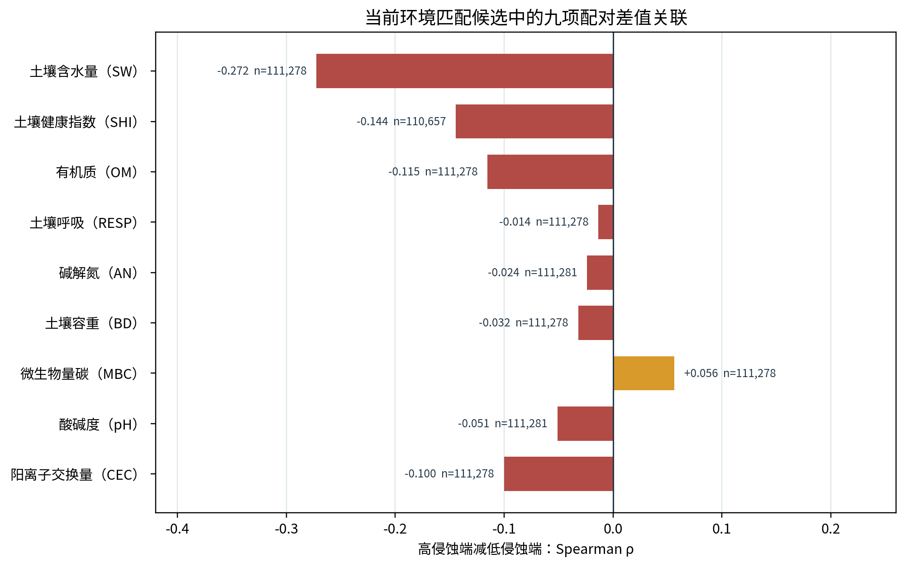{width=95%}

**读图说明。** 每根横条表示高侵蚀端减低侵蚀端后的健康差值，与配对侵蚀差值之间的Spearman相关。SW为−0.272、SHI为−0.144、OM为−0.115、CEC为−0.100；MBC为+0.056，其余接近零。环境近邻配对中，SW、SHI和OM仍保持负向排序。

图件与表9采用相同配对结果；重点指标按配对差值方向与关联强度共同解读。

匹配结果由环境距离、地理距离、SMD、侵蚀差和覆盖率共同描述。当前设计在纳入的环境变量上保持较小均差，并形成超过11万对比较位置；田间管理记录可在后续分层实测中与匹配指标并列分析。

### 2.3.1 配对差值的方向、强度与指标分化

当前匹配设计形成111,289对环境近邻位置。每一对先按Aa_20yr确定高、低侵蚀端，再计算两端的侵蚀差和健康结果差；配对Spearman因此度量“侵蚀差距较大的配对是否也呈现更明显的健康差距”。全域像元与配对差值具有不同的统计对象；配对结果重点呈现环境近邻中的方向保持及指标排序。

在九项结果中，SW的配对差值相关最突出（ρ=−0.272），其后为SHI（−0.144）、OM（−0.115）和CEC（−0.100）。pH为−0.051，BD为−0.032，AN为−0.024，RESP为−0.014，MBC为+0.056。高侵蚀端结果低于低侵蚀端的配对比例分别为SW 85.7%、SHI 70.7%、OM 66.2%；该比例与连续差值相关结合阅读，可以区分“有多少配对方向一致”与“差值是否随侵蚀差距有序变化”两类信息。

匹配分析由此将全域主线进一步限定到环境邻近的比较对象：SW、SHI和OM仍保持较清楚的负向排序，其他指标则接近零或出现弱方向差异。对后续现场研究而言，这种结果支持在同一土类、相近地形湿度和相似地理邻域内设置高低侵蚀对照，并同时测量水分、有机质和SHI所代表的综合状态。

匹配差值结果还可由“负差比例”和“连续差值相关”两项指标补充理解。SW、SHI和OM的高侵蚀端健康预测值低于低侵蚀端的配对比例分别为85.7%、70.7%和66.2%；CEC为69.2%，AN、OM、pH、SW、BD、MBC、RESP等结局的完整数值见表9。负差比例强调方向一致的配对占比，Spearman相关则强调差值大小是否随侵蚀差排序变化。两项结果回答的问题不同：前者描述“有多少对同向”，后者描述“变化幅度是否有序”。这种并列方式让配对结果既保留方向覆盖，也呈现连续效应梯度。

### 2.3.2 配对样本中的指标层次与空间比较

配对样本数量超过十一万对，使九项健康结果可以在相同的匹配框架中逐项比较。各指标有效配对数非常接近：SHI为110,657，其余大多约111,278至111,281。这样的共同支持结构便于直接观察同一组环境近邻中不同结局的响应排序。SHI因完整案例范围略小，仍保留超过十万组有效比较，主体方向与单项指标可以并列阅读。

配对ρ从SW的−0.272到MBC的+0.056，跨度覆盖负向、接近零和轻微正向三类表现。负差比例则从AN的51.4%到SW的85.7%，其范围更直接显示每个结局在配对方向上的覆盖。两类数值共同说明：同样的配对设计不会让所有健康指标产生同一响应。SW的负差覆盖与负相关均最清楚，SHI和OM保持次序一致的负向关系；CEC虽相关幅度较小，近七成配对仍呈现高侵蚀端CEC较低；其他结局的差值排序更接近零。

若将配对差值绘成散点，横轴为每对侵蚀差，纵轴为同一对的健康差，点云的总体倾斜方向对应Spearman关系，落在横轴下方的比例则对应负差覆盖。匹配质量图提供另一层空间背景：环境距离和地理距离说明两端位置的接近程度，颜色或标记再呈现变量平衡。沿“匹配位置—质量特征—结果差值”顺序读图，可以把抽象的ρ值联系到实际空间比较对象。

这些配对结果为现场研究提供了可执行的比较思路：在同土类和相近地形背景内同时选择侵蚀水平不同的田块，逐项测量SW、OM、CEC及其余健康属性，再计算每对实测值差。如此可将地图预测格局的秩次关系转成同一地理邻域内的实测差值，并与目前九项指标的配对结果逐项对照。

## 2.4 非线性响应：侵蚀梯度上的曲线形态

全域GAM显示SHI、SW和OM总体随log(1+侵蚀)增加而下降，且平均响应速度因区间而异。SHI和SW在较高侵蚀段下降更快；OM在低至中值区间略升或平台，随后转为下降。

综合图将三项曲线与全域、匹配结果并置，专门曲线图则放大SHI、SW和OM的形态变化。两幅图使用同一组已拟合曲线，分别支持跨分析模块对照和曲线细节阅读。纵轴为健康预测值，横轴为转换后的侵蚀尺度。

**图3　三项重点结局的全样本GAM响应曲线**

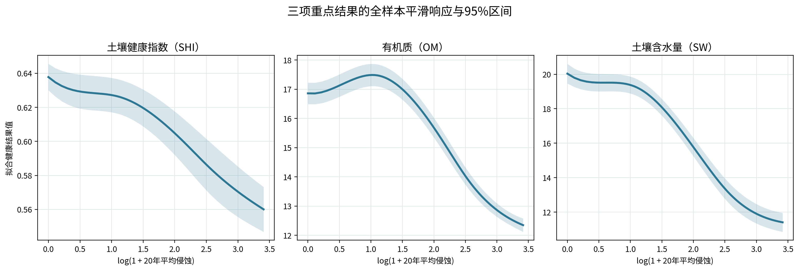{width=95%}

**读图说明。** 三个面板分别展示SHI、OM和SW的Gaussian GAM拟合。横轴为log(1+20年平均侵蚀)，纵轴为模型拟合健康值，浅色带为95%区间。SHI总体下降；SW在较高侵蚀段下降更明显；OM在低至中等侵蚀处略升后转为下降，说明响应速度随侵蚀范围而改变。

项目并列报告像元层拟合、配对差值表现和5公里空间块留出结果，使不同模型在总体与空间测试中的表现可以对照。零值指示加正值强度或分段模型能够更细地表示侵蚀状态与强度，其结果与全样本GAM曲线共同呈现低值结构和连续暴露梯度。

零值状态表示Aa_20yr为零，正值强度表示有效正侵蚀值的大小。两部分分别刻画侵蚀出现与侵蚀强度，完整样本同时由全范围平滑曲线概括。CDF折点、KDE、GMM和Otsu结果并列呈现低值分布的多种统计刻画。

### 2.4.1 零值、低值与侵蚀分布的分层表征

20年平均实际侵蚀的294,243个有效位置中，98,560个为精确零值，占33.5%。这一分布由零值部分与右偏正值部分共同构成；全样本、零值状态和正值强度三类分析分别刻画其总体结构。

经验累计分布曲线识别的主要折点约为5.0502，折点以下或等于折点的有效位置约137,000个，占46.6%。100次5公里空间块重抽样均识别相近折点，中位数约5.114，变异系数约3.6%，显示该统计转折位置在当前分析尺度下较稳定。

KDE从平滑峰谷描述正值分布，GMM比较2至3个混合成分，Otsu根据直方图类间差异识别候选界点；CDF折点经空间块重抽样呈现其统计稳定性。四类方法分别从曲线、混合分布、频数分箱和累积分布角度刻画低端侵蚀结构。

主结果以全部有效像元刻画完整侵蚀梯度，并将零值状态和正值大小分别建模。两部分结果与全样本平滑曲线共同展示侵蚀发生状态、正值强度和整体响应。若开展地面调查，CDF折点可作为分层布点的参考位置；样点覆盖折点两侧及零值区，再结合土类和地形湿度进行安排。

### 2.4.2 平滑曲线揭示的响应形态

GAM使用平滑项估计平均响应曲线，不预先限定为固定直线（Wood, 2017）。重点指标图显示，SHI和SW随log(1+Aa_20yr)升高总体下降，且在较高暴露范围曲线下降更快；OM在低至中等暴露段表现为相对平缓并伴有轻微起伏，随后转为更清楚的下降。图中的置信带在暴露分布两端更宽，说明曲线对中间主要数据区间的刻画更集中。

当前图组的平滑项有效自由度约为7.4，支持采用非线性形状表达全域关系。曲线的意义在于描述平均变化轨迹和局部斜率差别：同样大小的侵蚀变化，在曲线不同位置对应的预测差异并不相同。SHI、SW、OM三条曲线均使用Gaussian GAM和同一Aa变换绘制，因而可以直接比较形状；纵轴仍保持各结局原有尺度，跨结局的纵向数值不作直接比较。

### 2.4.3 重点指标曲线的形态比较

三条重点曲线展示了相同负向总体方向下的不同响应形态。SHI从低侵蚀区起便呈缓慢下降，约在中高暴露范围后下降幅度加大；综合健康预测值的变化速率沿侵蚀轴逐步改变。SW在低值段已有轻微变化，随后进入更明显的下行区，较高侵蚀端的拟合值与低侵蚀端拉开距离。OM则在低至中值区间保持平缓并有轻微上扬，再转入持续下降。曲线因此把三项重点结果区分为“先缓后快”“高值段加速下降”和“平台后转降”等可读形态。

这一比较也说明，单一线性斜率会把整段曲线压缩为一个平均变化量。SHI和SW在高值段更陡的走势，提示同样的侵蚀增量在分布不同位置可能对应不同预测差异；OM的低中段平台则说明，在侵蚀较低的位置，整体负向ρ不意味着每个相邻小区间都严格下降。报告以全样本GAM曲线展示平均形状，再以匹配差值和局部模型补充环境条件及地点差异，三者把暴露范围、近邻比较和地图位置分工表达。

浅色区间带显示曲线估计范围，在侵蚀分布两端通常比中间范围更宽。横轴变换压缩了正侵蚀分布长尾，使常见值与较高值能在一幅图上共同呈现；读者沿曲线先确认区间位置，再比较斜率、转折和端点区间即可。图中纵轴为模型拟合的健康值，曲线主要呈现变化方向与速率如何随暴露范围改变。

零值结构与曲线形态相互补充。全域有效侵蚀中约三分之一为零，CDF候选折点约5.0502，折点以下或等于该值的位置约占46.6%。项目同时比较KDE、GMM、Otsu和空间块重抽样结果，用于判断分布低端的候选划分如何随方法变化。主曲线仍保留零值与正值的完整样本结构，另以零值状态和正值强度的两段式模型检查响应构成。

GAM以log(1+Aa_20yr)为横轴，以九项健康结果为结局估计平滑曲线。SHI在低侵蚀段变化较缓、在中高侵蚀段下降加快；SW在较高侵蚀范围下降更明显；OM在低至中段略升或平台后转为下降。其余单项指标则呈现先升后降、弯曲或近乎平坦等多种形态。

## 2.5 环境异质性：不同背景下的斜率变化

不同土类的SHI标准化组内斜率分别为：26号冲积土−0.150、27号潮土−0.246、42号脱潮土−0.108。CEC对应斜率为−0.049、−0.309和−0.325。潮土及脱潮土中的负向幅度较大，冲积土的SHI关系较缓；土类分层与SW、OM等指标的环境组结果共同构成异质性画像。

土类分组图并列展示三个土类与九项结果的斜率，并标出配对数量。补充路径图展示选定土类与地形湿度组合的路径示意和估计，作为环境异质性的补充案例。各组结果同时标注配对数量、空间块数量与估计区间，供比较组间幅度及估计范围。配合组内空间块数量、斜率区间和配对规模，可同时读取各组的估计幅度与空间支持。

**图4　土类分组下九项健康结果的标准化配对斜率**

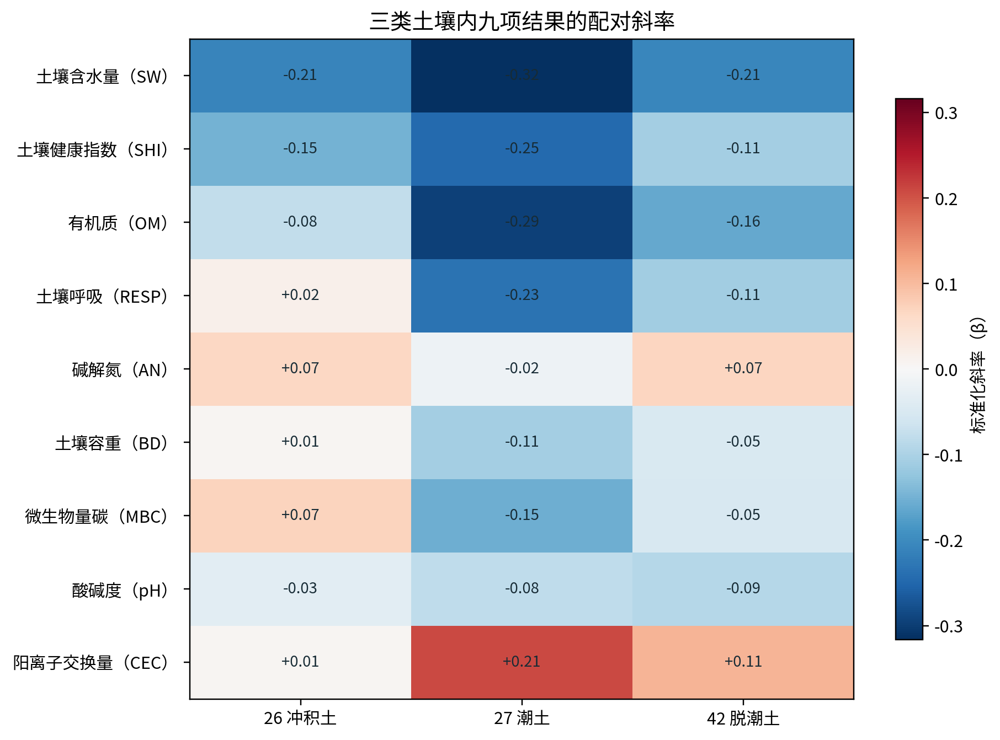{width=95%}

**读图说明。** 点和区间比较不同土类中的标准化配对斜率。SHI在26号冲积土、27号潮土、42号脱潮土中的估计分别为−0.150、−0.246和−0.108；CEC分别为−0.049、−0.309和−0.325。结果显示土类间斜率强弱不同。

*图中展示全部三个主要土类，不按结局强弱删组；数据来自已保存的土类交互表。*

**图5　不同环境组中的补充路径结果**

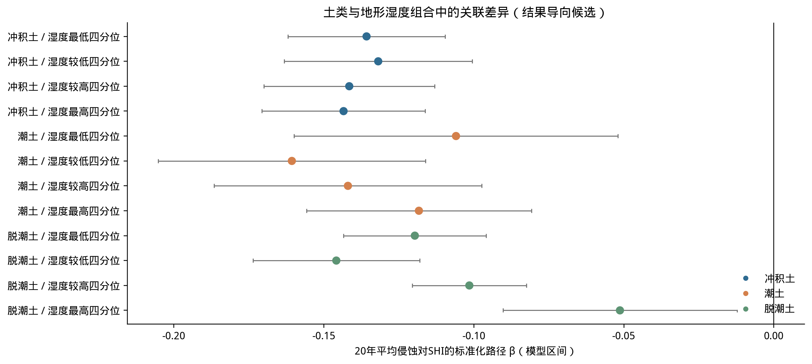{width=95%}

**读图说明。** 该路径图将土类和地形湿度分层与SHI路径并列。箭头表示模型设置的关系，旁侧系数为标准化估计；按土类与地形湿度分组比较侵蚀路径及区间，可辨认不同环境组合中的强弱变化。

*补充图并列呈现环境背景与响应差异，比较各类别中的空间关系。*

项目在多种环境变量与结局组合中比较组内斜率，主匹配候选的126项交互检验有123项经BH调整后q值小于0.05，另一早期设计有94项通过调整。交互图重点呈现土类、TWI及连续环境分组对应的斜率差异，并据此提出后续采样可直接检验的分层假设。

### 2.5.1 土类背景下的斜率差异

土类分组结果将全域平均关系进一步分解到冲积土、潮土和脱潮土。SHI的标准化配对斜率分别为−0.150、−0.246和−0.108，27号潮土组的负向关联较强；CEC相应估计为−0.049、−0.309和−0.325。CEC在冲积土中的斜率较弱，而在潮土和脱潮土中更明显。组间交互检验显示不同土类的斜率存在统计差异，图件同时列出配对数量和空间块数量，使组内支持与估计幅度一并呈现。

这一结果的研究价值在于显示全域平均会压缩土类内部的差异。对于SHI，潮土组的斜率高于冲积土和脱潮土；对于CEC，脱潮土与潮土的估计较为接近，而冲积土明显较弱。环境分层因此不仅是图面分类方式，也为下一轮按土类均衡布点、比较不同背景下的土壤响应提供了直接的设计依据。

土类分层结果显示，SHI的负向斜率在27号潮土中最强，其次为26号冲积土，42号脱潮土幅度较小；CEC的排列则是42号脱潮土和27号潮土较强、26号冲积土较弱。对土类、地形湿度、植被指数和温度等环境分组的交互测试，描述了条件关系是否随环境层次改变。尤其在27号潮土的地形湿度组内，SHI、OM与SW呈现可区分的组别斜率；相应系数与区间同时列出，便于比较组间幅度及组内支持。

### 2.5.2 连续环境梯度与土类分层的互补信息

土类是相对稳定的类别背景，TWI、植被指数、温度和地形曲率则提供连续环境梯度。两类变量所形成的异质性结果侧重点不同：土类图显示类别之间的平均斜率差异，环境梯度图显示变量由低到高时响应变化是否平滑，或是否集中在某一区间。交互模型将这两类信息转换为组别斜率或连续交互项，配合每组样本量和空间分布，提供“哪些背景下关系较强”的定量描述。

主匹配候选的126项环境组交互检验中，123项在BH调整后q值小于0.05；另一早期环境设计有94项通过相同调整。核心信息是跨多个环境变量和结局观察到的斜率异质性，而不是某一张图上的单一高响应组。土类与TWI的交叉图进一步显示，同一土类内部也有湿度层次变化；环境梯度与类别分组并读，可以同时识别土类间差别和土类内部的条件差异。

具体到SHI，27号潮土的组内斜率−0.246大于26号冲积土的−0.150及42号脱潮土的−0.108；这显示综合健康的侵蚀梯度随土类而改变。CEC则在42号脱潮土（−0.325）和27号潮土（−0.309）中呈更强负向关联，在26号冲积土中较弱（−0.049）。同一环境分类下，不同健康结局具有不同的斜率排序，环境分层因此同时呈现总体关联的条件变化与健康指标之间的差别。

## 2.6 局部空间差异：从平均关系走向地点识别

局部模型把全域平均线拆成空间上的许多小段，回答“关系在地图上怎样变化”。约240米单元的带局部岭收缩GWR显示，SW、OM和SHI的局部标准化系数中位数依次为−0.486、−0.395和−0.222；对应局部估计中负值比例为100%、100%和99.7%。CEC局部中位数为−0.152，7,396个估计单元中96.6%为负。全域、匹配和局部尺度的CEC结果因此都指向同一负向主线。

**表10　重点结果的局部系数汇总**

| 结果 | 局部估计单元 | 局部β中位数 | 负系数单元比例 | 通俗解释 |
|---|---:|---:|---:|---|
| SW | 7,408 | −0.486 | 100% | 局部估计负向最强，空间上仍有幅度变化 |
| OM | 7,408 | −0.395 | 100% | 局部估计整体偏负 |
| SHI | 7,387 | −0.222 | 99.7% | 几乎所有局部窗口都给出负向估计 |
| CEC | 7,396 | −0.152 | 96.6% | 局部方向与全域和匹配结果一致 |

分布图显示九项指标局部估计的集中范围，系数图将估计放回地图，符号图则比较局部方向的一致程度。三种画法相互补充，既给出全县平均印象，也保留空间差异。

**图6　九项结果的局部系数分布**

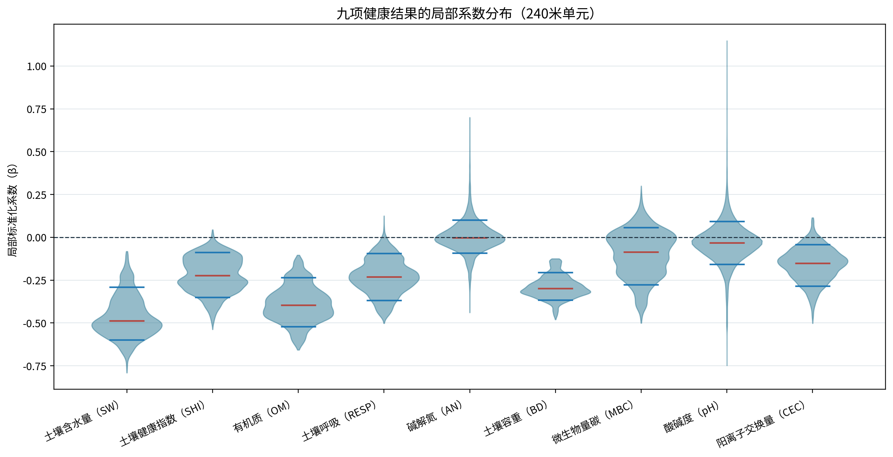{width=95%}

**读图说明。** 九项结局在约240米局部单元上的系数分布呈现清晰梯度：SW中位数−0.486、OM−0.395、BD−0.299、RESP−0.232、SHI−0.222、CEC−0.152、MBC−0.085、pH−0.032、AN−0.0028。箱体和分位范围显示局部估计的空间离散程度。

**图7　局部系数中位数与负号占比**

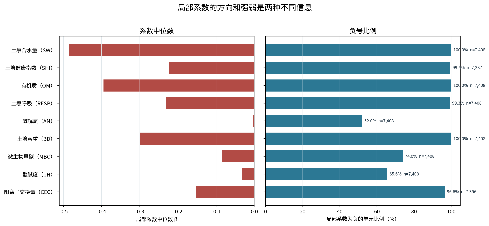{width=95%}

**读图说明。** 图中比较各项结局的局部系数中位数与负值单元比例。SW、OM和BD的局部估计全部为负；SHI为99.6%、RESP为99.3%、CEC为96.6%、MBC为74.0%、pH为65.6%，AN的估计接近零且正负更均衡。

**图8　九项结果的局部回归系数地图**

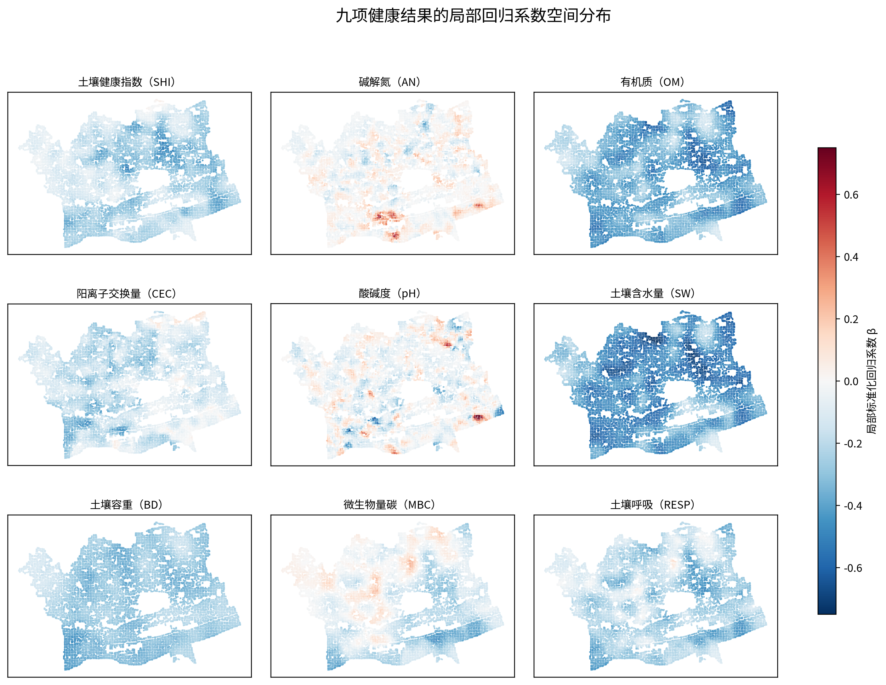{width=95%}

**读图说明。** 九个面板展示SHI及八项土壤指标在约240米空间单元上的局部标准化系数；色标以零为界，蓝色为负、红色为正。SW和OM呈较广泛的负向局部关系，AN与pH的局部方向变化较多；CEC图层按本报告统一变量定义。

*图源为单期局部系数表；颜色表示局部模型系数，地图把全域方向差异放回具体地点。*

地理加权随机森林（GRF）用于识别局地非线性和变量交互，与局部线性斜率形成互补。模型以约1.2公里间隔布置369个局部中心，每个局部森林使用最近的300个240米汇总单元，并以75%拟合、25%局部留出评估。SHI、OM、SW的局部验证R²中位数分别为0.610、0.618和0.736；侵蚀项的局部边际效应中位数依次为−0.144、−0.263和−0.437。侵蚀在三项局部预测中的平均变量重要性分别为0.432、0.571和0.712，显示它在SW模型中的预测权重最高。随机森林、局部GWR和全域相关从不同角度指向同一批重点结果。

空间变化系数GAM进一步检验“关系曲线会不会随位置改变”。按5公里空间块整块留出时，SHI的空间变系数模型R²为0.668，高于全局曲线模型的0.654；OM为0.605对0.598；SW为0.755对0.750。提升幅度为0.005至0.014，说明空间变化项带来稳定但适度的预测增益，也支持把局部差异作为研究主线的一部分。

**表11　同一770点样本上的GWR与MGWR比较**

| 结果 | GWR R² | MGWR R² | MGWR侵蚀带宽邻居数 | 中位距离 | 局部系数排序相关 |
|---|---:|---:|---:|---:|---:|
| SHI | 0.887 | 0.869 | 32 | 2.64 km | 0.537 |
| OM | 0.714 | 0.696 | 767 | 23.78 km | 0.291 |
| SW | 0.834 | 0.822 | 767 | 23.78 km | 0.200 |

同一770点样本上的标准GWR与MGWR为尺度比较提供了另一组结果：GWR样本内R²略高，SHI、OM、SW分别高0.018、0.018和0.012；MGWR则显示不同指标偏好的邻域尺度不同，SHI约32个近邻，OM和SW约767个近邻。系数空间排序相关分别为0.537、0.291和0.200，说明整体方向较一致，而“哪里更强”的精细排序受模型形式影响。这个比较与240米全量局部GWR-LCR各有侧重：前者专门比较模型和尺度，后者提供更完整的局部地图。

局部空间关联统计把“本格高侵蚀、低健康”与“高侵蚀位置周围也聚集低健康”分开考察。已有SHI同位高侵蚀—低健康共现约2,473个240米单元；两类局部模型识别的负向热点约2,484和3,124个单元。不同统计定义得到的热点边界各有侧重。将共同识别位置和边界差异位置一并纳入采样框，可同时比较热点核心与周边梯度。

### 2.6.1 九项局部系数与空间集聚

约240 m局部模型把全域平均效应展开到空间单元。GWR-LCR局部标准化系数中位数在九项结果间形成清晰排序：SW为−0.486，OM为−0.395，BD为−0.299，RESP为−0.232，SHI为−0.222，CEC为−0.152，MBC为−0.085，pH为−0.032，AN为−0.0028。SW、OM和BD的局部系数全部为负；SHI约99.6%、RESP约99.3%、CEC约96.6%、MBC约74.0%、pH约65.6%的局部单元为负。AN的局部系数则围绕零值分布，方向呈现较强地域差异。

这组分布说明，局部关系的平均值和空间离散范围要共同阅读。SW与OM既有更负的局部中位数，也有较一致的局部方向；SHI的中位系数小于二者，但负向单元比例仍接近整体覆盖；AN和pH的正负混合则提醒读者，弱全域相关可能对应多个方向不同的局部片区。局部系数地图和密度图分别呈现“在哪里”与“分布有多宽”，二者组合提供比单一平均值更完整的空间解释。

**表12　九项健康结果的局部系数全序列**

| 指标 | 局部系数中位数 | 估计单元数 | 负系数单元比例 |
|---|---:|---:|---:|
| SW | −0.486 | 7,408 | 100.0% |
| OM | −0.395 | 7,408 | 100.0% |
| BD | −0.299 | 7,408 | 100.0% |
| RESP | −0.232 | 7,408 | 99.3% |
| SHI | −0.222 | 7,387 | 99.6% |
| CEC | −0.152 | 7,396 | 96.6% |
| MBC | −0.085 | 7,408 | 74.0% |
| pH | −0.032 | 7,408 | 65.6% |
| AN | −0.003 | 7,408 | 52.0% |

双变量LISA、局部秩相关和Gi*分别刻画不同邻域统计量。对于CEC的现行分析，7,396个局部单元的局部Spearman中位数为−0.309，89.3%单元为负；双变量LISA中，FDR筛选后的高侵蚀—低邻域CEC类别为949个单元，同位高侵蚀—低CEC位置为2,571个。图件同时呈现SHI与八项指标，因而可比较“自身值共现”“邻域关联”和“局部斜率”三类空间问题。

标准GWR与MGWR在770个共同位置上大体保持SHI、OM和SW系数的负向符号；局部系数排序相关分别约为0.537、0.291和0.200。这种组合表明，两类模型对总体方向判断较一致，对最强区域的空间排序则各有差异。MGWR邻域中位距离在SHI约2.64 km，OM与SW约23.78 km，显示不同健康结果具有不同的空间变化尺度。

局部地图外，约240米局部Spearman进一步显示CEC与20年平均侵蚀的秩相关中位数为−0.309，89.3%的局部单元为负。双变量局部Moran分类中，经过多重检验调整后，高侵蚀与邻域低CEC的组合共有949个单元；同位高侵蚀、低CEC位置为2,571个单元，占7,396个有效局部单元的34.8%。这三类空间量化分别对应局地排序、邻域组合与同位置共现。SHI、SW、OM则以局部负向系数的广泛覆盖构成更稳定的地图主线。

### 2.6.2 局部强度、空间尺度与模型表现

三项重点结局的局部估计形成相互衔接的空间结果。SW的局部系数中位数为−0.486，OM为−0.395，SHI为−0.222，分别对应更突出的单项水分梯度、较明显的有机质梯度和综合健康的空间变化。局部估计符号为负的单元比例分别为100%、100%和99.6%，表明负向主线覆盖范围广；地图中的系数大小仍沿区域变化，可进一步定位强关系与缓关系。

GWR与MGWR把局部强度推进到空间变化尺度。在770个共同空间均衡位置上，SHI的MGWR侵蚀带宽中位距离约2.64公里，OM和SW约23.78公里。SHI在更短邻域内形成其侵蚀系数，说明该关系的空间变化更细；OM与SW则由较大邻域刻画整体趋势。两种模型的局部系数排序相关分别为0.537、0.291和0.200，方向判断保持负向，地点强弱排序则随带宽设定而变化。局部系数地图回答“强关系在哪里”，带宽对照补充回答“关系以多大空间范围改变”。

GRF的局地留出结果把结局拟合能力与侵蚀边际效应放在同一局部模型中。SW的局部验证R²中位数为0.736，OM为0.618，SHI为0.610；对应侵蚀边际效应中位数为−0.437、−0.263和−0.144。SW既具有最高局部拟合中位数，也具有最强负向边际效应，进一步支持其作为重点观测指标。SVC-GAM在空间块留出中对三项结局的R²提升为0.005至0.014，说明允许响应随位置平滑改变能够改进预测表现；这一结果与局部回归系数地图共同刻画空间异质性。

局部秩相关、双变量LISA与Gi*热点各自使用邻域统计量。局部秩相关保留连续排序强度，LISA区分本位置与邻域的高低组合，Gi*着重标出相邻高值或低值集聚。CEC的局部负相关中位数、949个高侵蚀—低邻域CEC单元及2,571个同位高侵蚀—低CEC单元，分别反映排序、空间邻接和位置共现。空间图组把不同统计定义并列呈现，形成更精细的局部识别框架。

## 2.7 环境控制下的SHI路径与模型拟合

路径模型的重点是看侵蚀与SHI的条件关联怎样随控制变量增加而改变。无环境控制模型的SHI标准化直接路径约−0.157，模型R²约0.553，加入侵蚀后条件ΔR²约0.017。加入核心环境控制后，直接路径约−0.113，R²约0.601，侵蚀带来的条件ΔR²约0.0079。加入更广的环境与空间趋势后，路径约−0.106，R²约0.651，条件ΔR²约0.0069。

核心环境控制下SHI路径为−0.113，模型R²为0.601，加入侵蚀后的条件ΔR²为0.0079。R²概括环境、健康维度和侵蚀变量共同进入模型后的拟合；ΔR²专门表示在核心环境条件上增加侵蚀所带来的拟合增量。

**表13　环境控制层级下SHI路径及模型拟合**

| 控制方案 | 空间块 | 像元 | R² | 条件β | ΔR² |
|---|---:|---:|---:|---:|---:|
| 无环境控制 | 35 | 293,145 | 0.553 | −0.157 | 0.0170 |
| 中等控制 | 35 | 293,145 | 0.597 | −0.116 | 0.0086 |
| 核心环境控制 | 35 | 293,145 | 0.601 | −0.113 | 0.0079 |
| 更广环境及空间趋势 | 35 | 293,145 | 0.651 | −0.106 | 0.0069 |

图9和图10展示控制层级及路径、拟合增量的变化；图11并列全域与匹配总体的路径结果；图12呈现侵蚀加入模型后的条件拟合增量；图13和图14比较侵蚀到健康维度的路径；图15展示核心环境控制下的路径结构。七幅图分别从路径系数、总体拟合、维度梯度和结构关系呈现SEM结果。

**图9　控制变量增加时侵蚀到SHI的路径和拟合增量**

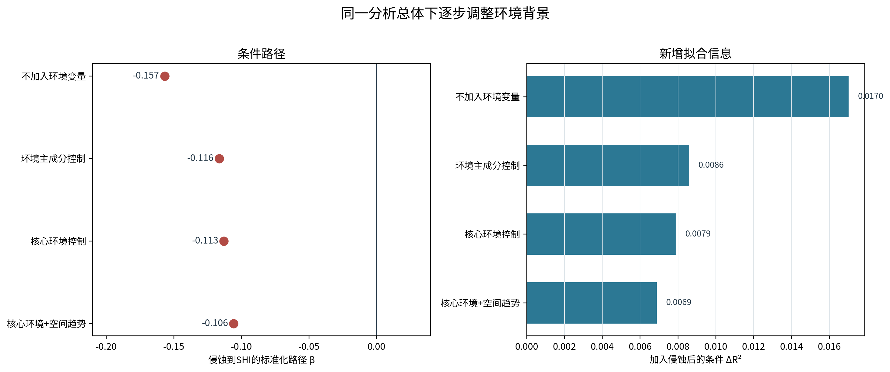{width=95%}

**读图说明。** 图中比较逐步加入环境信息后侵蚀到SHI的标准化路径与模型拟合。核心环境控制下，路径为−0.113；SHI模型R²为0.601，加入侵蚀后的条件ΔR²为0.0079。路径系数表示控制条件下的关联强度，ΔR²表示模型序列中的拟合增量。

**图10　SHI路径在不同环境控制层级中的变化**

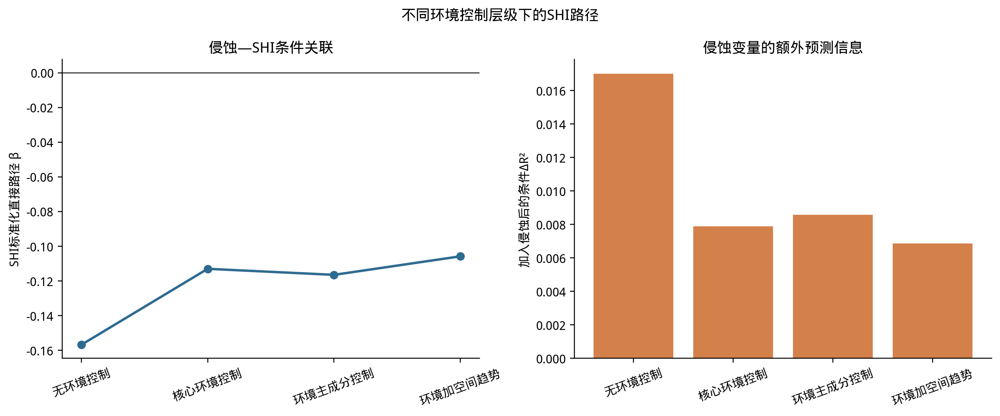{width=95%}

**读图说明。** 左侧比较无控制、核心环境、环境主成分和空间趋势控制下的侵蚀—SHI路径，估计依次为−0.157、−0.113、−0.117和−0.106。右侧显示加入侵蚀后的拟合增量；核心环境控制方案的ΔR²约0.0079。

**图11　全域与匹配样本中的路径模型对照**

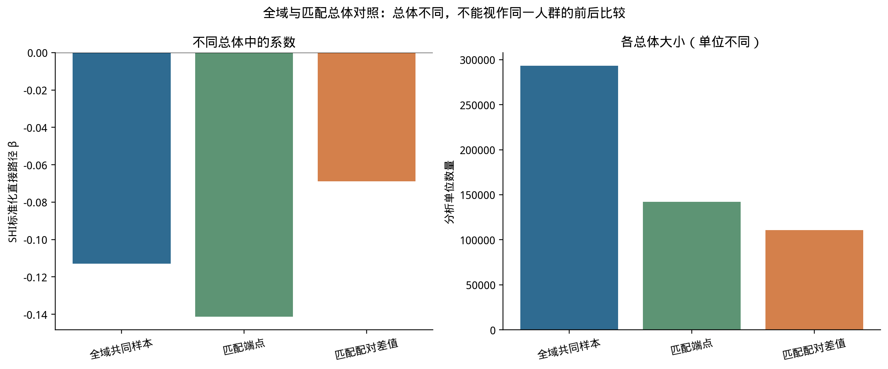{width=95%}

**读图说明。** 图中并列展示全域共同样本、匹配端点和匹配配对差值三种总体中的SHI路径。左侧为标准化路径系数，右侧为各总体的支持量；全域像元、配对端点和配对差值按各自统计单位分别读取。

**图12　加入侵蚀后的条件预测增量**

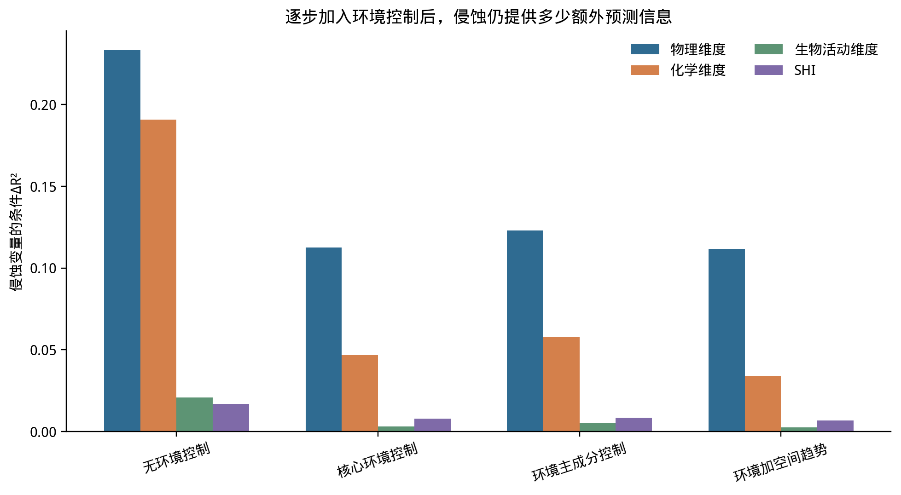{width=95%}

**读图说明。** 柱形比较逐步控制环境背景后，侵蚀变量对物理、化学、生物活动维度及SHI带来的条件拟合增量。物理维度增量较高，化学维度次之，生物活动维度与SHI较小；横轴为控制方案，纵轴为加入侵蚀后的ΔR²。

核心环境模型呈现出清楚的维度强弱梯度：侵蚀与物理维度的标准化路径为−0.389，与化学维度为−0.251，与生物活动维度为−0.066，与SHI为−0.113。物理维度的负向联系最强，化学维度次之，生物活动维度较弱，显示九项健康结果在功能维度上的响应梯度。维度结果与各组成指标结合阅读，可以辨认哪些土壤属性贡献了共同变化信号。

### 2.7.1 路径梯度与综合健康格局

核心环境模型中的四条重点路径依次指向物理维度（−0.389）、化学维度（−0.251）、生物活动维度（−0.066）和SHI（−0.113）。物理路径幅度最大，与SW在全域、配对、局部和局地预测中的突出表现相呼应；化学维度路径较小但仍清楚，与OM主导的化学属性梯度相衔接；生物活动维度路径较弱，与MBC和RESP的全域秩相关处于较低梯度相协调。SHI的综合路径位于单项维度之间，体现综合指数把多个方向和强度整合后的整体联系。

路径系数随着环境信息加入而收敛，从无环境控制的−0.157变化到核心环境控制的−0.113，再到核心环境加空间趋势的−0.106。路径方向保持负向，整体R²则由0.553增加至0.651；与此同时，加入侵蚀后的条件ΔR²从0.0170降至0.0069。三种量描述不同内容：路径系数是给定控制条件下的标准化关联，整体R²是方程组合的拟合程度，ΔR²是侵蚀变量加入所带来的拟合增量。将其并列，可以看到环境与空间变量解释了SHI格局的重要部分，而侵蚀仍保留额外的负向统计信息。

路径图还展示了健康维度与SHI之间的联系，使“侵蚀关联哪些健康面向”与“哪些面向共同构成SHI”在图面上连续呈现。阅读时可先沿侵蚀箭头比较三类维度和综合指数，再沿各维度到SHI的路径观察其条件联系，最后结合方框中的R²理解方程层面的解释范围。此种读取顺序把系数、模型拟合与结构关系分开，使路径图的每类信息都有明确对应的统计量。

**表14　侵蚀与健康维度的核心控制路径结果**

| 模型路径 | 标准化β | 结果解读 |
|---|---:|---|
| 侵蚀 → 物理维度 | −0.389 | 维度中负向联系最强 |
| 侵蚀 → 化学维度 | −0.251 | 负向联系清晰，幅度较小 |
| 侵蚀 → 生物活动维度 | −0.066 | 合并联系较弱，响应强度有别 |
| 侵蚀 → SHI（核心环境） | −0.113 | 控制核心环境后仍为负向 |

**图13　物理、化学、生物活动和SHI的维度路径比较**

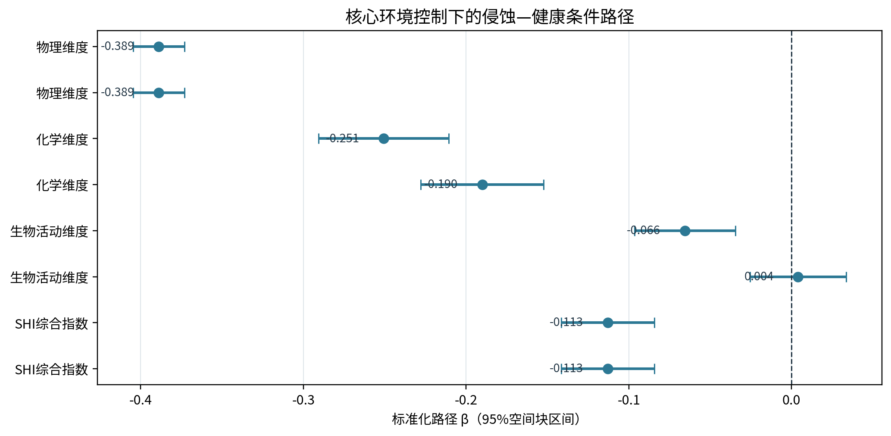{width=95%}

**读图说明。** 点表示侵蚀到物理、化学、生物活动维度及SHI的标准化路径，横线为35个5公里空间块计算的区间。四条路径依次为−0.389、−0.251、−0.066和−0.113，物理及化学维度的负向估计更强。

**图14　侵蚀与三类健康维度的综合路径图**

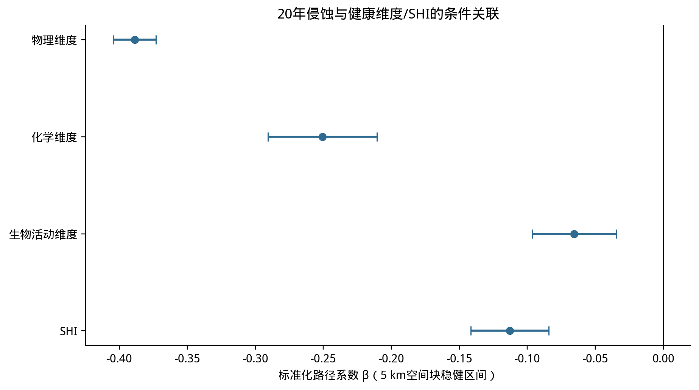{width=95%}

**读图说明。** 图中把侵蚀到三类健康维度、再到SHI的路径画在同一结构中。箭头旁标示标准化系数，区间用于比较估计范围；SW与BD构成物理维度，OM与AN构成化学维度，MBC与RESP构成生物活动维度。

**图15　核心环境控制下的SHI路径结构**

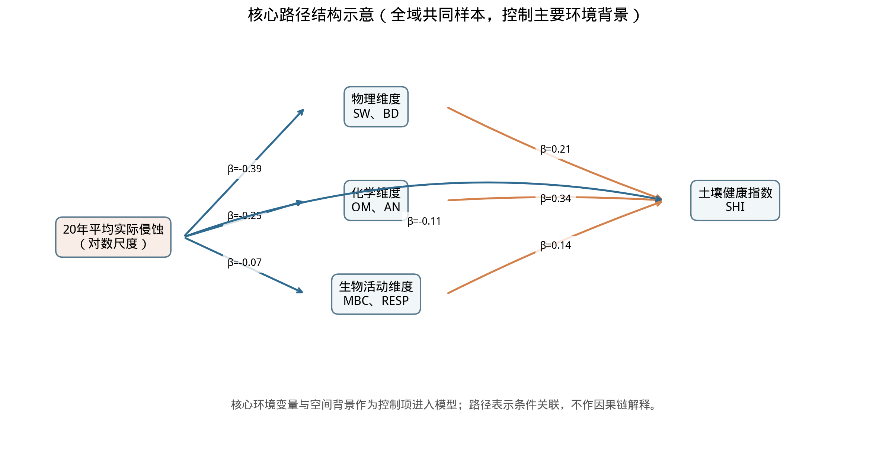{width=95%}

**读图说明。** 方框代表侵蚀、健康维度和SHI，箭头表示模型设置的条件路径，β为标准化系数。图中突出显示侵蚀到各维度的关联及维度到SHI的路径；沿箭头读取可看清路径层级。

SEM结果按分析总体、路径结构与环境控制层级组织。核心环境模型包含高程、曲率、TWI、地表温度、植被指数和土类，并采用共同完整案例和5公里空间块区间。报告以这一组路径作为主叙述，再将全域、环境匹配端点及其他控制层级作为对照，系统呈现路径系数、方程R²和条件ΔR²的变化。

控制层级由无环境控制、环境主成分、核心环境变量到环境与空间趋势逐步扩展，侵蚀到SHI的标准化路径依次约为−0.157、−0.116、−0.113和−0.106。路径幅度沿控制层级收敛，方向保持为负。

四个控制模型的整体R²分别约0.553、0.597、0.601和0.651；核心环境控制模型加入侵蚀后的条件ΔR²约0.0079，更广环境与空间趋势模型约0.0069。整体R²呈现模型的总体拟合，条件ΔR²呈现侵蚀变量的拟合增量。

核心环境控制下，侵蚀到物理、化学、生物活动维度及SHI的标准化路径依次为−0.389、−0.251、−0.066和−0.113。物理维度由SW与BD表征，化学维度由OM与AN表征，生物维度由MBC与RESP表征，路径梯度显示不同健康功能层次的响应强度。

模型比较表汇集了1,582个拟合状态和10,711条路径记录，覆盖不同分析总体、路径结构与环境控制条件。正文以35个空间块支持的核心环境路径为主，并将其他模型作为结构对照，比较路径方向、拟合度和侵蚀增量。

### 2.7.2 环境控制层级与健康维度路径

D1共同环境完整案例由293,145个像元构成，覆盖35个5 km空间块。无环境控制时，侵蚀到SHI的标准化路径约−0.157，条件ΔR²约0.017；加入核心环境变量后，路径约−0.113，ΔR²约0.0079；在更丰富的环境与空间趋势条件下，路径约−0.106，ΔR²约0.0069。SHI方程整体R²约为0.601—0.651。随控制条件增加，侵蚀路径幅度收敛而方向保持一致，说明环境结构解释了SHI空间差异的重要部分，同时侵蚀仍提供较小的条件关联信息。

在核心环境控制下，侵蚀到物理、化学和生物活动维度的标准化路径分别约为−0.389、−0.251和−0.066。物理维度由SW与BD代表，其中SW在全域、匹配和局部分析中均较突出；化学维度由OM与AN组成，主要由OM贡献清晰的负向空间梯度；生物活动维度由MBC与RESP组成，两个单项指标呈现不同强度。路径结果因此与全域九项指标结构形成对应关系，并为SHI内部差异提供维度层面的说明。

## 2.8 现场采样候选区与分层设计

项目结合侵蚀水平、SHI和局部GWR系数形成T1—T4四类互斥空间画像。T1代表高侵蚀与较强负向局部关联，T2代表高侵蚀与较缓负向关联，T3代表低侵蚀但SHI较低，T4代表较低侵蚀背景下的环境对照。各组按照项目探索性分位规则构成，用于规划覆盖不同侵蚀水平、健康状态和局部斜率的现场样本。

**表15　四类现场采样候选区画像**

| 分区 | 单元数 | 面积 | 平均侵蚀 | 平均SHI | GWR β中位数 | 实测重点 |
|---|---:|---:|---:|---:|---:|---|
| T1 高侵蚀—强负向 | 623 | 18.882 km² | 15.670 | 0.549 | −0.567 | 侵蚀、含水量与有机质 |
| T2 高侵蚀—较弱负向 | 842 | 24.001 km² | 14.951 | 0.584 | −0.327 | 环境与田间管理条件 |
| T3 低侵蚀—低SHI | 60 | 2.053 km² | 5.480 | 0.562 | −0.368 | 低SHI的土壤属性组合 |
| T4 环境对照 | 961 | 38.767 km² | 5.109 | 0.628 | −0.311 | 相近环境下的实测参照 |

T1与T2平均侵蚀相近，但SHI和局部系数中位数不同，构成高侵蚀背景中的强弱关联对照；T3在较低平均侵蚀下仍有较低SHI，适合与T4比较健康属性和环境背景。四类画像共同将抽样位置分散到不同侵蚀、综合健康与局部关联组合。

**图16　四类空间候选区的指标画像**

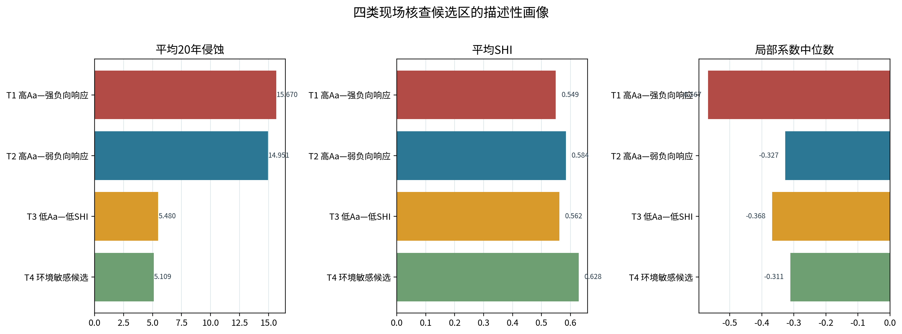{width=95%}

**读图说明。** 四个候选区同时展示面积、平均侵蚀、SHI及局部系数。T1、T2、T3、T4面积分别为18.882、24.001、2.053和38.767 km²；T1和T2侵蚀较高，T3侵蚀较低且SHI偏低，T4面积最大。图面用于比较候选区组合画像并安排后续核查。

**图17　空间候选区分布和环境背景**

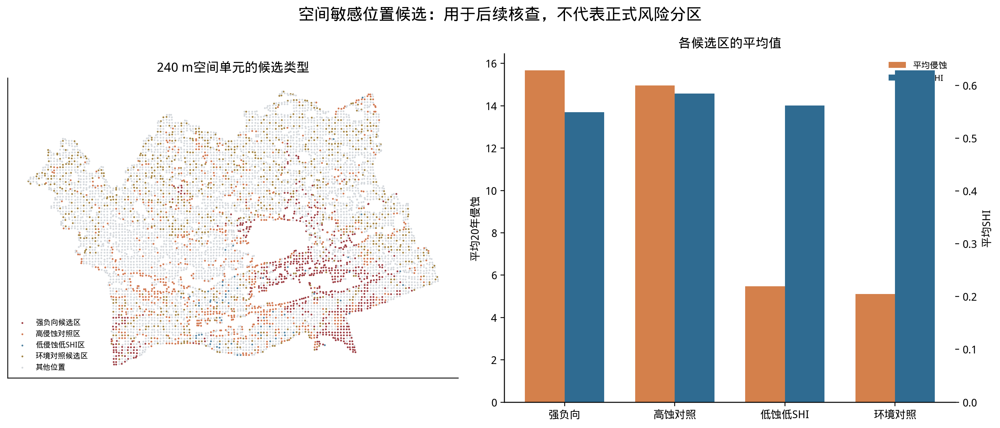{width=95%}

**读图说明。** 地图将20年平均实际侵蚀下的候选环境区放回研究区位置。底图用于定位，颜色和符号对应环境组或候选条件；与区组画像合读，可以识别高侵蚀、局部负向关系较强及环境背景集中出现的位置。

T1—T4分层样本可兼顾侵蚀水平、SHI和局部斜率的不同组合。将每层内的田块分散布设，并同步记录土类、坡位、耕作、灌排、作物与采样深度，可直接检验地图画像所对应的土壤属性差异。

候选区的空间表现可沿四类画像依次比较。T1把较高侵蚀和较强负向局部系数组合在一起；T2同样处于较高侵蚀背景，但局部系数幅度较缓；T3在平均侵蚀较低时仍具有较低SHI和负向局部系数；T4覆盖面积最大，平均侵蚀不高但仍保留明显的局部关系。该分区的用途是把抽样方案从“只选最高侵蚀区”扩展为覆盖不同暴露水平、局部关联强弱和健康状态的多层次设计。现场布点时可在每类内部增加空间离散度，保留组间比较结构。

### 2.8.1 从候选区画像到可执行的田间布点

四类候选区构成一个交叉的空间设计：T1与T2都位于高侵蚀背景，局部系数强度和平均SHI不同；T3和T4的平均侵蚀较低，但健康状态与区域覆盖存在差异。将它们同时纳入样点框架，可覆盖高低侵蚀区、局部关系强弱区和不同健康水平的田块。

布点可分三层开展。第一层按T1—T4确定区带，保证每类都有田块进入样本；第二层在每类内按26、27、42号土类及TWI梯度分层，使主要环境背景均有覆盖；第三层在分层单元内优先选择空间分散的田块，并记录相邻田块之间的距离。样点的分散布置能让局部空间比较覆盖不同地图位置，保留分层内部的区域差异。

每个田块的观测记录需要同时包括坐标、采样深度、采样时点、作物与管理信息、土壤水分及八项单独健康指标。SHI可作为综合参照，现场分析仍逐项保留AN、OM、CEC、pH、SW、BD、MBC和RESP，以便判断地图所见的综合梯度对应哪些土壤属性。对于SW，可同步记录采样前后的降水、灌溉和地表覆盖；对于OM、CEC等较稳定属性，按统一深度和实验室方法取样，便于空间比较。

实测完成后，可先按坐标把现场样点与30米预测格网连接，再在T1—T4、土类和TWI层内比较地图预测与实测值。随后以同环境近邻的高低侵蚀田块构造实测差值，沿用当前环境匹配指标解释顺序；最后将现场测量结果作为实测结局，与本报告的全域秩序、局部系数地图和路径关系逐项对应。这样的测量链可直接检验报告提出的三项重点结果，也保留九项指标完整的比较结构。

## 2.9 空间支持尺度与研究链条

研究结果分别基于30米像元、环境匹配对、约240米局部单元、770个空间均衡位置和35个5公里空间块。将这些分析单位与结果类型连接，可以沿着全域方向、环境近邻、局部关系、模型比较和区域稳定性逐步阅读。

图18展示不同模块的空间支持，图19汇总总体关联、配对差值、局部系数、路径模型和候选区，构成从总体结果到空间解释和现场采样的阅读顺序。

**图18　不同分析使用的样本单位与支持尺度**

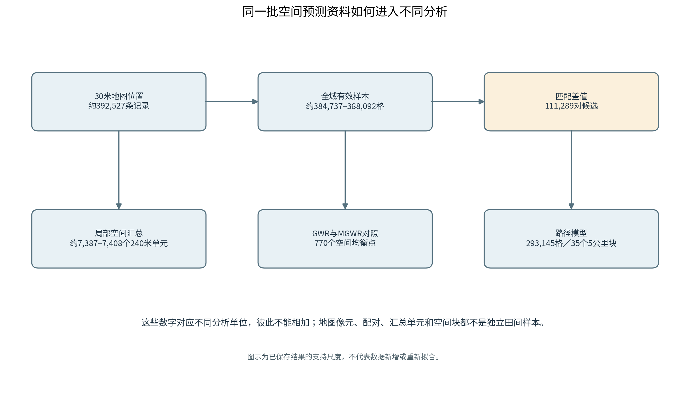{width=95%}

**读图说明。** 流程图并列呈现各分析的空间支持：30米像元用于全域关系，环境匹配以两端形成配对，约240米单元用于局部系数，770个空间均衡位置用于GWR/MGWR比较，5公里区块用于空间留出和重抽样。不同单位对应总体、近邻、局部及区域稳定性问题。

**图19　从总体关系到空间候选的综合证据图**

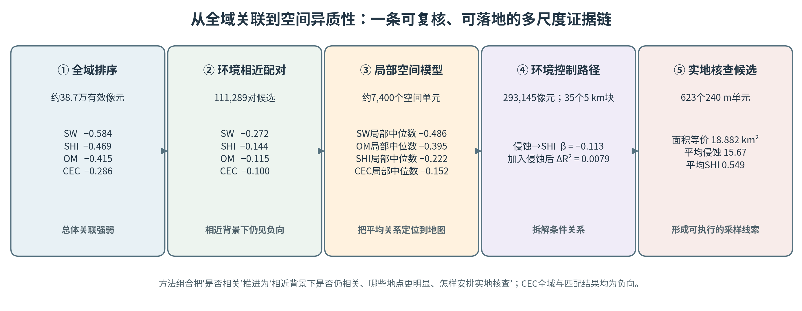{width=95%}

**读图说明。** 综合图并置全域秩相关、环境匹配配对、局部系数、路径模型与候选区结果。SW、SHI和OM构成最清楚的负向主线；局部模型定位强度变化，路径模型补充环境控制下的条件关系。各面板按其标题和统计单位分别阅读。

正文19幅核心图按功能分成五组：总体方向和非线性、匹配与环境差异、空间位置和局部系数、路径关系、现场候选区与证据整合。另有120幅附图拆解重要统计量，分别呈现指标分布、空间结构、方法比较与各阶段结果。

## 2.10 用五个问题归纳当前发现

**问题一：环境背景相近时，侵蚀与健康是否仍有关联？** 是。当前111,289对匹配候选中，SW、SHI、OM的配对差值秩相关分别为−0.272、−0.144、−0.115，CEC为−0.100。匹配把比较放在已记录环境更相似的位置之间，显示主要负向关系在这一层仍然保留。

**问题二：关系会不会随环境背景而不同？** 会。土类分组、环境组斜率和局部系数地图共同呈现出空间差异；GAM与空间变系数模型又显示平均曲线和局部关系有不同形状。它们把县域平均值展开成可定位、可继续检验的环境异质性线索。

**问题三：不同健康指标是否表现不同？** 是。全域中SW、SHI和OM的负向关系最突出，CEC为−0.286，RESP居中，其余指标整体较弱；匹配、分组和局部分析进一步显示九项指标的响应并不相同。综合SHI与单项指标相互补充，能够同时呈现整体状态和具体土壤性质。

**问题四：与既有PCNM结果如何衔接？** 项目保留既有PCNM成果；后续在指标定义、暴露时期、样本单位和空间支持统一后，可沿同一研究主线并列呈现空间控制与环境匹配结果。

**问题五：怎样推进现场研究？** 按T1—T4、土类与TWI建立空间分层样本框，同步测量九项健康指标与管理信息，并预先确定主要侵蚀暴露、匹配规则和5公里空间留出。

### 2.10.1 五项问题之间的递进关系

五项研究问题构成从统计关联到实地比较的递进路线。第一问先确定侵蚀梯度与健康结果的总体方向，回答哪些指标应进入后续分析。第二问将观察对象限定在环境相近的近邻位置，检验总体方向在配对差值中如何呈现。第三问进一步检查同一方向是否随土类、地形湿度和连续环境变量改变。第四问把既有PCNM结果放回项目整体框架，作为已形成的空间控制研究与新增匹配研究之间的对照环节。第五问依据前述结果确定需要采集的指标、空间层次和田间环境记录，使地图分析能转化为现场可检验的问题。

这一路线使结果章节具有清楚的阅读顺序。全域相关先给出SW、SHI和OM的强弱位置；匹配差值说明三者在当前比较框架中的方向和覆盖；响应曲线显示变化速度会随侵蚀水平而变；局部系数和空间热点标出区域差异；路径结果将九项指标组织为物理、化学、生物活动维度与SHI。随后，T1—T4候选区把这些统计线索映射到抽样空间，使指标选择、样点分层和环境记录形成连续的实证设计。

PCNM的作用在这条路线中有明确位置：它代表项目既有的空间控制成果，后续可以按相同指标、侵蚀时期与空间支持开展并列比较。环境匹配则强调在非RUSLE环境背景相近的位置中形成高低侵蚀对照。两类分析可回答相邻但不同的问题：PCNM描述空间结构进入模型后的条件关系，环境匹配描述相似环境近邻中的配对差值。沿同一结局逐项比较两者，将有助于理解空间控制方式变化时，侵蚀—健康估计的方向和强度怎样对应。

由此，项目的核心产出是一套有先后、有对应关系的分析链：先用全域指标梯度建立焦点，再通过环境匹配组织比较对象，随后用曲线与空间模型定位关系变化，最后以路径和实测设计完成结果整合。每一层都有清楚的统计单位、主要问题和图件表达，报告中的表格、图集和逐图说明均按这一顺序编排。

## 2.11 多尺度证据如何汇成一条主线

本项目最重要的方法成果，是把县域总体关系、环境相近位置的比较、非线性响应、局部系数和环境控制路径放进同一个解释框架。不同方法各自回答一个明确问题，再以同一组健康结局和同一侵蚀主线相互校验，避免单一相关系数承担过多解释任务。由此，研究从“地图上是否共变”进一步推进到“关系在何种环境下保留、曲线怎样变化、空间强度如何分布、哪些发现值得实地检验”。

全域层面，SW、SHI和OM的秩相关分别为−0.584、−0.469和−0.415，是九项指标中最突出的负向关系；CEC为−0.286，处于第二层。匹配层面，SW、SHI和OM的配对差值秩相关分别为−0.272、−0.144和−0.115，CEC为−0.100，显示在本轮纳入的环境匹配规则下，核心方向仍然保留。局部层面，SW、OM、SHI的系数中位数分别为−0.486、−0.395和−0.222；CEC中位数为−0.152，7,396个局部单元中96.6%为负。全域、配对和局部三种支持尺度共同构成了清楚的方向收敛。CEC的多种统计表达也提供了更细的互证：全域Pearson原始侵蚀相关为−0.320，Spearman为−0.286，基于log1p侵蚀的标准化β为−0.305；35个5公里空间块的399次重抽样给出β的95%区间−0.382至−0.239。进入匹配样本后，CEC为负向的端点差值占69.2%；局部系数的第5至第95百分位为−0.327至−0.011。相关、斜率、端点比例与局部系数不是同一个统计量，但它们在各自问题上都保留了负向信号，使CEC的空间解释比单独报告一个全域系数更完整。

非线性与空间模型把这条主线进一步展开。GAM显示重点结局的平均响应存在弯曲变化；GRF在局地留出样本上取得SHI、OM、SW的中位R² 0.610、0.618和0.736；空间变系数GAM在5公里空间块留出中，相比全局GAM分别提高0.014、0.007和0.005。它们从曲线形状、局地预测和空间变化三个角度说明，温县的侵蚀—健康关系既有共同方向，也具有明显的局地结构。核心环境控制路径中，侵蚀到SHI的条件β为−0.113，较未控制模型的−0.157收缩，但方向保持一致；这一结果把全域关系与环境背景纳入了同一解释链。

### 2.11.1 本研究形成的主要方法贡献

本研究的方法创新集中在研究流程的组织方式：把栅格对齐、环境匹配、全域响应、空间异质性和条件路径连续起来，使每类方法分别回答总体方向、环境近邻差异、曲线形态、局部变化和维度路径问题。该流程把匹配设计与多尺度空间结果组成可复用的县域栅格研究框架。

这条流程还把研究问题和空间支持逐一对应起来。30米像元适合描绘完整县域格局；240米汇总单元让局部系数在较稳定的邻域中呈现；770个空间均衡点使GWR与MGWR能够在同一批位置上直接比较；5公里空间块则用于留出和重复抽样。不同尺度不是重复计算同一结果，而是分别匹配“总体在哪里”“局部怎样变化”“不同空间模型表现如何”“估计的不确定性有多大”等问题。将这些支持尺度按目的编排，是本项目把空间统计、匹配设计和模型比较连接起来的关键方法环节，也使研究框架能迁移到其他区域的栅格研究。

首先，研究以统一的30米栅格对齐作为共同起点，再分别按每个分析所需字段建立有效样本。九项全域关联覆盖约38.5万至38.8万个共同有效像元；主路径模型则要求更多字段同时完整，使用293,145个像元。将样本规模与空间支持在每一步标清，使分析对象可追溯，也为后续把预测栅格和实测样点并列核验打下基础。主暴露固定为20年平均实际侵蚀，确保报告各模块沿同一时间情景展开。

其次，研究把环境匹配作为全域地图关系的设计补充。全域相关描绘所有有效位置的排序，匹配分析则把视角转到环境更相近的比较对象；当前匹配候选形成111,289对，并把同一批健康结局逐项纳入差值分析。由此获得“全县格局如何、匹配支持范围内又如何”的并列答案。CEC的全域ρ=−0.286、匹配ρ=−0.100和局部中位β=−0.152，是这套跨尺度衔接最直观的示例：方向一致，强度则随分析对象而变化。

第三，空间模型形成从局部线性到局地非线性的互补组合。240米局部岭收缩GWR把九项健康结果映射到约7,400个空间单元；770个均衡位置上的GWR/MGWR比较则揭示指标偏好的空间尺度并不相同。SHI的MGWR典型邻域约2.64公里，OM与SW则接近23.78公里；三项结果的局部系数空间排序相关为0.537、0.291和0.200，显示方法既找到了总体一致性，也量化了地点强弱排序的敏感程度。

地理加权随机森林把分析进一步扩展到非线性和交互作用。369个局部中心各使用最近的300个240米单元拟合局部模型，并以局部留出数据评估；SHI、OM、SW的局地验证R²中位数为0.610、0.618和0.736。空间变系数GAM再以5公里空间块整块留出，SHI、OM、SW相对全局GAM的R²提高0.014、0.007和0.005。这种“局地训练—局地留出—空间整块比较”的组合，为平均曲线之外的空间响应提供了具体、可比较的量化证据。

第四，路径模型用分层控制展示侵蚀—SHI关系的变化过程。侵蚀路径从无环境控制时的−0.157，逐步变为核心控制时的−0.113和更广环境及空间趋势控制时的−0.106；模型R²则从0.553提升到0.651。报告同时呈现路径幅度和整模型拟合变化，让读者看到环境信息如何改变估计，也看见侵蚀路径在不同控制层级下仍保持负向。物理、化学、生物活动维度的结果继续扩展了指标解释，构成从单项健康属性到综合SHI的结构化比较。

第五，九项健康指标与SHI并列呈现，使成果兼顾综合判断和具体属性。SW、SHI、OM形成全域突出主线；CEC、RESP处于中间层；AN、BD、MBC、pH则保持各自较弱的表现。19幅正文图、120幅附录图与15张核心表按总体、匹配、曲线、土类分组、局部系数、路径和候选区组织，展示多尺度结果之间的联系，并衔接到现场采样设计。

这条分析链的主要方法优势体现在三方面：让统计尺度对应具体问题，让空间依赖进入留出和区间估计，并让综合SHI与九项单指标并列解释。这样既保留全县主线，也能识别局部差异和指标特征。局部模型、候选区和分层指标画像进一步把统计输出转化为现场抽样依据，使地图分析直接连接独立实测设计。

#### 2.11.2 面向独立实测的研究设计

多尺度结果为实测研究提供了明确的结局和空间层次。SHI、SW和OM在全域、环境匹配与局部模型中保持较突出负向关系；CEC和RESP呈中等强度，其他指标提供养分、酸碱与生物活动的补充画像。空间分层可覆盖T1—T4四类候选区，同时纳入GWR与MGWR系数方向一致的位置和排序差异较大的位置。

采样可按土类和TWI分层，并在每层内选择空间分散的田块。每个样点同步测量土壤水分、有机质、CEC、SHI相关指标及侵蚀表征，记录作物、灌溉、施肥、耕作和采样时点。与地图预测值按坐标和时间匹配后，可直接比较全域梯度、环境近邻差值和局部模型所识别的区域排序。

研究指标同时保留综合健康与单项土壤属性。SW与OM承担主要响应检验，SHI呈现综合格局；CEC、RESP、AN、BD、MBC与pH补齐化学、生物和物理指标的响应谱。既有PCNM结果可在统一指标、暴露时期与空间支持后，与环境匹配结果并列讨论。

## 2.12 后续实测的实施步骤

第一步，建立田块级样点框架。按T1—T4、土类和地形湿度分层，在每层中选择地理位置分散的田块，并为每个田块安排坐标、采样深度与重复测量记录。

第二步，统一现场测量方案。建议同步测量土壤水分、有机质、CEC、碱解氮、容重、微生物量碳、土壤呼吸和pH，并记录作物类型、灌排、施肥、有机投入、耕作方式及采样日期。重复测量可用于描述季节变化和田块内差异。

第三步，事前确定分析规则。以SHI、SW和OM作为重点结果，同时完整报告九项指标；预先确定侵蚀暴露、环境协变量、土类分层、匹配距离及5公里空间留出区。环境匹配与空间评价沿用本报告的模块顺序，便于直接对照地图结果。

第四步，结合既有PCNM和新增实测结果开展跨方法比较。统一健康指标定义、暴露时期和空间支持后，分别报告总体关联、配对差值、局部系数和路径结果，逐步检验温县地图所揭示的主要空间梯度。

### 2.12.1 实测样点的分层配置与分析衔接

样点配置可依照“空间候选区—土类—地形湿度”逐层展开。先将T1—T4作为一级空间层，再在每个一级层内安排26号冲积土、27号潮土和42号脱潮土的样点，最后覆盖TWI由低到高的环境梯度。这样既保留高低侵蚀区的差异，也能比较相同土类或湿度背景下的土壤属性；当多个分层条件同时出现时，可按照田块所在区带和土类组合进行标记。

每个点位使用统一的定位、取样深度、采样季节和样品处理流程。调查表同时记录农田管理和地表状态，例如作物、覆盖、灌溉、施肥、耕作和坡位。土壤水分随季节及管理变化较快，可在固定季节重复采集并记录采样前的天气和灌排条件；OM、CEC、AN、BD、MBC、RESP和pH按同一实验室分析流程测定。标准化记录让同一田块的多项属性可以组合为健康画像，也使不同区带的测量处于统一尺度。

现场分析先绘制样点与预测栅格的空间对应图，再按九项健康指标逐项比较实测值与地图预测值。第二步按T1—T4及环境分层汇总指标均值、离散范围和组间差异；第三步依据同土类、相近环境条件构造高低侵蚀近邻配对，计算实测差值；第四步将样点周围环境纳入回归与空间分析，比较全域方向、局部关系和既有PCNM结果。每一步都沿用本报告的指标顺序与图表结构，便于把地图发现与实测结果逐层衔接。

最终结果以综合SHI和八项单项指标并列展示，并按侵蚀水平、土类及TWI分层绘制对照图。SW与OM重点解释水分及有机质属性的变化，CEC、AN、BD、MBC、RESP和pH共同补充其他土壤功能信息。将田块管理记录与空间层次一起整理，可把区域结果转换成具体的土壤属性和农田背景对照，为县域耕地的分区监测提供一套清楚的实施方案。

**表16　后续实测与分析工作安排**

| 顺序 | 研究工作 | 主要产出 |
|---|---|---|
| 1 | 按T1—T4、土类和TWI构建田块样点框架 | 分层地图与田块清单 |
| 2 | 同步采集九项健康结果及管理信息 | 坐标化的现场测量数据 |
| 3 | 预先确定暴露、匹配与空间评价规则 | 可复现的分析方案 |
| 4 | 在统一空间单位上复核全域、配对与局部结果 | 地图与实测对照表 |
| 5 | 与既有PCNM结果开展指标和尺度一致的比较 | 跨方法结果综合 |

## 2.13 综合讨论与研究贡献

全域统计、匹配分析、响应曲线、局部空间模型和路径模型共同呈现出一个由总体到局部、由综合指数到具体指标的结果结构。总体排序首先显示SW、SHI和OM与侵蚀的负向关联较突出；匹配分析进一步表明，这一方向在环境近邻配对中仍然可见；GAM揭示重点指标的关系强度随侵蚀水平变化；GWR、MGWR和局部空间统计则把这种关系展开为具有区域梯度的空间图景。不同方法对估计对象的定义各不相同，但它们在指标排序和局地变化方面提供互补信息。

SHI、SW和OM构成研究结果的三条核心线索。SHI综合概括多个土壤属性的共同变化，适合表达总体健康格局；SW指向水分保持及其时空变化；OM则连接土壤有机质储量、结构和养分循环。三者在全域、曲线和局部分析中方向相近，而配对差值的强弱排列又显示SW对侵蚀梯度的对应更突出。这个组合说明，综合健康指数可以指示整体格局，但解释侵蚀相关的土壤过程仍需回到单项指标，特别是水分和有机质的空间表现。

九项健康指标在关联强度和空间响应上呈现分化。

环境组和局部系数图进一步呈现县域平均斜率内部的空间差异。SW、OM和SHI的局部系数中位数不同，土类分组下的CEC、SHI以及各单项指标也呈现不同的强弱组合。此类差异有助于把后续调查从随机选点转向按土类和局部响应分层抽样：一方面覆盖主要土壤类型和地形湿度梯度，另一方面覆盖局部负向系数较强及模型之间意见不同的区域。这样的抽样框架可以同时检验主方向和空间异质性。

路径模型为指标关系提供结构化补充。控制核心环境变量后，侵蚀到SHI的标准化路径仍为负，物理、化学和生物活动维度的路径强度呈现分化。物理维度的响应最突出，化学维度次之，生物活动维度较弱；这一排序与全域关联中水分和有机质的重要性相互呼应。模型整体R²反映环境变量、健康维度与指数共同组织的SHI空间变化；加入侵蚀后的增量则刻画侵蚀在既有环境结构之外所提供的补充信息，两者分别阅读。

研究在方法上的价值，来自对多个空间尺度和指标层次的系统连接。传统的单一相关图主要给出总体方向；本研究增加了相似环境位置的配对对照，继而用非线性响应和局部模型说明关系随侵蚀水平和地理位置的变化，最后通过路径图整合多项健康结果。这一分析框架在同一研究区内形成了可比较的结果组织方式，并将空间制图从结果展示推进到分层抽样设计。

### 2.13.1 从关联排序到空间解释的研究推进

本研究结果形成了层层递进的解释结构。全域秩相关首先给出九项健康结果的总体梯度，SW、SHI和OM因强度突出而成为重点；匹配分析随后在环境相近的对照位置中复核这些方向，使结果拥有更具体的空间比较单位；GAM再把平均关联展开到不同侵蚀区间，识别响应曲线的弯曲和变化速率；土类分组与局部模型把关系放回环境类别和地理位置；路径模型最后把九项结果归纳为健康维度和综合指数的共同结构。

这条分析链的特点在于每个模块增加了新的问题。环境匹配关注可比位置之间的差值，GAM关注总体曲线形态，GWR与MGWR关注局部斜率及其空间尺度，LISA和Gi*关注邻接组合及热点，GRF与SVC-GAM关注非线性预测和空间变化，SEM关注控制条件下的维度路径。将统计对象、空间单位和模型结果与各自问题一一对应，便能区分指标方向、响应幅度、地理范围和结构关系。

跨尺度结果呈现方向上的收敛，也保留强度上的分化。SW在全域秩相关、空间块标准化斜率、匹配配对和局部系数中均位于重点位置；OM的总体方向稳定，曲线与局部结果进一步提供响应形状和地点信息；SHI在全域和路径模型中概括综合健康格局。CEC在全域、配对和局部系数中同样保留负向结果，但统计幅度低于SW、SHI和OM。与九项指标整体排序相比，路径模型中物理与化学维度的梯度揭示了各项结果间的组成联系。

空间结果的研究用途由描述逐步转向定位。约240米局部系数提供连续的区域强度表面，MGWR带宽比较提供关系变化的典型空间尺度，LISA和Gi*提供局部集聚类别，T1—T4则把侵蚀、SHI与局部系数组合成田间候选区画像。由此，统计地图可以支持调查设计：覆盖全县主要环境背景，同时纳入高侵蚀强负向区、高侵蚀较缓区和低侵蚀低SHI区，形成田间比较的空间结构。

综合来看，温县耕地的侵蚀—健康关系呈现多维度的县域空间结构。研究同时给出了总体排序、环境近邻差值、曲线形态、土类斜率、局部系数、空间集聚与维度路径，使多个统计表达围绕同一侵蚀主线衔接。该框架的主要成果，是把环境匹配嵌入栅格分析，再与不同空间支持尺度、九项健康属性和综合指数共同组织，为县域土壤健康空间研究形成一套结构完整、层次清楚并可进入实测阶段的分析方案。

### 2.13.2 综合指数与单项指标的双层解释

SHI和八项土壤属性构成互补的结果体系。SHI把多项属性整合到共同的空间健康表面，适于比较整体状态；SW、OM、CEC、AN、BD、MBC、RESP和pH则保留具体土壤性质之间的差别。全域排名中，SHI位于SW之后、OM之前；匹配差值中，SHI的负向ρ为−0.144，仍处于三项重点结果之中；路径模型中，侵蚀到SHI的核心环境条件路径为−0.113。三类结果共同展示综合健康格局与单项属性梯度的对应关系。

单项指标进一步说明综合指数内部的响应并不均匀。SW在全域和局部空间结果中最突出；OM提供与碳储量和土壤结构相关的重点空间画像；CEC在全域秩相关、匹配差值、GWR-LCR与局部LISA中均形成可辨认的负向关系；RESP、AN、BD、MBC与pH则呈现中等或较弱的总体排序，并在局部系数图中显示不同程度的地域变化。逐项报告因此具有两项作用：识别SHI空间梯度的具体组成，同时保留综合指数未能表达的单项属性差异。

从研究表达上看，综合指数负责回答“总体健康格局沿侵蚀梯度如何变化”，单项指标负责回答“哪些土壤性质对应这一变化”。两层结果相互参照，形成由总体状态到具体属性的解释路径。后续实测可同步采集SHI所依托的各项指标，让综合结果与单项测量在同一田块、同一时期和同一空间分层中对应分析。

面向土壤管理，现有结果支持优先关注水分和有机质相关的空间格局，同时保留SHI作为综合参照，并根据土类和湿度背景选择现场对照区。候选区可为田间采样提供空间覆盖起点；现场调查同步记录耕作、灌溉、施肥、作物和采样时点，可进一步解释预测图中呈现的区域差别。若独立样点复现当前排序与局地梯度，便可继续把空间统计线索转化为可检验的农田过程解释。

### 2.13.3 CEC的多尺度结果衔接

CEC的现行结果可沿相关、回归、环境匹配、局部系数和邻域空间统计依次读取。全域Pearson相关为−0.320，Spearman秩相关为−0.286，以log(1+Aa_20yr)为暴露的标准化β为−0.305；35个5公里空间块的399次重抽样区间为−0.382至−0.239。三项全域统计分别描述线性共变、秩序共变和标准差尺度的平均变化，系数与区间共同呈现CEC在侵蚀梯度上的总体关系。

进入当前111,289对环境匹配样本后，CEC有效配对差值相关为−0.100，69.2%的配对中高侵蚀端CEC较低。环境近邻中的方向覆盖较高，连续差值秩相关处于中等幅度。两项结果并列后，能看清高低侵蚀端健康差的方向覆盖与变化排序各自呈现的特征。

局部层面，CEC的GWR-LCR系数中位数为−0.152，7,396个局部估计单元中96.6%为负；局部Spearman相关中位数为−0.309，89.3%的单元为负。双变量LISA识别出949个高侵蚀—低邻域CEC单元；同位高侵蚀与低CEC共现为2,571个单元，占有效局部单元的34.8%。系数图显示局部估计幅度，秩相关图显示邻域排序，LISA图突出高低组合的空间类别，三者为CEC提供不同层次的地图解释。

从全域到局部，CEC的估计幅度会随统计对象、空间支持和指标定义改变，但总体负向方向保持一致。报告对CEC的结果统一采用第一章所述的变量定义，图中名称统一为CEC；相关与配对指标提供总体梯度，局部模型和LISA进一步指向空间位置与邻域结构。这一组多尺度结果也体现了本项目从全域比较推进到局地识别的分析顺序。

## 2.14 结论

温县耕地20年平均实际侵蚀与土壤健康结果之间呈现清晰的多指标空间关联结构。全域排序、环境近邻配对、GAM曲线、GWR/MGWR局部系数与路径模型共同显示，SW、SHI和OM形成最突出的负向响应主线，局部幅度随环境和地理位置变化。

本研究形成的主要成果，是一套贯通环境匹配、九项指标比较、非线性响应、局部空间关系和路径分析的多尺度工作框架，并据此识别了适用于后续实测的指标重点与空间候选区。结果指向一个明确的研究方向：围绕水分、有机质及综合健康格局，按土类、地形湿度和局部系数分层布设样点，以统一的现场测量方案检验空间分析所揭示的主要梯度。

# 附录A 图件逐幅解读

本附录逐幅解读120幅附图；与正文19幅核心图合计139幅。每幅附图依次说明研究问题、图面信息、分析单位、读图重点及其在研究主线中的位置。图件按项目阶段排列，正文核心图概括主要发现，附录补充阶段性分析和方法比较。

匹配方案：M3先在相同土类内按环境变量划分6组，再在组内寻找近邻；M4保留相同土类条件，直接按环境相似程度寻找最近邻。P1指全样本主匹配配对。图件内部编号Q01、Q02、Q03分别对应阈值筛选前后配对数量、匹配样本平衡诊断、配对数与唯一端点数；这些字母数字是图表编号。

方法简称：GMM为高斯混合模型，以多个分布成分描述侵蚀值组合；KDE为核密度估计，以平滑曲线显示数值集中位置；CDF为累计分布曲线，表示不超过某值的像元比例；SMD为标准化均差，用统一尺度比较配对端环境差异；TWI为地形湿度指数，表示地形汇水倾向。GAM用于拟合平滑响应曲线；GWR与MGWR分别估计局部关系和变量专属空间带宽；LISA描述位置与邻域的局部空间关联；SEM以路径形式组织多条条件关系。CEC图内均使用CEC名称，变量定义见第一章。

## 阶段F：匹配设计与空间稳定性

### 附录图 1｜5 km 整块重复空间留出

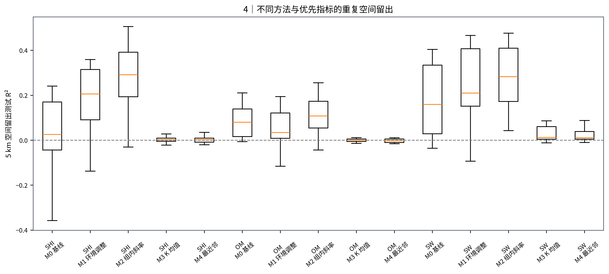{width=92%}

**研究问题。** 环境背景相近时，侵蚀与健康是否仍有关联？

**图面信息。** 每个箱线图汇总 10 次固定随机种子的 5 km 整块空间测试划分。三种像元级模型 在两个 Aa 时期使用共同完整像元样本；两种配对模型 分别构建训练、验证和测试配对，并仅用训练集拟合变换。 统计单位：5公里空间块或空间留出区块。

**读图重点。** 比较十次整块空间测试的中位数与分位范围，观察不同模型在未参与拟合的区域中表现是否集中；横轴所列模型按训练总体和侵蚀时期分别读取。

**研究位置。** 本图展示匹配方案的环境平衡、地理距离或跨区表现，说明设计规则如何确定可比较样本。

**深入解读。** 整块空间留出以未参与拟合的地理区域作为检验对象。箱线中位数呈现典型表现，分位范围显示区块组合变化；各模型分布越集中，跨区结果越一致。

### 附录图 2｜两个侵蚀时期的共同像元比较

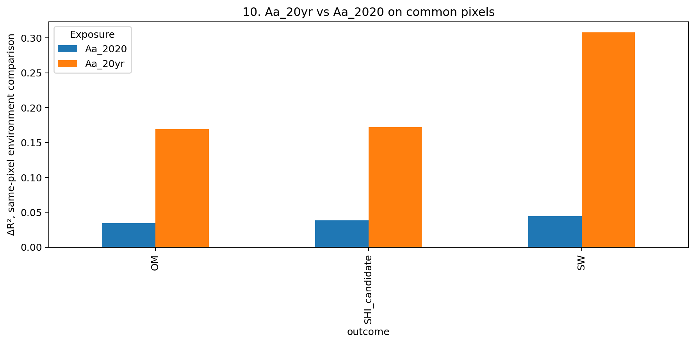{width=92%}

**研究问题。** 环境背景相近时，侵蚀与健康是否仍有关联？

**图面信息。** 像元层比较要求两期使用同一批完整像元、V5 环境变量、OLS 设计和空间随机种子。全样本匹配配对按侵蚀时期分别构建，因此配套表单列展示，不视为两期完全相同的配对样本。 统计单位：环境匹配对及高低侵蚀端点。

**读图重点。** 先沿图例区分共同像元模型和按时期建立的匹配样本，再比较两个时期的估计方向与幅度；共同像元便于同址比较，分期配对呈现各期自己的近邻结构。

**研究位置。** 本图展示匹配方案的环境平衡、地理距离或跨区表现，说明设计规则如何确定可比较样本。

**深入解读。** 共同像元与分期匹配对应两种比较对象。先按标记区分样本口径，再比较时期估计方向和强度；该图把同址时期变化与各期近邻样本的关系放在一处。

### 附录图 3｜优先指标的配对斜率

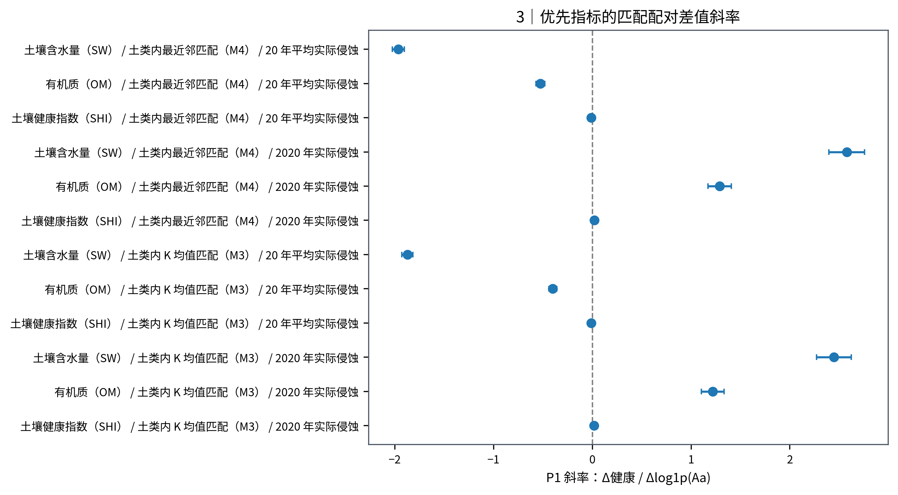{width=92%}

**研究问题。** 环境背景相近时，侵蚀与健康是否仍有关联？

**图面信息。** 点为全样本 P1 匹配配对斜率，横线为模型估计的 95% 置信区间。结果结合5公里整块空间留出表现阅读。 统计单位：5公里空间块或空间留出区块。

**读图重点。** 以零线判断配对斜率方向，比较不同土类和健康指标的点估计；横线表示空间块重抽样范围，区间跨零的结果与方向清楚的结果分别读取。

**研究位置。** 本图展示匹配方案的环境平衡、地理距离或跨区表现，说明设计规则如何确定可比较样本。

**深入解读。** 多指标对照图使用统一横轴或标准化尺度排列健康结局，方向、斜率和区间可作横向比较。结果同时保留共同趋势与较弱响应，为重点结果与完整指标谱建立参照。

### 附录图 4｜匹配覆盖与环境平衡

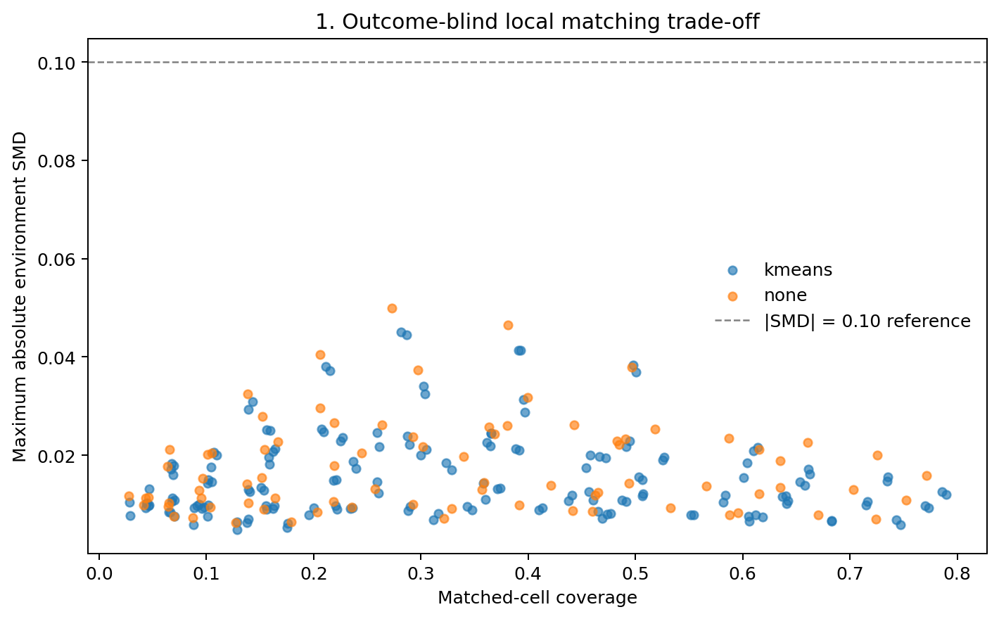{width=92%}

**研究问题。** 环境背景相近时，侵蚀与健康是否仍有关联？

**图面信息。** 局地搜索在 20 年平均实际侵蚀下评价 243 组匹配参数，覆盖率、SMD、环境距离和侵蚀差异均纳入设计诊断；横线仅为描述性平衡参考。 统计单位：环境匹配对及高低侵蚀端点。

**读图重点。** 横向比较候选方案的覆盖率和配对量，再查看环境平衡指标；覆盖扩大而环境差距变化时，图面显示设计覆盖与近邻相似程度的同步变化。

**研究位置。** 本图展示匹配方案的环境平衡、地理距离或跨区表现，说明设计规则如何确定可比较样本。

**深入解读。** 匹配图把覆盖率与环境平衡并列：覆盖率说明多少位置进入比较，标准化均差和环境距离说明配对两端背景相似程度。沿方案变化观察两类指标，可读出样本规模与环境接近度如何共同改变。

### 附录图 5｜环境组空间分布与高响应组

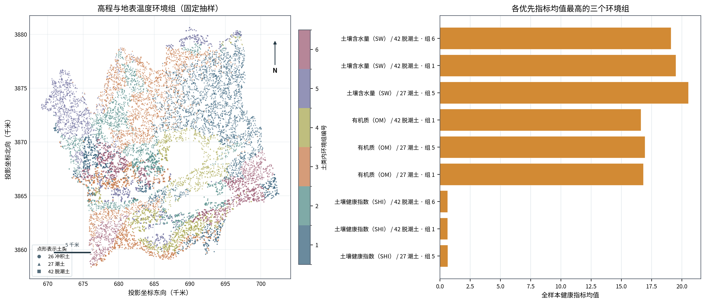{width=92%}

**研究问题。** 环境背景相近时，侵蚀与健康是否仍有关联？

**图面信息。** 左图为有效像元的固定抽样，颜色表示土类内环境组编号、点形表示土壤类型，并使用真实投影坐标绘制；组号只在土类内部解释。右图为 20 年平均实际侵蚀下各优先指标全样本均值最高的三个环境组；2020 年结果见配套数据表。高响应环境组根据健康结果排序，仅作描述性探索，用于标示候选环境组的位置。 统计单位：环境匹配对及高低侵蚀端点。

**读图重点。** 地图颜色表示土类内部的环境组，点形表示土壤类型；右侧按指标比较响应较高的环境组，组号需在对应土类内部读取。

**研究位置。** 本图展示匹配方案的环境平衡、地理距离或跨区表现，说明设计规则如何确定可比较样本。

**深入解读。** 环境组编号表示特定方案中的类别，地图显示各类在耕地范围内的位置，组间系数则显示侵蚀关系随背景改变的幅度。将分组地图与估计图对读，可以把统计差异对应到具体空间位置。

### 附录图 6｜环境距离、地理距离与侵蚀差

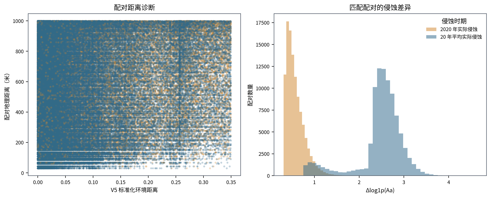{width=92%}

**研究问题。** 环境背景相近时，侵蚀与健康是否仍有关联？

**图面信息。** 每个点代表一个全样本 既有环境近邻匹配方案 配对；金色点表示低侵蚀端为零的配对。环境距离和地理距离用于描述匹配质量；完整空间留出表现见图 4。 统计单位：环境匹配对及高低侵蚀端点。

**读图重点。** 横轴为配对环境距离，纵轴为地理距离，颜色标出低侵蚀端为零值的配对；点越靠近坐标原点，两端环境和空间距离越小。

**研究位置。** 本图展示匹配方案的环境平衡、地理距离或跨区表现，说明设计规则如何确定可比较样本。

**深入解读。** 匹配图把覆盖率与环境平衡并列：覆盖率说明多少位置进入比较，标准化均差和环境距离说明配对两端背景相似程度。沿方案变化观察两类指标，可读出样本规模与环境接近度如何共同改变。

## 阶段G：响应类型与环境异质性

### 附录图 7｜各健康指标重点环境组的配对位置

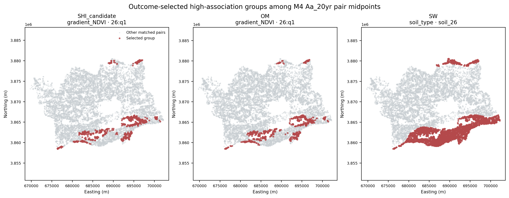{width=92%}

**研究问题。** 不同健康指标与环境背景的响应有何差异？

**图面信息。** 每个面板展示固定随机抽取的 15,000 个 既有环境近邻匹配方案、20 年平均侵蚀配对中点。红色为该指标按复合负向关联指标选中的环境组，灰色为其他样本。坐标为投影坐标，单位米。这些点图表示配对位置，展示配对位置覆盖。 统计单位：土类或环境分组；组内统计单位依图注。

**读图重点。** 红色点表示该指标选中的重点环境组配对中点，灰色点为其他配对；比较各面板红色点的空间位置，可看出不同结局对应的环境组是否落在同一片区。

**研究位置。** 本图将健康结局放到不同环境背景中比较，为分组斜率和指标差异提供依据。

**深入解读。** 匹配图把覆盖率与环境平衡并列：覆盖率说明多少位置进入比较，标准化均差和环境距离说明配对两端背景相似程度。沿方案变化观察两类指标，可读出样本规模与环境接近度如何共同改变。

### 附录图 8｜匹配覆盖率与环境平衡

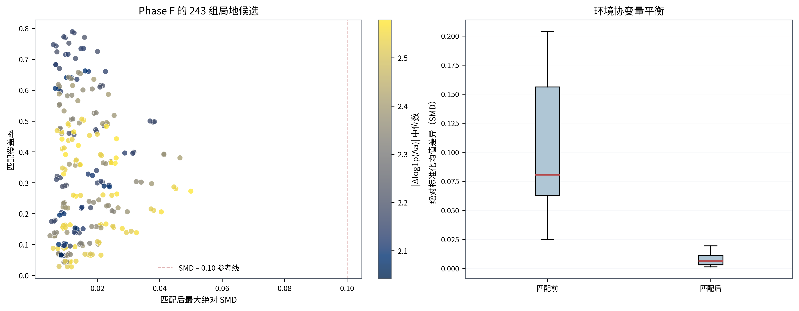{width=92%}

**研究问题。** 不同健康指标与环境背景的响应有何差异？

**图面信息。** 候选覆盖率与平衡诊断来自既有 Phase F 结果盲局地搜索。SMD 参考线仅作描述，不单独用于判定最终匹配方案。 统计单位：土类或环境分组；组内统计单位依图注。

**读图重点。** 比较各候选设计的成功配对数、唯一端点覆盖和环境平衡指标；方案排序展示不同参数下样本规模与环境相似程度的变化。

**研究位置。** 本图将健康结局放到不同环境背景中比较，为分组斜率和指标差异提供依据。

**深入解读。** 匹配图把覆盖率与环境平衡并列：覆盖率说明多少位置进入比较，标准化均差和环境距离说明配对两端背景相似程度。沿方案变化观察两类指标，可读出样本规模与环境接近度如何共同改变。

## 阶段H：低侵蚀分布诊断补充

### 附录图 9｜混合高斯分类置信度变化时的像元归属

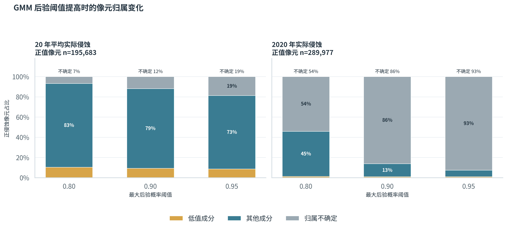{width=92%}

**研究问题。** GMM 后验分类的不确定像元比例如何随阈值改变？

**图面信息。** 每个柱形以正 Aa 像元为分母，分成低值成分、高值成分和最大后验概率低于指定阈值的归属不确定像元。柱顶直接标出不确定比例，柱内标注较大的组分比例。阈值越高，分类更保守，但不确定像元比例上升；2020 年正值像元在三个阈值下有较大比例归入不确定类别。 统计单位：30米耕地栅格的结局完整案例。

**读图重点。** 柱内读取低值组、高值组和未归属像元占比，柱顶读取分类不确定比例；门槛提高后未归属比例上升，表示分类标准变严。

**研究位置。** 本图补充侵蚀零值、正值或候选低值的分布结构，为后续匹配和响应分析说明暴露范围。

**深入解读。** 零值与正值分布分别对应侵蚀是否发生和发生后的强度，阈值图定位连续分布中的候选转折。CDF、核密度、混合模型与空间重抽样从不同角度呈现低值结构。

### 附录图 10｜混合高斯分类的分组数量与边界稳定性

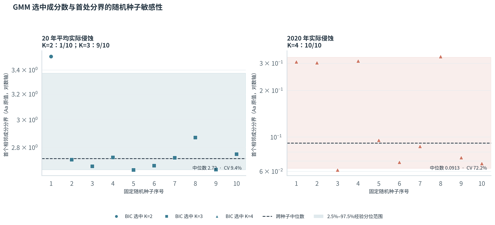{width=92%}

**研究问题。** GMM 的成分数和分界是否受随机种子影响？

**图面信息。** 每个点对应一个固定随机种子下由 BIC 选中的 GMM 模型；点形表示成分数，纵轴为首个相邻成分边界的 Aa 原值。虚线为跨种子中位数，浅色带为种子经验分位范围（2.5%–97.5%），为随机种子间经验分位范围。20 年平均实际侵蚀的选中 K 在 2 与 3 之间变化；2020 年选中 K 虽一致，首处分界仍需结合较大的种子间波动解读。  统计单位：固定随机种子下的GMM模型拟合结果及其分界估计

**读图重点。** 每个点代表一个随机种子下选出的混合成分数和首个分界值；虚线与色带汇总种子间的中位数及范围，分别比较分组数和界点稳定性。

**研究位置。** 本图补充侵蚀零值、正值或候选低值的分布结构，为后续匹配和响应分析说明暴露范围。

**深入解读。** 零值与正值分布分别对应侵蚀是否发生和发生后的强度，阈值图定位连续分布中的候选转折。CDF、核密度、混合模型与空间重抽样从不同角度呈现低值结构。

### 附录图 11｜不同分布方法给出的侵蚀候选界点

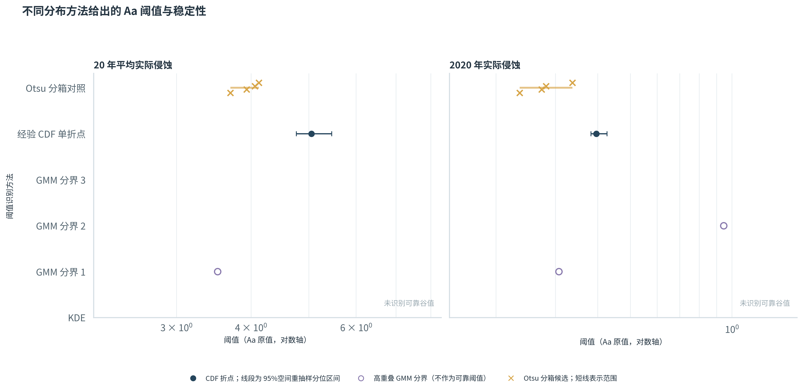{width=92%}

**研究问题。** 各分布方法的阈值是否收敛到相似范围？

**图面信息。** 横轴为 Aa 原值阈值并使用对数刻度。CDF 点两侧线段表示100次5公里空间分块重抽样的2.5%—97.5%经验分位区间；Otsu短线表示不同直方图分箱得到的候选范围；空心GMM点表示混合成分之间的重叠；KDE曲线呈现正值侵蚀的平滑密度形态。 统计单位：100次5公里空间分块重抽样下的侵蚀候选界点估计

**读图重点。** 沿侵蚀原值的对数横轴比较CDF、KDE、混合模型和Otsu给出的候选界点；区间、空心点和曲线分别呈现重抽样范围、成分重叠及密度谷值。

**研究位置。** 本图把CDF、KDE、混合模型和Otsu给出的候选界点放入空间块重抽样结果中比较，说明界点在不同区域组合下的稳定范围。

**深入解读。** 零值与正值分布分别对应侵蚀是否发生和发生后的强度，阈值图定位连续分布中的候选转折。CDF、核密度、混合模型与空间重抽样从不同角度呈现低值结构。

## 阶段H：低侵蚀筛选后的环境组异质性

### 附录图 12｜主要土类配对斜率与空间块区间

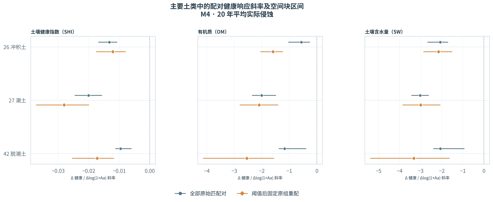{width=92%}

**研究问题。** 低值筛选前后，三类主要土壤中的 SHI、OM 和 SW 配对斜率如何变化？

**图面信息。** 点为同土类、同 5 km 块配对上的固定线性斜率，横线为按 5 km 空间块重抽样得到的 95% 区间。比较全部原配对与阈值后固定原环境组重配；26 为冲积土、27 为潮土、42 为脱潮土。 统计单位：5公里空间块或空间留出区块。

**读图重点。** 以零线为参照比较主要土类中的配对斜率，点为估计、线为五公里空间块区间；同一指标的不同土类并列后可读出方向和组间幅度差。

**研究位置。** 本图呈现低值处理后的样本覆盖或分组差异，连接侵蚀分布诊断与环境分层分析。

**深入解读。** 多指标对照图使用统一横轴或标准化尺度排列健康结局，方向、斜率和区间可作横向比较。结果同时保留共同趋势与较弱响应，为重点结果与完整指标谱建立参照。

### 附录图 13｜环境组内低值像元保留率

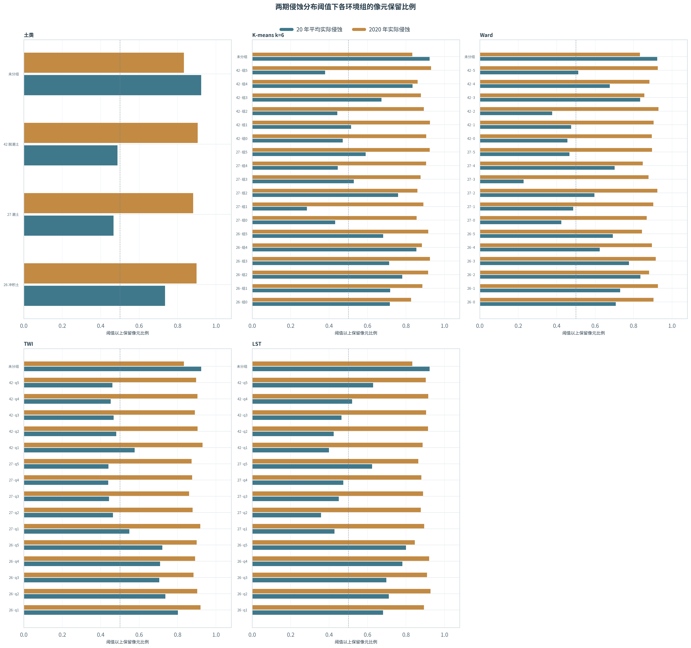{width=92%}

**研究问题。** 低侵蚀阈值在不同土类和环境组中各保留多少有效像元？

**图面信息。** 固定环境组内超过分布阈值的有效像元比例；颜色深浅表示该组被阈值排除的比例。分组只使用既有环境变量标签，阈值由侵蚀分布确定。 统计单位：土类×环境组内的有效耕地像元及低值筛选后保留比例

**读图重点。** 按土类和环境组读取阈值筛选后保留的比例；颜色表示组内低值像元占比，组间差异显示低值样本在环境背景中的分布。

**研究位置。** 本图量化固定环境组在低值阈值筛选后保留的有效耕地像元比例，用于比较筛选对不同土类和环境组的影响。

**深入解读。** 零值与正值分布分别对应侵蚀是否发生和发生后的强度，阈值图定位连续分布中的候选转折。CDF、核密度、混合模型与空间重抽样从不同角度呈现低值结构。

### 附录图 14｜环境组匹配支持量与环境差异

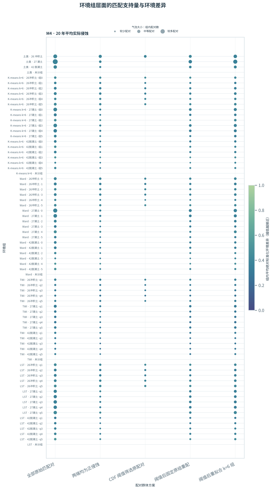{width=70%}

**研究问题。** 阈值过滤及重新匹配后，各环境组保留多少配对、环境相似度如何？

**图面信息。** 每个气泡代表一个环境组与一个匹配方案；气泡大小按该组同组配对数缩放，颜色表示从配对端点环境值重算的连续环境差平均绝对标准化幅度，各变量以全体有效耕地像元标准差统一量纲。来源匹配表的标量环境距离另列于源数据与报告。重配方案改变匹配对象，气泡对应不同匹配对象与样本结构。 统计单位：环境组×匹配方案组合；气泡大小依据组内匹配对数，颜色依据配对端点环境差

**读图重点。** 气泡面积表示环境组的配对支持量，颜色表示配对两端的环境差幅度；沿方案和组别比较气泡大小与颜色，可同时读取样本量和背景接近程度。

**研究位置。** 本图诊断阈值处理后各环境组的匹配支持量和环境差异，为解读后续分组响应提供匹配质量背景。

**深入解读。** 匹配图把覆盖率与环境平衡并列：覆盖率说明多少位置进入比较，标准化均差和环境距离说明配对两端背景相似程度。沿方案变化观察两类指标，可读出样本规模与环境接近度如何共同改变。

## 阶段H：低侵蚀群体诊断与响应探索

### 附录图 15｜5 km 空间块组成

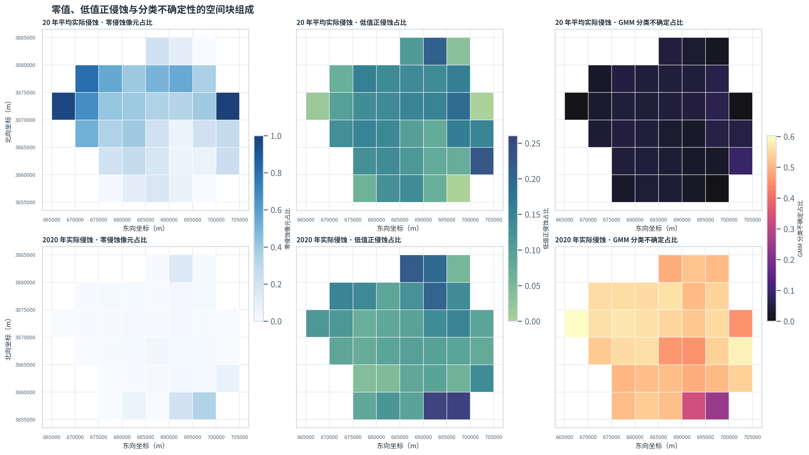{width=92%}

**研究问题。** 侵蚀零值、低值与不确定分类是否呈现空间聚集？

**图面信息。** 每格为空间块级汇总，格内统计实际有效耕地像元占比；同一指标的两个时期使用相同色阶，三个指标各自设定色阶。零值比例和 GMM 后验不确定比例在两个时期均可绘制；只有通过空间稳定性检查的分布阈值才显示低值正侵蚀比例。空间块图呈现大范围聚集结构，30 m 栅格图则显示像元尺度的局部边界与细节。 统计单位：5公里空间块或空间留出区块。

**读图重点。** 每格代表一个五公里空间块，按图例比较侵蚀零值比例、低值比例或分类不确定比例；相邻格的连续颜色显示县域尺度的空间集聚。

**研究位置。** 本图呈现低值处理后的样本覆盖或分组差异，连接侵蚀分布诊断与环境分层分析。

**深入解读。** 每格代表一个五公里空间块，格中数值与颜色概括侵蚀零值、低值或模型不确定比例。比较相邻区块的连续变化，可以辨认县域尺度的聚集带，并理解空间分块如何对应地图位置。

### 附录图 16｜核密度曲线平滑宽度的敏感性

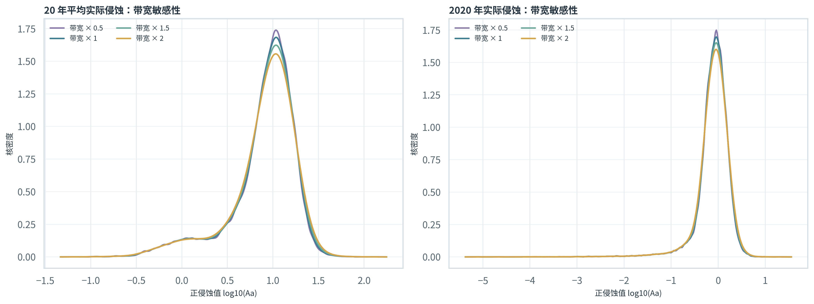{width=92%}

**研究问题。** 低值分界是否对平滑参数稳定？

**图面信息。** 对 Scott 带宽分别使用 0.5、1、1.5、2 倍平滑强度。虚线只标出满足预设峰谷规则的候选分界；图中展示各平滑宽度下识别出的候选谷值。 统计单位：正侵蚀值样本及各带宽下核密度估计的候选谷值

**读图重点。** 比较不同平滑宽度下核密度曲线的峰谷位置；只有满足预设峰谷规则的候选点才标记，候选位置随带宽改变的幅度反映分布界点对平滑程度的敏感性。

**研究位置。** 本图检验候选低值界点对核密度平滑宽度的敏感性，连接侵蚀分布诊断与后续阈值使用。

**深入解读。** 零值与正值分布分别对应侵蚀是否发生和发生后的强度，阈值图定位连续分布中的候选转折。CDF、核密度、混合模型与空间重抽样从不同角度呈现低值结构。

### 附录图 17｜低值分区与侵蚀空间分布

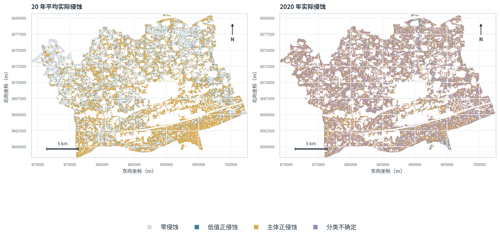{width=92%}

**研究问题。** 零值与可识别低值侵蚀在空间上如何分布？

**图面信息。** 地图基于有效耕地掩膜和原始 30 m 行列网格。零值独立显示；正值类别按识别出的分布阈值表示。正值分界按分布诊断结果显示。  统计单位：30米耕地栅格中的有效侵蚀像元

**读图重点。** 地图将零值、正值及候选低值分区放回三十米网格；先看图例中的类别，再比较各类斑块的位置、面积和连通程度。

**研究位置。** 本图把零侵蚀、低值和其他正值类别映射到30米耕地网格，展示候选阈值的空间位置与覆盖范围。

**深入解读。** 零值与正值分布分别对应侵蚀是否发生和发生后的强度，阈值图定位连续分布中的候选转折。CDF、核密度、混合模型与空间重抽样从不同角度呈现低值结构。

### 附录图 18｜低值连通斑块尺度

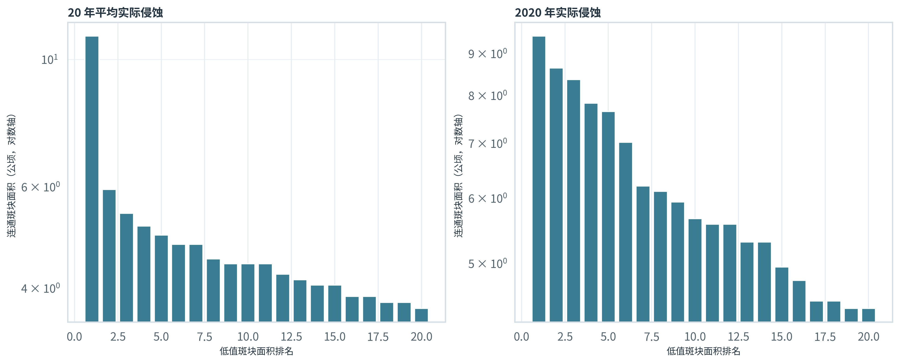{width=92%}

**研究问题。** 低值侵蚀斑块是零散分布还是空间聚集？

**图面信息。** 低值正侵蚀斑块在原始 30 m 格网上按八邻域连通定义，面积按每像元 900 m² 计算。图展示面积最大的前 20 个斑块。 统计单位：30米耕地栅格的结局完整案例。

**读图重点。** 按斑块面积读取连通区域大小和排序，比较最大斑块与其余斑块的尺度差异；空间位置展示低值区是分散出现还是形成连续区域。

**研究位置。** 本图以连通斑块面积刻画低值侵蚀像元的空间连续程度，补充阈值类别的空间形态信息。

**深入解读。** 零值与正值分布分别对应侵蚀是否发生和发生后的强度，阈值图定位连续分布中的候选转折。CDF、核密度、混合模型与空间重抽样从不同角度呈现低值结构。

### 附录图 19｜环境画像中的低值群体比例

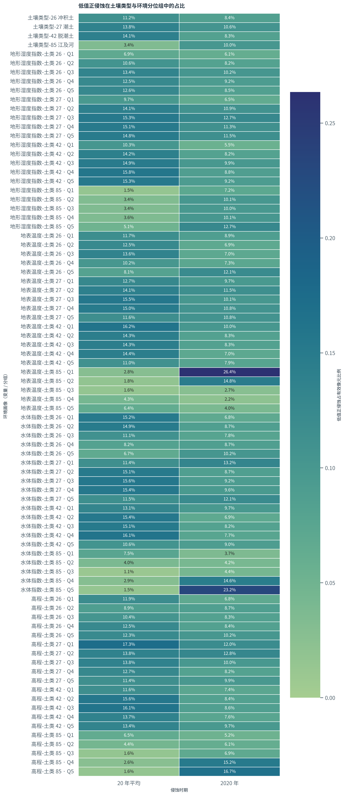{width=54%}

**研究问题。** 低值侵蚀状态是否集中于特定土类或环境背景？

**图面信息。** 仅在有效分布阈值存在时计算阈值以下正值比例；每个环境分位组按该组完整有效像元作分母。图中以侵蚀分布阈值统计各环境分位组的低值比例，Otsu候选值作为界点参照。 统计单位：土类或环境分组；组内统计单位依图注。

**读图重点。** 每行表示一种土类或环境画像，每列表示侵蚀时期，格内百分比为该背景中的低值侵蚀比例；沿行比较两期，再沿环境梯度比较比例变化。

**研究位置。** 本图呈现低值处理后的样本覆盖或分组差异，连接侵蚀分布诊断与环境分层分析。

**深入解读。** 该热图将环境画像和侵蚀时期并列，格内百分比表示对应土类或环境组合中的低值侵蚀比例。沿行比较两期，再沿环境梯度查看比例变化，可识别低值群体常见的背景。

### 附录图 20｜空间重抽样阈值稳定性

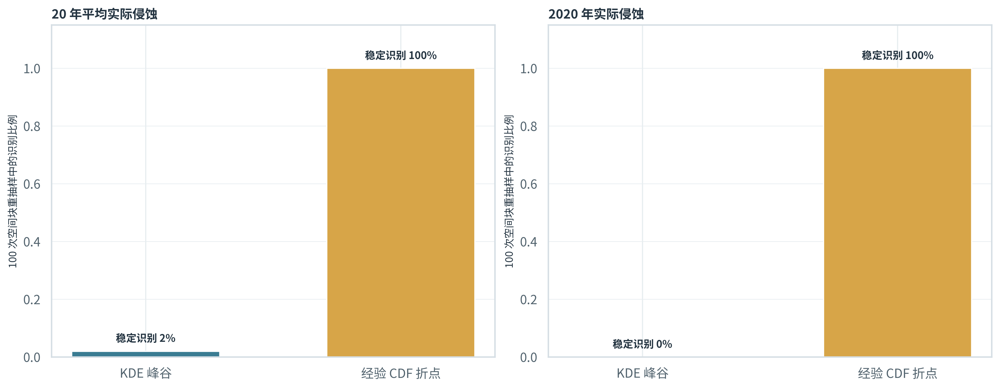{width=92%}

**研究问题。** 候选低值界点在空间重抽样下是否稳定？

**图面信息。** 以5公里网格为空间块进行重抽样，统计不同区块样本中Scott KDE识别出峰谷结构的比例，并比较峰谷位置随空间样本变化的分布。 统计单位：5公里空间块或空间留出区块。

**读图重点。** 读取空间块重抽样中候选阈值出现的频率和数值范围；频率高且位置集中的候选值，在不同区域组合下重复出现得更稳定。

**研究位置。** 本图考察候选界点在5公里空间块重抽样中的出现频率和位置变化，补充分布阈值的空间稳定性评估。

**深入解读。** 零值与正值分布分别对应侵蚀是否发生和发生后的强度，阈值图定位连续分布中的候选转折。CDF、核密度、混合模型与空间重抽样从不同角度呈现低值结构。

### 附录图 21｜阈值筛选前后保留的匹配对数量

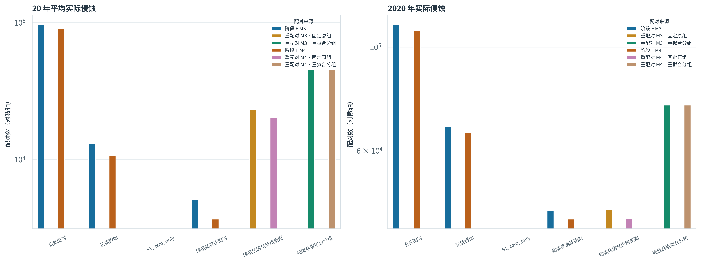{width=92%}

**研究问题。** 筛除低值侵蚀会保留多少配对样本？

**图面信息。** 柱高为匹配对数量（对数轴），比较原有 分组匹配与环境近邻匹配 配对、端点均为正值以及阈值后重配对。图中同时列出不同样本组合的R²，展示样本保留与拟合表现的共同变化。 统计单位：环境匹配对及高低侵蚀端点。

**读图重点。** 比较原始配对、正值端点及阈值筛选后的匹配对数和唯一端点数；两种计数分别表示配对样本规模和实际覆盖的像元位置。

**研究位置。** 本图补充侵蚀零值、正值或候选低值的分布结构，为后续匹配和响应分析说明暴露范围。

**深入解读。** 匹配图把覆盖率与环境平衡并列：覆盖率说明多少位置进入比较，标准化均差和环境距离说明配对两端背景相似程度。沿方案变化观察两类指标，可读出样本规模与环境接近度如何共同改变。

### 附录图 22｜阈值候选方法比较

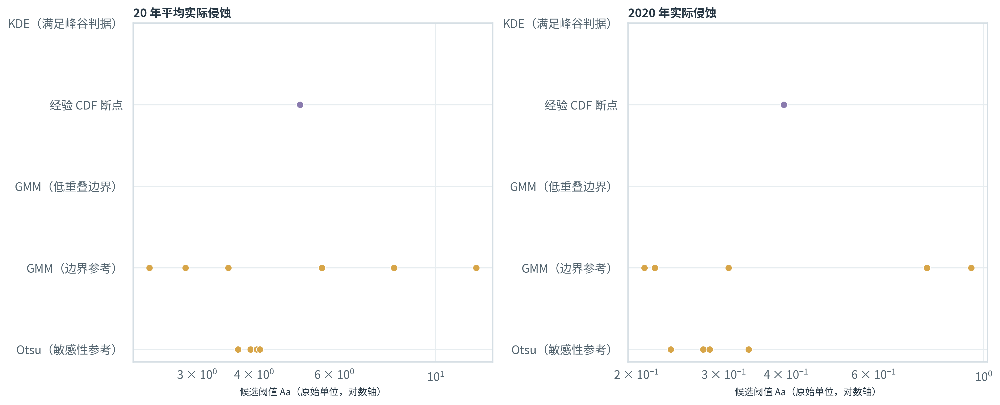{width=92%}

**研究问题。** 不同分布方法给出的低值界点是否一致？

**图面信息。** 比较所有通过判据的分布候选、CDF 断点、GMM 边界与 Otsu 参考值。Otsu 与高重叠 GMM 只用于敏感性对照，不作为主筛选阈值。  统计单位：各候选阈值方法的分界估计

**读图重点。** 按方法名称比较候选界点的位置和范围；CDF、KDE、混合模型与Otsu依据不同的分布特征，聚集程度显示方法间的一致性。

**研究位置。** 本图并列不同分布方法的候选界点，展示各方法依据的分布结构及候选范围是否收敛。

**深入解读。** 零值与正值分布分别对应侵蚀是否发生和发生后的强度，阈值图定位连续分布中的候选转折。CDF、核密度、混合模型与空间重抽样从不同角度呈现低值结构。

### 附录图 23｜零值、正值与侵蚀分布

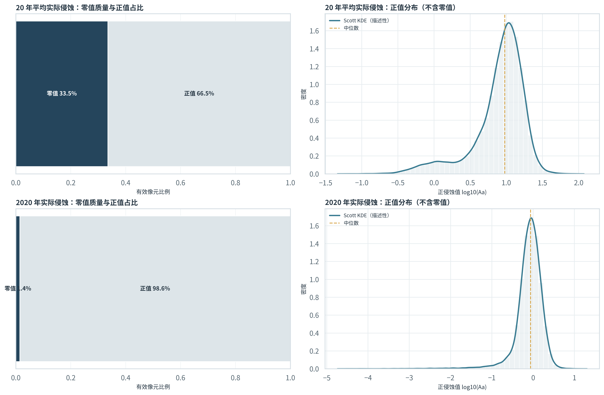{width=92%}

**研究问题。** 低值与零值是否构成独立侵蚀状态？

**图面信息。** 零侵蚀与正侵蚀的分布分开呈现。零值是有效观测中的独立质量点；右侧密度图只使用正侵蚀值并在 log10 尺度展示。  统计单位：有效耕地像元；正值密度部分限于正侵蚀像元

**读图重点。** 左侧区分有效零值与正侵蚀像元，右侧只比较正值分布；将零值比例与正值长尾分开读取，可辨认发生频率和发生后强度的分布结构。

**研究位置。** 本图先区分有效像元中的零侵蚀和正侵蚀，再描述正值子集的分布形状，为阈值分析提供数据背景。

**深入解读。** 零值与正值分布分别对应侵蚀是否发生和发生后的强度，阈值图定位连续分布中的候选转折。CDF、核密度、混合模型与空间重抽样从不同角度呈现低值结构。

### 附录图 24｜高斯混合与分量不确定性

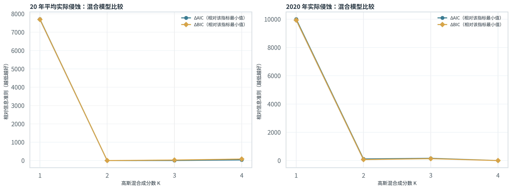{width=92%}

**研究问题。** 正侵蚀值是否呈现可区分的多个群体？

**图面信息。** 高斯混合模型在 log10 正值尺度比较 K=1–4。BIC展示候选成分数间的相对拟合；分量重叠程度和后验分类比例共同呈现低值分布结构。  统计单位：正侵蚀像元及高斯混合模型分量估计

**读图重点。** 比较不同混合成分数的BIC、成分重叠与后验分类比例；成分分界和不确定像元比例共同呈现多群体分布的清晰程度。

**研究位置。** 本图比较正侵蚀值的混合分量数、拟合优度和分类不确定性，补充分布阈值的模型依据。

**深入解读。** 零值与正值分布分别对应侵蚀是否发生和发生后的强度，阈值图定位连续分布中的候选转折。CDF、核密度、混合模型与空间重抽样从不同角度呈现低值结构。

## 阶段H：匹配像元与配对响应

### 附录图 25｜匹配对数量与不重复端点数量

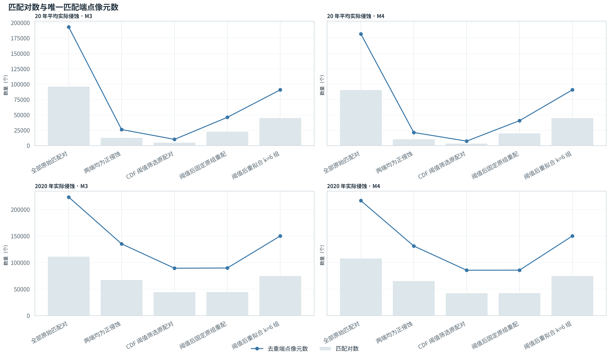{width=92%}

**研究问题。** 各筛选与重配方案保留了多少配对与独立栅格端点？

**图面信息。** 柱形表示匹配对数，折线表示高、低侵蚀端点按 cell_id 合并后的唯一像元数。一个像元可能参与多个匹配对，因此两种数量是不同分析单位；两项数量分别对应配对对象和去重后的栅格位置。 统计单位：环境匹配对及高低侵蚀端点。

**读图重点。** 柱形表示匹配对数量，折线表示去重后的高低侵蚀端点数；两者差距反映一个像元参与多对匹配的程度。

**研究位置。** 本图说明匹配端点的空间覆盖，并对应后续的配对响应结果。

**深入解读。** 匹配图把覆盖率与环境平衡并列：覆盖率说明多少位置进入比较，标准化均差和环境距离说明配对两端背景相似程度。沿方案变化观察两类指标，可读出样本规模与环境接近度如何共同改变。

### 附录图 26｜阈值筛选后匹配端点空间分布

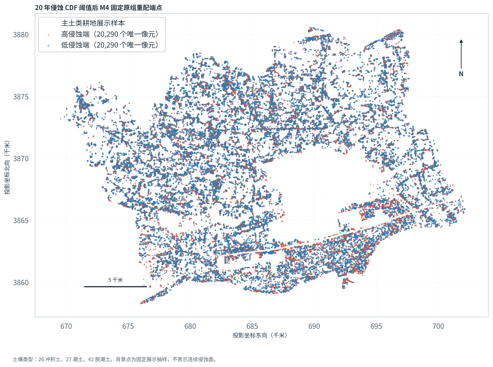{width=92%}

**研究问题。** 阈值后重新匹配的高低侵蚀端点在研究区如何分布？

**图面信息。** 地图展示 既有环境近邻匹配方案 在两端 Aa_20yr 均高于 CDF 分布阈值 5.050 后、固定原环境组重新匹配的唯一端点像元。点按 cell_id 去重；符号标记端点在配对中的高低侵蚀角色。背景为主土类有效耕地的固定展示样本。 统计单位：去重后的匹配端点像元。

**读图重点。** 按地图符号辨认高、低侵蚀匹配端点，观察阈值筛选后保留位置的空间覆盖；对照不同土类和区带可看出样本集中区域。

**研究位置。** 本图说明匹配端点的空间覆盖，并对应后续的配对响应结果。

**深入解读。** 匹配图把覆盖率与环境平衡并列：覆盖率说明多少位置进入比较，标准化均差和环境距离说明配对两端背景相似程度。沿方案变化观察两类指标，可读出样本规模与环境接近度如何共同改变。

## 数据与初始诊断｜项目全量产出

### 附录图 27｜土壤含水量栅格空间分布

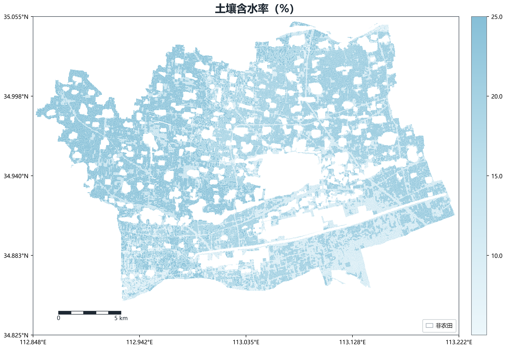{width=92%}

**研究问题。** 土壤含水量栅格空间分布呈现怎样的关系或空间格局？

**图面信息。** 每个栅格像元的颜色表示预测土壤含水量，显示预测土壤含水量的空间分布。 统计单位：30米耕地栅格的结局完整案例。

**读图重点。** 色阶表示对应健康指标预测值在耕地网格中的高低；先按各自图例辨认取值范围，再观察高值和低值斑块的位置及其连续程度。

**研究位置。** 本图提供研究区土壤健康预测面的空间基线，便于定位后续分组、局部结果和候选区域。

**深入解读。** 健康指标栅格以连续颜色表示预测值的空间梯度。结合全域相关与局部回归结果，可以辨认总体排序对应的主要区域，并比较不同土壤属性的空间格局。

### 附录图 28｜土壤呼吸栅格空间分布

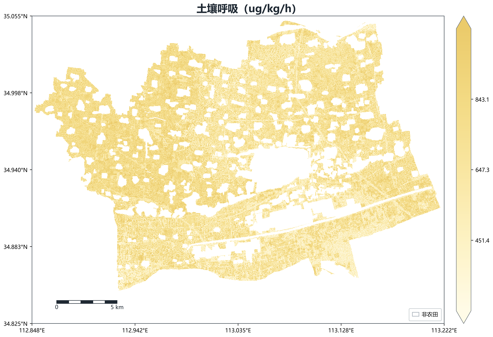{width=92%}

**研究问题。** 土壤呼吸栅格空间分布呈现怎样的关系或空间格局？

**图面信息。** 每个像元的颜色表示预测土壤呼吸指标；请按图例读取数值范围，该图展示空间分布而非独立实测点。 统计单位：30米耕地栅格的结局完整案例。

**读图重点。** 色阶表示对应健康指标预测值在耕地网格中的高低；先按各自图例辨认取值范围，再观察高值和低值斑块的位置及其连续程度。

**研究位置。** 本图提供研究区土壤健康预测面的空间基线，便于定位后续分组、局部结果和候选区域。

**深入解读。** 健康指标栅格以连续颜色表示预测值的空间梯度。结合全域相关与局部回归结果，可以辨认总体排序对应的主要区域，并比较不同土壤属性的空间格局。

### 附录图 29｜土壤容重栅格空间分布

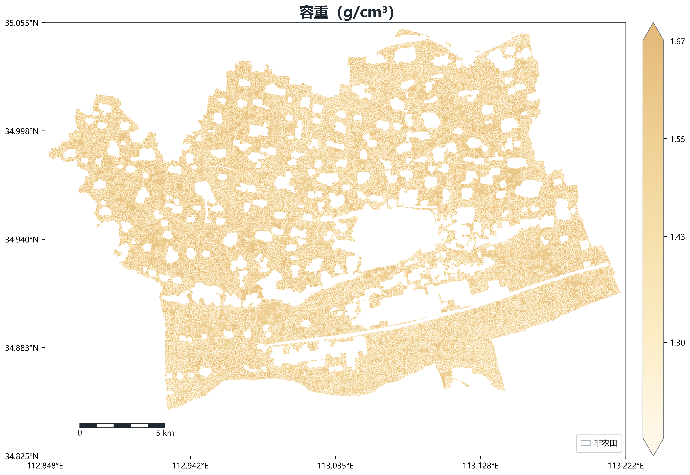{width=92%}

**研究问题。** 土壤容重栅格空间分布呈现怎样的关系或空间格局？

**图面信息。** 每个像元的颜色表示预测土壤容重，显示预测土壤容重的空间格局。 统计单位：30米耕地栅格的结局完整案例。

**读图重点。** 色阶表示对应健康指标预测值在耕地网格中的高低；先按各自图例辨认取值范围，再观察高值和低值斑块的位置及其连续程度。

**研究位置。** 本图提供研究区土壤健康预测面的空间基线，便于定位后续分组、局部结果和候选区域。

**深入解读。** 健康指标栅格以连续颜色表示预测值的空间梯度。结合全域相关与局部回归结果，可以辨认总体排序对应的主要区域，并比较不同土壤属性的空间格局。

### 附录图 30｜土壤有机质栅格空间分布

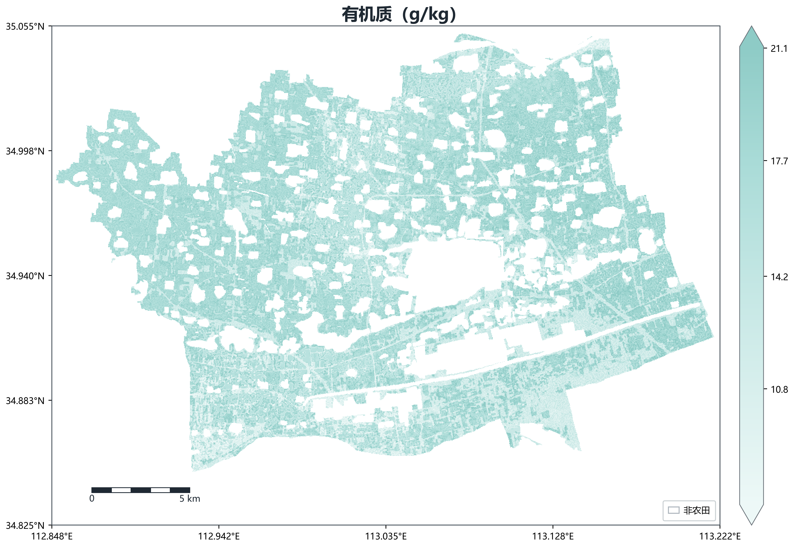{width=92%}

**研究问题。** 土壤有机质栅格空间分布呈现怎样的关系或空间格局？

**图面信息。** 每个像元的颜色表示预测土壤有机质；可据图例比较空间高低，但像元值来自预测面。 统计单位：30米耕地栅格的结局完整案例。

**读图重点。** 色阶表示对应健康指标预测值在耕地网格中的高低；先按各自图例辨认取值范围，再观察高值和低值斑块的位置及其连续程度。

**研究位置。** 本图提供研究区土壤健康预测面的空间基线，便于定位后续分组、局部结果和候选区域。

**深入解读。** 健康指标栅格以连续颜色表示预测值的空间梯度。结合全域相关与局部回归结果，可以辨认总体排序对应的主要区域，并比较不同土壤属性的空间格局。

### 附录图 31｜土壤酸碱度栅格空间分布

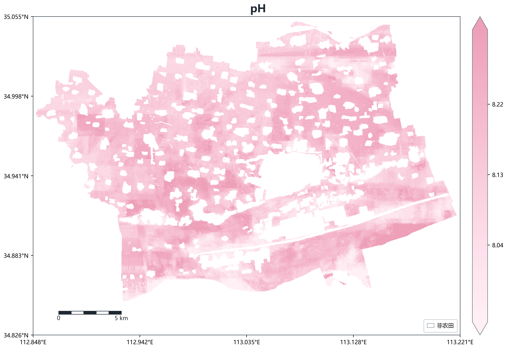{width=92%}

**研究问题。** 土壤酸碱度栅格空间分布呈现怎样的关系或空间格局？

**图面信息。** 每个像元的颜色表示预测土壤酸碱度；地图用于观察空间格局，数值解释应看图例。 统计单位：30米耕地栅格的结局完整案例。

**读图重点。** 色阶表示对应健康指标预测值在耕地网格中的高低；先按各自图例辨认取值范围，再观察高值和低值斑块的位置及其连续程度。

**研究位置。** 本图提供研究区土壤健康预测面的空间基线，便于定位后续分组、局部结果和候选区域。

**深入解读。** 健康指标栅格以连续颜色表示预测值的空间梯度。结合全域相关与局部回归结果，可以辨认总体排序对应的主要区域，并比较不同土壤属性的空间格局。

### 附录图 32｜微生物量碳栅格空间分布

{width=92%}

**研究问题。** 微生物量碳栅格空间分布呈现怎样的关系或空间格局？

**图面信息。** 每个像元的颜色表示预测微生物量碳，显示预测微生物量碳的空间格局。 统计单位：30米耕地栅格的结局完整案例。

**读图重点。** 色阶表示对应健康指标预测值在耕地网格中的高低；先按各自图例辨认取值范围，再观察高值和低值斑块的位置及其连续程度。

**研究位置。** 本图提供研究区土壤健康预测面的空间基线，便于定位后续分组、局部结果和候选区域。

**深入解读。** 健康指标栅格以连续颜色表示预测值的空间梯度。结合全域相关与局部回归结果，可以辨认总体排序对应的主要区域，并比较不同土壤属性的空间格局。

### 附录图 33｜碱解氮栅格空间分布

{width=92%}

**研究问题。** 碱解氮栅格空间分布呈现怎样的关系或空间格局？

**图面信息。** 每个像元的颜色表示预测碱解氮；请按图例读取数值，地图展示的是连续预测栅格。 统计单位：30米耕地栅格的结局完整案例。

**读图重点。** 色阶表示对应健康指标预测值在耕地网格中的高低；先按各自图例辨认取值范围，再观察高值和低值斑块的位置及其连续程度。

**研究位置。** 本图提供研究区土壤健康预测面的空间基线，便于定位后续分组、局部结果和候选区域。

**深入解读。** 健康指标栅格以连续颜色表示预测值的空间梯度。结合全域相关与局部回归结果，可以辨认总体排序对应的主要区域，并比较不同土壤属性的空间格局。

## 综合与历史图件｜项目全量产出

### 附录图 34｜三类土壤健康结果的匹配分析

{width=92%}

**研究问题。** 三类土壤健康结果的匹配分析呈现怎样的关系或空间格局？

**图面信息。** 三个柱子依次比较 SHI 的全样本拟合、结果筛选后同一批样本的表观拟合、以及空间留出测试表现。三类柱形对应不同筛选与测试阶段，柱高表示各阶段SHI拟合表现。  统计单位：全样本模型、结果筛选模型与空间留出测试的拟合结果

**读图重点。** 按面板标题辨认各结局及匹配统计量，再比较配对斜率方向、区间和样本支持；多面板展示同一匹配框架下健康结果的差异。

**研究位置。** 本图并列全样本基线、结果筛选后的表观拟合和空间留出表现，展示不同评估条件下SHI拟合结果的变化。

**深入解读。** 匹配图把覆盖率与环境平衡并列：覆盖率说明多少位置进入比较，标准化均差和环境距离说明配对两端背景相似程度。沿方案变化观察两类指标，可读出样本规模与环境接近度如何共同改变。

### 附录图 35｜不同匹配参数下的拟合比较

{width=92%}

**研究问题。** 不同匹配参数下的拟合比较呈现怎样的关系或空间格局？

**图面信息。** 三个面板分别改变环境距离上限、地理距离上限和配对侵蚀差范围；每个箱体汇总该参数下 SHI 模型的表观 R²。箱体越高表示尝试结果越不稳定。  统计单位：不同匹配参数设置下的SHI模型拟合结果

**读图重点。** 按模型或参数方案比较拟合指标，重点读取方案排序及其随参数改变的幅度；再结合空间留出图，理解拟合表现与跨区表现的关系。

**研究位置。** 本图显示匹配参数组合与SHI拟合度的对应变化，呈现参数试验结果的分布范围。

**深入解读。** 匹配图把覆盖率与环境平衡并列：覆盖率说明多少位置进入比较，标准化均差和环境距离说明配对两端背景相似程度。沿方案变化观察两类指标，可读出样本规模与环境接近度如何共同改变。

### 附录图 36｜不同匹配距离限制下的关联比较

{width=92%}

**研究问题。** 不同匹配距离限制下的关联比较呈现怎样的关系或空间格局？

**图面信息。** 箱线图比较环境距离限制改变时的拟合分布；横向各组是不同限制值，纵轴为表观R²，箱体呈现各匹配设置下拟合表现的分布。 统计单位：不同环境距离上限设置下的匹配模型拟合结果

**读图重点。** 比较不同空间距离限制下的样本覆盖和侵蚀—健康估计；更宽的距离限制改变近邻范围，图中估计变化显示这一设计选择的结果。

**研究位置。** 本图比较环境距离限制改变时的模型拟合分布，说明匹配方案与结果表现如何共同变化。

**深入解读。** 匹配图把覆盖率与环境平衡并列：覆盖率说明多少位置进入比较，标准化均差和环境距离说明配对两端背景相似程度。沿方案变化观察两类指标，可读出样本规模与环境接近度如何共同改变。

### 附录图 37｜候选环境变量之间的相关性

{width=92%}

**研究问题。** 候选环境变量之间的相关性呈现怎样的关系或空间格局？

**图面信息。** 每个格子表示两种环境变量在有效耕地像元上的相关方向和强弱；颜色越深，关系越强。高相关变量组合提示环境信息可能存在重叠，供环境变量构建参考。 统计单位：30米耕地栅格的结局完整案例。

**读图重点。** 横纵轴均为候选环境变量，颜色和数值表示变量两两相关方向与强度；高相关格提示环境信息相近的变量组合。

**研究位置。** 本图记录前期匹配和响应探索，展示研究路线从候选方案走向多尺度分析的衔接。

**深入解读。** 环境变量相关图呈现协变量之间的同步程度，取值分布图呈现范围和集中区间。前者帮助识别信息重叠，后者说明数值尺度；两者衔接环境数据整理与匹配距离构造。

### 附录图 38｜候选环境变量的取值分布

{width=92%}

**研究问题。** 候选环境变量的取值分布呈现怎样的关系或空间格局？

**图面信息。** 每个面板展示一种候选环境变量在研究区的取值分布；横轴是变量值，纵轴是像元数或密度，用来检查偏态、异常范围和变量尺度。 统计单位：30米耕地栅格的结局完整案例。

**读图重点。** 逐变量比较取值范围、集中位置与长尾；分布差异说明各环境梯度覆盖的空间范围和数值尺度。

**研究位置。** 本图记录前期匹配和响应探索，展示研究路线从候选方案走向多尺度分析的衔接。

**深入解读。** 环境变量相关图呈现协变量之间的同步程度，取值分布图呈现范围和集中区间。前者帮助识别信息重叠，后者说明数值尺度；两者衔接环境数据整理与匹配距离构造。

### 附录图 39｜匹配对的环境差异与地理距离

{width=92%}

**研究问题。** 匹配对的环境差异与地理距离呈现怎样的关系或空间格局？

**图面信息。** 每个点是一对匹配样本；横轴表示两端环境差异，纵轴表示两端地理距离。点越靠左下，说明两端环境和地理位置都更接近。 统计单位：环境匹配对及高低侵蚀端点。

**读图重点。** 横轴读取匹配两端的环境距离，纵轴读取地理距离；点云范围显示配对在环境相似程度与空间邻近程度上的共同分布。

**研究位置。** 本图记录前期匹配和响应探索，展示研究路线从候选方案走向多尺度分析的衔接。

**深入解读。** 匹配图把覆盖率与环境平衡并列：覆盖率说明多少位置进入比较，标准化均差和环境距离说明配对两端背景相似程度。沿方案变化观察两类指标，可读出样本规模与环境接近度如何共同改变。

## 阶段 A–E｜数据准备与环境分组

### 附录图 40｜实际侵蚀重采样敏感性

{width=92%}

**研究问题。** 不同重采样方法下实际侵蚀的数值分布如何变化？

**图面信息。** 比较面积平均与最近邻重采样得到的既有 Aa 栅格分布；不重建或验证 RUSLE 因子乘积。  统计单位：面积平均与最近邻重采样得到的Aa栅格有效像元值

**读图重点。** 比较不同侵蚀重采样或分辨率设置下的统计结果，读取估计值变化方向和幅度；结果聚集表示主要关系对输入栅格处理尺度较稳定。

**研究位置。** 本图比较两种栅格重采样方式形成的实际侵蚀值分布，说明输入栅格处理会带来何种数值差异。

**深入解读。** 零值与正值分布分别对应侵蚀是否发生和发生后的强度，阈值图定位连续分布中的候选转折。CDF、核密度、混合模型与空间重抽样从不同角度呈现低值结构。

### 附录图 41｜环境组空间分布（新方案，10组）

{width=92%}

**研究问题。** 环境分组？

**图面信息。** 新版分土类分面图：26 冲积土、27 潮土、42 脱潮土；每类考察 k=10。 统计单位：土类或环境分组；组内统计单位依图注。

**读图重点。** 地图颜色表示既定土类和环境变量下的组别，图题标示组数或分类方案；比较组界与空间覆盖，观察不同方案怎样划分耕地环境背景。

**研究位置。** 本图呈现环境变量或环境分组的空间背景，为匹配设计和健康响应比较提供共同参照。

**深入解读。** 环境组编号表示特定方案中的类别，地图显示各类在耕地范围内的位置，组间系数则显示侵蚀关系随背景改变的幅度。将分组地图与估计图对读，可以把统计差异对应到具体空间位置。

### 附录图 42｜环境组空间分布（新方案，12组）

{width=92%}

**研究问题。** 环境分组？

**图面信息。** 新版分土类分面图：26 冲积土、27 潮土、42 脱潮土；每类考察 k=12。 统计单位：土类或环境分组；组内统计单位依图注。

**读图重点。** 地图颜色表示既定土类和环境变量下的组别，图题标示组数或分类方案；比较组界与空间覆盖，观察不同方案怎样划分耕地环境背景。

**研究位置。** 本图呈现环境变量或环境分组的空间背景，为匹配设计和健康响应比较提供共同参照。

**深入解读。** 环境组编号表示特定方案中的类别，地图显示各类在耕地范围内的位置，组间系数则显示侵蚀关系随背景改变的幅度。将分组地图与估计图对读，可以把统计差异对应到具体空间位置。

### 附录图 43｜环境组空间分布（新方案，6组）

{width=92%}

**研究问题。** 环境分组？

**图面信息。** 新版分土类分面图：26 冲积土、27 潮土、42 脱潮土。各面板独立聚类，颜色组号只在土类内部解释。 统计单位：土类或环境分组；组内统计单位依图注。

**读图重点。** 地图颜色表示既定土类和环境变量下的组别，图题标示组数或分类方案；比较组界与空间覆盖，观察不同方案怎样划分耕地环境背景。

**研究位置。** 本图呈现环境变量或环境分组的空间背景，为匹配设计和健康响应比较提供共同参照。

**深入解读。** 环境组编号表示特定方案中的类别，地图显示各类在耕地范围内的位置，组间系数则显示侵蚀关系随背景改变的幅度。将分组地图与估计图对读，可以把统计差异对应到具体空间位置。

### 附录图 44｜环境组空间分布（新方案，8组）

{width=92%}

**研究问题。** 环境分组？

**图面信息。** 新版分土类分面图：26 冲积土、27 潮土、42 脱潮土；每类考察 k=8。 统计单位：土类或环境分组；组内统计单位依图注。

**读图重点。** 地图颜色表示既定土类和环境变量下的组别，图题标示组数或分类方案；比较组界与空间覆盖，观察不同方案怎样划分耕地环境背景。

**研究位置。** 本图呈现环境变量或环境分组的空间背景，为匹配设计和健康响应比较提供共同参照。

**深入解读。** 环境组编号表示特定方案中的类别，地图显示各类在耕地范围内的位置，组间系数则显示侵蚀关系随背景改变的幅度。将分组地图与估计图对读，可以把统计差异对应到具体空间位置。

### 附录图 45｜环境组空间图（早期全域样式复原，10组）

{width=92%}

**研究问题。** 不同土壤类型中的环境组在空间上如何分布？

**图面信息。** 早期全域栅格布局的中文图件，按原环境组 GeoTIFF 使用 tab20 配色并隐藏坐标轴；包含 26 冲积土、27 潮土和 42 脱潮土，组别编码是分层聚类结果的类别编号。 统计单位：土类或环境分组；组内统计单位依图注。

**读图重点。** 地图颜色表示既定土类和环境变量下的组别，图题标示组数或分类方案；比较组界与空间覆盖，观察不同方案怎样划分耕地环境背景。

**研究位置。** 本图呈现环境变量或环境分组的空间背景，为匹配设计和健康响应比较提供共同参照。

**深入解读。** 环境组编号表示特定方案中的类别，地图显示各类在耕地范围内的位置，组间系数则显示侵蚀关系随背景改变的幅度。将分组地图与估计图对读，可以把统计差异对应到具体空间位置。

### 附录图 46｜环境组空间图（早期全域样式复原，12组）

{width=92%}

**研究问题。** 不同土壤类型中的环境组在空间上如何分布？

**图面信息。** 早期全域栅格布局的中文图件，按原环境组 GeoTIFF 使用 tab20 配色并隐藏坐标轴；包含 26 冲积土、27 潮土和 42 脱潮土，组别编码是分层聚类结果的类别编号。 统计单位：土类或环境分组；组内统计单位依图注。

**读图重点。** 地图颜色表示既定土类和环境变量下的组别，图题标示组数或分类方案；比较组界与空间覆盖，观察不同方案怎样划分耕地环境背景。

**研究位置。** 本图呈现环境变量或环境分组的空间背景，为匹配设计和健康响应比较提供共同参照。

**深入解读。** 环境组编号表示特定方案中的类别，地图显示各类在耕地范围内的位置，组间系数则显示侵蚀关系随背景改变的幅度。将分组地图与估计图对读，可以把统计差异对应到具体空间位置。

### 附录图 47｜环境组空间图（早期全域样式复原，6组）

{width=92%}

**研究问题。** 不同土壤类型中的环境组在空间上如何分布？

**图面信息。** 早期全域栅格布局的中文图件，按原环境组 GeoTIFF 使用 tab20 配色并隐藏坐标轴；包含 26 冲积土、27 潮土和 42 脱潮土，组别编码是分层聚类结果的类别编号。 统计单位：土类或环境分组；组内统计单位依图注。

**读图重点。** 地图颜色表示既定土类和环境变量下的组别，图题标示组数或分类方案；比较组界与空间覆盖，观察不同方案怎样划分耕地环境背景。

**研究位置。** 本图呈现环境变量或环境分组的空间背景，为匹配设计和健康响应比较提供共同参照。

**深入解读。** 环境组编号表示特定方案中的类别，地图显示各类在耕地范围内的位置，组间系数则显示侵蚀关系随背景改变的幅度。将分组地图与估计图对读，可以把统计差异对应到具体空间位置。

### 附录图 48｜环境组空间图（早期全域样式复原，8组）

{width=92%}

**研究问题。** 不同土壤类型中的环境组在空间上如何分布？

**图面信息。** 早期全域栅格布局的中文图件，按原环境组 GeoTIFF 使用 tab20 配色并隐藏坐标轴；包含 26 冲积土、27 潮土和 42 脱潮土，组别编码是分层聚类结果的类别编号。 统计单位：土类或环境分组；组内统计单位依图注。

**读图重点。** 地图颜色表示既定土类和环境变量下的组别，图题标示组数或分类方案；比较组界与空间覆盖，观察不同方案怎样划分耕地环境背景。

**研究位置。** 本图呈现环境变量或环境分组的空间背景，为匹配设计和健康响应比较提供共同参照。

**深入解读。** 环境组编号表示特定方案中的类别，地图显示各类在耕地范围内的位置，组间系数则显示侵蚀关系随背景改变的幅度。将分组地图与估计图对读，可以把统计差异对应到具体空间位置。

### 附录图 49｜耕地范围内环境变量相关性

{width=92%}

**研究问题。** 环境匹配？

**图面信息。** 显示有效耕地范围内连续环境变量之间的 Pearson 相关，辅助识别冗余变量。 统计单位：30米耕地栅格的结局完整案例。

**读图重点。** 横纵轴列出候选环境变量，格内相关系数和色阶表示耕地像元间的共同变化方向及强弱；对角线外的高相关组合最值得对照。

**研究位置。** 本图呈现环境变量或环境分组的空间背景，为匹配设计和健康响应比较提供共同参照。

**深入解读。** 环境变量相关图呈现协变量之间的同步程度，取值分布图呈现范围和集中区间。前者帮助识别信息重叠，后者说明数值尺度；两者衔接环境数据整理与匹配距离构造。

## 阶段I：土壤健康分析

### 附录图 50｜20年平均实际侵蚀的匹配位置

{width=92%}

**研究问题。** 20 年平均侵蚀的匹配像元结果呈现怎样的关系或空间格局？

**图面信息。** 在匹配后的唯一像元中检视 20 年平均侵蚀与健康指标的关系。 统计单位：30米耕地栅格的结局完整案例。

**读图重点。** 地图展示20年平均实际侵蚀匹配后进入分析的像元位置；结合颜色图例和土类边界，观察有效比较样本在耕地范围内的空间覆盖。

**研究位置。** 本图定位匹配端点和配对中点的空间覆盖，说明环境近邻比较在哪些区域开展。

**深入解读。** 匹配图把覆盖率与环境平衡并列：覆盖率说明多少位置进入比较，标准化均差和环境距离说明配对两端背景相似程度。沿方案变化观察两类指标，可读出样本规模与环境接近度如何共同改变。

### 附录图 51｜20年平均实际侵蚀的匹配配对

{width=92%}

**研究问题。** 20 年平均侵蚀的匹配配对结果呈现怎样的关系或空间格局？

**图面信息。** 每一对比较环境相近但 20 年平均侵蚀水平不同的样本；斜率刻画配对侵蚀差与健康差的共同变化。 统计单位：环境匹配对及高低侵蚀端点。

**读图重点。** 每点对应一个环境近邻配对，横轴为高低端侵蚀差、纵轴为同一对的健康差；点云倾斜方向与拟合斜率显示差值是否共同变化。

**研究位置。** 本图把匹配设计转为健康结局的端点比较，承接总体相关，并与第二章环境匹配结果相对应。

**深入解读。** 匹配图把覆盖率与环境平衡并列：覆盖率说明多少位置进入比较，标准化均差和环境距离说明配对两端背景相似程度。沿方案变化观察两类指标，可读出样本规模与环境接近度如何共同改变。

### 附录图 52｜2020年实际侵蚀的匹配位置

{width=92%}

**研究问题。** 2020 年侵蚀的匹配像元结果呈现怎样的关系或空间格局？

**图面信息。** 在筛选出的匹配像元中比较侵蚀与健康指标。 统计单位：30米耕地栅格的结局完整案例。

**读图重点。** 地图展示2020年侵蚀情景下进入分析的匹配像元；按图例比较各类像元的地理位置和覆盖范围，与20年情景对应图并读。

**研究位置。** 本图定位匹配端点和配对中点的空间覆盖，说明环境近邻比较在哪些区域开展。

**深入解读。** 匹配图把覆盖率与环境平衡并列：覆盖率说明多少位置进入比较，标准化均差和环境距离说明配对两端背景相似程度。沿方案变化观察两类指标，可读出样本规模与环境接近度如何共同改变。

### 附录图 53｜2020年实际侵蚀的匹配配对

{width=92%}

**研究问题。** 2020 年侵蚀的匹配配对结果呈现怎样的关系或空间格局？

**图面信息。** 每一对比较环境相近但侵蚀水平不同的样本；横轴是配对中的侵蚀差，纵轴是健康指标差，斜率表示两种差值是否一起变化。 统计单位：环境匹配对及高低侵蚀端点。

**读图重点。** 每点对应一个2020年侵蚀配对，横轴为两端侵蚀差、纵轴为健康差；配对斜率描述暴露差距增加时健康差值的共同变化方向。

**研究位置。** 本图把匹配设计转为健康结局的端点比较，承接总体相关，并与第二章环境匹配结果相对应。

**深入解读。** 匹配图把覆盖率与环境平衡并列：覆盖率说明多少位置进入比较，标准化均差和环境距离说明配对两端背景相似程度。沿方案变化观察两类指标，可读出样本规模与环境接近度如何共同改变。

### 附录图 54｜26号冲积土中地形湿度低组的敏感性分析

{width=92%}

**研究问题。** 26 号冲积土中 TWI 第 1 组的敏感性分析呈现怎样的关系或空间格局？

**图面信息。** 仅看 26 号冲积土中按地形湿度指数（TWI）编号为第 1 组的样本，检查估计对分组规则是否敏感；q1表示TWI最低的环境组。 统计单位：土类或环境分组；组内统计单位依图注。

**读图重点。** 范围限定在26号冲积土和TWI最低组；比较敏感性方案的样本数与估计区间，判断该局部环境组合对分组规则的响应变化。

**研究位置。** 本图按土类或环境梯度展开健康响应，定位总体关系在不同背景下的斜率变化。

**深入解读。** 匹配图把覆盖率与环境平衡并列：覆盖率说明多少位置进入比较，标准化均差和环境距离说明配对两端背景相似程度。沿方案变化观察两类指标，可读出样本规模与环境接近度如何共同改变。

### 附录图 55｜CEC 与侵蚀的同位共现

{width=92%}

**研究问题。** CEC 与侵蚀的同位共现呈现怎样的关系或空间格局？

**图面信息。** 地图按同一约 240 米空间单元中的侵蚀和 CEC 是否高于各自全区均值进行分类，显示两者是否在同一位置高低共现；该图采用同一单元分类，LISA则按单元与邻域的组合分类。  统计单位：约240米空间单元中的侵蚀与CEC同位分类

**读图重点。** 同一240米单元按侵蚀和CEC是否高于全区均值分类；颜色表示两变量在同一位置的高低组合，适合读取空间共现区域。

**研究位置。** 本图将侵蚀与CEC在同一空间单元中的高低组合制图，描述同位共现格局，并与邻域型LISA结果区分。

**深入解读。** 本图呈现CEC在对应空间单元上的取值、局部系数或邻域关系，色阶和统计量按图例读取。与全域、配对及其他局部指标对照，可追踪CEC从总体到地点的结果结构。

### 附录图 56｜CEC 的侵蚀—健康局部聚集

{width=92%}

**研究问题。** CEC 的侵蚀—健康局部聚集呈现怎样的关系或空间格局？

**图面信息。** 地图比较一个单元的侵蚀高低与邻近单元 CEC 的高低；图中显著类别来自置换检验并按指标做 FDR 校正。  统计单位：约240米空间单元及其邻域；类别来自双变量局部Moran置换检验

**读图重点。** 横向比较局部单元侵蚀值与邻近单元CEC值，按LISA类别辨认高—高、低—低及空间离群组合；显著类别使用置换检验和FDR校正标出。

**研究位置。** 本图按一个单元的侵蚀水平和邻近单元CEC水平识别局部组合，呈现两者的邻域关联结构。

**深入解读。** 局部空间统计分别呈现系数大小、邻域聚集和局部排序同步。系数图定位关系方向与幅度，热点图标示相邻位置的集中组合，局部秩相关表达邻近排序的一致程度。

### 附录图 57｜CEC 的地理加权回归负向响应热点

{width=92%}

**研究问题。** CEC 的地理加权回归负向响应热点呈现怎样的关系或空间格局？

**图面信息。** 地图按1公里邻域汇总GWR局部负向系数强度，呈现负向响应的空间热点与冷点；非负系数按零处理。颜色显示邻近单元中负向系数强度的聚集范围。 统计单位：GWR局部系数估计位置及其1公里邻域汇总

**读图重点。** 颜色表示一公里邻域内GWR负向CEC系数的聚集强度；热点位置代表负向估计集中区域，冷点代表这种估计较弱的区域。

**研究位置。** 本图将GWR局部负系数强度按1公里邻域汇总，定位负向系数在空间上的聚集区。

**深入解读。** 局部空间统计分别呈现系数大小、邻域聚集和局部排序同步。系数图定位关系方向与幅度，热点图标示相邻位置的集中组合，局部秩相关表达邻近排序的一致程度。

### 附录图 58｜CEC 的局部 GWR 系数

{width=92%}

**研究问题。** CEC 的局部 GWR 系数呈现怎样的关系或空间格局？

**图面信息。** 颜色显示各空间位置的局部侵蚀系数：蓝色通常代表负值、红色代表正值；面板按 20 年平均侵蚀和 2020 年侵蚀分别展示 CEC 与侵蚀的局部关系。  统计单位：GWR局部系数估计位置；分别按侵蚀时期展示

**读图重点。** 颜色表示局部GWR侵蚀系数，蓝色为负向、红色为正向；分别比较20年平均侵蚀与2020年情景下系数的空间位置和幅度。

**研究位置。** 本图呈现CEC与侵蚀局部回归系数的空间变化，并按侵蚀时期并列显示估计差异。

**深入解读。** 本图呈现CEC在对应空间单元上的取值、局部系数或邻域关系，色阶和统计量按图例读取。与全域、配对及其他局部指标对照，可追踪CEC从总体到地点的结果结构。

### 附录图 59｜CEC 的局部共线性敏感性热点

{width=92%}

**研究问题。** CEC 的局部共线性敏感性热点呈现怎样的关系或空间格局？

**图面信息。** 地图按1公里邻域汇总GWR-LCR局部负向系数强度，呈现负向响应的空间热点与冷点；GWR-LCR在局部回归中加入岭惩罚，图中颜色表示邻域负向系数的聚集范围。 统计单位：GWR-LCR局部估计位置及其1公里邻域汇总

**读图重点。** 图面比较一公里邻域内GWR-LCR负向系数强度的聚集；局部岭惩罚用于降低邻域变量共线性，热点范围呈现系数集中的区带。

**研究位置。** 本图呈现加入局部岭惩罚后的GWR-LCR负系数邻域聚集，为CEC局部回归结果补充共线性敏感性视角。

**深入解读。** 局部空间统计分别呈现系数大小、邻域聚集和局部排序同步。系数图定位关系方向与幅度，热点图标示相邻位置的集中组合，局部秩相关表达邻近排序的一致程度。

### 附录图 60｜CEC 的局部秩相关（约 240 米单元）

{width=92%}

**研究问题。** CEC 的局部秩相关（约 240 米单元）呈现怎样的关系或空间格局？

**图面信息。** 每个方块代表约 240 米空间单元；在每个单元周围最近的 100 个单元内，计算 log1p(20 年平均实际侵蚀) 与 CEC 的 Spearman 秩相关。颜色表示局部相关方向和强弱；窗口彼此重叠，展示局部相关在空间邻域中的变化。 统计单位：约240米空间汇总单元。

**读图重点。** 每个240米单元的颜色表示最近100个单元内侵蚀与CEC的Spearman秩相关；正负方向和色阶强度描述局部邻域中的排序同步。

**研究位置。** 本图建立九项健康结果的总体强弱次序，为后续曲线、分组和局部模型提供比较基准。

**深入解读。** 局部空间统计分别呈现系数大小、邻域聚集和局部排序同步。系数图定位关系方向与幅度，热点图标示相邻位置的集中组合，局部秩相关表达邻近排序的一致程度。

### 附录图 61｜不同健康指标的标准化侵蚀效应

{width=92%}

**研究问题。** 不同健康指标的标准化侵蚀效应呈现怎样的关系或空间格局？

**图面信息。** 点表示标准化后的侵蚀效应估计，横线表示不确定区间；点在零线左侧表示负向估计，区间跨过零线时证据较弱。  统计单位：全域模型中的标准化侵蚀效应估计及其区间

**读图重点。** 点表示标准化侵蚀效应，横线表示不确定区间；零线左侧为负向估计，区间宽度呈现空间块抽样下估计的变化范围。

**研究位置。** 本图把不同健康指标的标准化侵蚀效应放在共同尺度上，便于比较方向和相对幅度。

**深入解读。** 多指标对照图使用统一横轴或标准化尺度排列健康结局，方向、斜率和区间可作横向比较。结果同时保留共同趋势与较弱响应，为重点结果与完整指标谱建立参照。

### 附录图 62｜不同变量的局部回归空间尺度

{width=92%}

**研究问题。** 不同变量的局部回归空间尺度呈现怎样的关系或空间格局？

**图面信息。** 每个变量对应的带宽反映模型允许其影响变化的空间范围；更宽的带宽意味着模型使用更大邻域估计。 统计单位：MGWR各解释变量的最优带宽估计

**读图重点。** 按变量比较局部回归带宽，带宽越大表示估计使用的邻域越广；变量间差异显示哪些关系在较大区域平缓变化、哪些关系更局部。

**研究位置。** 本图比较MGWR为不同变量选择的带宽，说明各变量对应的空间变化尺度。

**深入解读。** GWR在局部邻域中估计关系，MGWR允许不同变量采用不同空间带宽。系数地图呈现局地方向与幅度，带宽图呈现空间尺度；共同位置比较可观察模型结构带来的差异。

### 附录图 63｜不同土壤健康维度的效应比较

{width=92%}

**研究问题。** 不同土壤健康维度的效应比较呈现怎样的关系或空间格局？

**图面信息。** 森林图比较不同土壤健康维度的关联估计；点为估计值，线为不确定区间。各维度的单位和构造不同，重点比较方向和区间，不比较原始斜率大小。  统计单位：土壤健康各维度的标准化模型效应估计及其区间

**读图重点。** 点和区间比较物理、化学、生物活动等健康维度的标准化效应；优先查看方向和区间，再结合各维度构成理解强度梯度。

**研究位置。** 本图并列物理、化学和生物健康维度的关联估计与区间，突出维度间方向和不确定性差别。

**深入解读。** 多指标对照图使用统一横轴或标准化尺度排列健康结局，方向、斜率和区间可作横向比较。结果同时保留共同趋势与较弱响应，为重点结果与完整指标谱建立参照。

### 附录图 64｜不同土类中侵蚀对健康的局部累积效应

{width=92%}

**研究问题。** 不同土类中侵蚀对健康的局部累积效应呈现怎样的关系或空间格局？

**图面信息。** 曲线展示在控制模型中其他变量后的侵蚀累积局部效应，并按土类分开；曲线偏离零线表示预测值相对基准变化。 统计单位：土类或环境分组；组内统计单位依图注。

**读图重点。** 每条曲线为对应土类中侵蚀对预测结局的累积局部效应；相对零线的偏离表示模型估计的变化幅度，横轴展示侵蚀范围。

**研究位置。** 本图按土类或环境梯度展开健康响应，定位总体关系在不同背景下的斜率变化。

**深入解读。** 响应曲线沿侵蚀轴展示健康拟合值的方向、斜率快慢和转折区间，阴影带表示估计区间。曲线补充单一相关系数无法呈现的非线性细节，并指示变化集中的侵蚀范围。

### 附录图 65｜不同土类中的匹配响应曲线

{width=92%}

**研究问题。** 不同土类中的匹配响应曲线呈现怎样的关系或空间格局？

**图面信息。** 各曲线表示在不同土类中，匹配样本的健康指标随侵蚀变化的模型估计；比较曲线方向和弯曲程度时要注意各土类样本量不同。 统计单位：土类或环境分组；组内统计单位依图注。

**读图重点。** 沿侵蚀横轴比较不同土类的匹配响应曲线，读取各曲线的方向、弯曲和分离区间；曲线差异呈现土类背景下的响应形态。

**研究位置。** 本图把匹配设计转为健康结局的端点比较，承接总体相关，并与第二章环境匹配结果相对应。

**深入解读。** 响应曲线沿侵蚀轴展示健康拟合值的方向、斜率快慢和转折区间，阴影带表示估计区间。曲线补充单一相关系数无法呈现的非线性细节，并指示变化集中的侵蚀范围。

### 附录图 66｜不同地形湿度组中的匹配响应曲线

{width=92%}

**研究问题。** 不同地形湿度组中的匹配响应曲线呈现怎样的关系或空间格局？

**图面信息。** 各曲线表示不同地形湿度组中匹配样本的响应趋势；曲线差异呈现不同地形湿度组中的响应形态。 统计单位：模型拟合总体中的有效栅格记录。

**读图重点。** 比较地形湿度组的匹配响应曲线，先看曲线方向，再观察组间曲线在哪些侵蚀区间分离；该差异呈现湿度背景下的响应形态。

**研究位置。** 本图把匹配设计转为健康结局的端点比较，承接总体相关，并与第二章环境匹配结果相对应。

**深入解读。** 响应曲线沿侵蚀轴展示健康拟合值的方向、斜率快慢和转折区间，阴影带表示估计区间。曲线补充单一相关系数无法呈现的非线性细节，并指示变化集中的侵蚀范围。

### 附录图 67｜不同地形湿度组的匹配配对斜率

{width=92%}

**研究问题。** 不同地形湿度组的匹配配对斜率呈现怎样的关系或空间格局？

**图面信息。** 比较不同地形湿度组内的侵蚀—健康配对斜率；斜率方向表示关联方向，置信区间体现估计不确定性。  统计单位：各地形湿度组内的环境匹配配对斜率估计

**读图重点。** 比较不同地形湿度组的配对斜率点估计和区间；零线区分方向，组间点位差显示匹配响应随湿度梯度的变化。

**研究位置。** 本图比较不同地形湿度分组中的配对斜率，呈现环境梯度下的响应异质性。

**深入解读。** 环境组编号表示特定方案中的类别，地图显示各类在耕地范围内的位置，组间系数则显示侵蚀关系随背景改变的幅度。将分组地图与估计图对读，可以把统计差异对应到具体空间位置。

### 附录图 68｜不同环境组的配对斜率

{width=92%}

**研究问题。** 不同环境组的配对斜率呈现怎样的关系或空间格局？

**图面信息。** 森林图的点是各环境组配对斜率，横线是不确定区间；零线左侧为负向估计，区间不跨零时方向证据更明确。该结果按健康响应排序，属于探索性筛选。 统计单位：土类或环境分组；组内统计单位依图注。

**读图重点。** 按环境组比较配对斜率，读取点估计、零线位置和不确定区间；组间差异将总体配对关系展开为不同背景下的响应强度。

**研究位置。** 本图把匹配设计转为健康结局的端点比较，承接总体相关，并与第二章环境匹配结果相对应。

**深入解读。** 环境组编号表示特定方案中的类别，地图显示各类在耕地范围内的位置，组间系数则显示侵蚀关系随背景改变的幅度。将分组地图与估计图对读，可以把统计差异对应到具体空间位置。

### 附录图 69｜不同解释变量的作用空间尺度

{width=92%}

**研究问题。** 不同解释变量的作用空间尺度呈现怎样的关系或空间格局？

**图面信息。** 比较模型中各变量所用的空间带宽；较小带宽代表模型允许该变量的作用在更短距离内变化。 统计单位：MGWR解释变量的空间作用尺度（带宽）估计

**读图重点。** 按解释变量比较模型选择的空间带宽，结合变量排序读取相对作用范围；带宽差异表达模型估计中各变量允许变化的空间尺度。

**研究位置。** 本图比较解释变量的MGWR带宽，展示模型赋予各变量的作用空间范围。

**深入解读。** GWR在局部邻域中估计关系，MGWR允许不同变量采用不同空间带宽。系数地图呈现局地方向与幅度，带宽图呈现空间尺度；共同位置比较可观察模型结构带来的差异。

### 附录图 70｜中位侵蚀水平下的局部边际效应

{width=92%}

**研究问题。** 中位侵蚀水平下的局部边际效应呈现怎样的关系或空间格局？

**图面信息。** 地图显示中位侵蚀水平附近模型估计的局部边际效应；正负号表示模型预测随侵蚀增加时的局部变化方向。 统计单位：模型拟合总体中的有效栅格记录。

**读图重点。** 地图颜色表示中位侵蚀水平附近的局部边际效应；正负号表示预测值随侵蚀变化的方向，颜色强度表示模型估计幅度。

**研究位置。** 本图把县域平均关系细化到局部单元或邻域统计，呈现响应强度、空间位置及局部聚集结构。

**深入解读。** 空间机器学习图呈现预测贡献、局部边际变化或地点拟合表现。贡献图排序模型使用变量的程度，边际效应图展示取值变化对应的预测响应，空间拟合图呈现地点差别。

### 附录图 71｜九项健康结局的局部回归系数图

{width=92%}

**研究问题。** 九项健康结局的局部回归系数图呈现怎样的关系或空间格局？

**图面信息。** 九个面板分别显示 SHI 及八项土壤指标的 GWR 局部标准化侵蚀系数；系数方向和颜色按图例读取，CEC 使用本项目当前数据版本。  统计单位：九项健康结果各自的GWR局部系数估计位置

**读图重点。** 九个面板依次呈现SHI及八项指标的局部标准化系数；统一查看零线两侧色彩及空间区带，比较各指标局地关系的共同点与差异。

**研究位置。** 本图把九项健康结果的GWR局部系数映射到空间位置，便于横向比较各指标的局地方向与强度。

**深入解读。** 多指标对照图使用统一横轴或标准化尺度排列健康结局，方向、斜率和区间可作横向比较。结果同时保留共同趋势与较弱响应，为重点结果与完整指标谱建立参照。

### 附录图 72｜侵蚀变量对模型预测的空间贡献

{width=92%}

**研究问题。** 侵蚀变量对模型预测的空间贡献呈现怎样的关系或空间格局？

**图面信息。** 地图展示侵蚀变量对模型预测的贡献方向和大小；SHAP值表示侵蚀变量对模型预测的贡献方向和大小。  统计单位：模型空间位置上的侵蚀变量SHAP贡献估计

**读图重点。** 颜色表示侵蚀变量对模型预测的SHAP贡献方向和大小；正负值说明侵蚀信息把模型预测推向何处，空间分布显示贡献变化位置。

**研究位置。** 本图展示侵蚀变量对模型预测的局部SHAP贡献，连接预测解释与空间位置。

**深入解读。** 空间机器学习图呈现预测贡献、局部边际变化或地点拟合表现。贡献图排序模型使用变量的程度，边际效应图展示取值变化对应的预测响应，空间拟合图呈现地点差别。

### 附录图 73｜侵蚀强度与健康指标的总体响应曲线

{width=92%}

**研究问题。** 侵蚀强度与健康指标的总体响应曲线呈现怎样的关系或空间格局？

**图面信息。** 横轴是侵蚀强度，纵轴是模型估计的健康指标水平；曲线弯曲表示关系可能不是简单直线。 统计单位：模型拟合总体中的有效栅格记录。

**读图重点。** 沿横轴由低到高追踪侵蚀，比较模型估计健康值的变化方向和曲率；曲线斜率的变化显示总体响应在不同侵蚀范围的快慢。

**研究位置。** 本图把总体趋势展开为连续响应曲线，展示重点结局的变化速度如何随侵蚀区间改变。

**深入解读。** 响应曲线沿侵蚀轴展示健康拟合值的方向、斜率快慢和转折区间，阴影带表示估计区间。曲线补充单一相关系数无法呈现的非线性细节，并指示变化集中的侵蚀范围。

### 附录图 74｜健康指数、有机质和含水量的取值分布

{width=92%}

**研究问题。** 健康指数、有机质和含水量的取值分布呈现怎样的关系或空间格局？

**图面信息。** 曲线或柱形展示这些指标在耕地像元中的取值集中位置和离散程度；分布重叠越多，表示取值范围相似。 统计单位：模型拟合总体中的有效栅格记录。

**读图重点。** 分别查看SHI、OM和SW的取值集中区间与分布宽度；曲线或柱形显示不同健康结果的空间取值结构，便于理解指标间的尺度差异。

**研究位置。** 本图补充九项土壤健康结果的指标比较，与总体排序、环境分组和局部响应形成连续分析。

**深入解读。** 多指标对照图使用统一横轴或标准化尺度排列健康结局，方向、斜率和区间可作横向比较。结果同时保留共同趋势与较弱响应，为重点结果与完整指标谱建立参照。

### 附录图 75｜健康指标不同分位上的侵蚀效应斜率

{width=92%}

**研究问题。** 健康指标不同分位上的侵蚀效应斜率呈现怎样的关系或空间格局？

**图面信息。** 展示侵蚀效应在健康指标不同取值分位上的变化；横轴位置或斜率变化反映低值、中位和高值区域的关联可能不同。  统计单位：健康结果不同分位水平下的侵蚀效应斜率估计

**读图重点。** 横轴按健康指标取值分位排列，比较各分位上的侵蚀斜率；斜率随分位变化显示低值、中位和高值区域的关系差异。

**研究位置。** 本图比较健康结果处于不同分位水平时的侵蚀斜率，呈现响应是否随健康状态而变化。

**深入解读。** 多指标对照图使用统一横轴或标准化尺度排列健康结局，方向、斜率和区间可作横向比较。结果同时保留共同趋势与较弱响应，为重点结果与完整指标谱建立参照。

### 附录图 76｜全区侵蚀与健康指标的相关性

{width=92%}

**研究问题。** 全区侵蚀与健康指标的相关性呈现怎样的关系或空间格局？

**图面信息。** 每个格子比较一种侵蚀指标与一种健康指标的全区相关方向和强弱；颜色越深，相关越强。 统计单位：30米耕地栅格的结局完整案例。

**读图重点。** 行列对应侵蚀变量和健康指标，格内颜色表示全区相关方向与强度；横向比较一个结局，纵向比较同一暴露对应的多项结局。

**研究位置。** 本图建立九项健康结果的总体强弱次序，为后续曲线、分组和局部模型提供比较基准。

**深入解读。** 多指标对照图使用统一横轴或标准化尺度排列健康结局，方向、斜率和区间可作横向比较。结果同时保留共同趋势与较弱响应，为重点结果与完整指标谱建立参照。

### 附录图 77｜全局模型的拟合表现比较

{width=92%}

**研究问题。** 全局模型的拟合表现比较呈现怎样的关系或空间格局？

**图面信息。** 每个分组比较不同侵蚀时期或结局下模型的全样本拟合度；R²高只表示训练样本拟合较好，需与独立空间留出结果对照。  统计单位：不同模型、结局和侵蚀时期的全样本拟合结果

**读图重点。** 按模型和结果比较全样本拟合指标，读取各方案的R²或误差变化；配合空间测试结果，可区分样本内拟合和区域外表现。

**研究位置。** 本图并列全局模型在不同结局或侵蚀时期下的拟合度，供模型比较和空间验证结果对读。

**深入解读。** 模型拟合图比较不同变量组合或模型结构对结果的概括程度。结合控制层级、样本总体和空间留出读取，可以区分总体拟合变化与跨区域表现。

### 附录图 78｜全样本加性模型的侵蚀响应曲线

{width=92%}

**研究问题。** 全样本加性模型的侵蚀响应曲线呈现怎样的关系或空间格局？

**图面信息。** 九个面板展示 SHI 和八项土壤指标随 Aa_20yr 变化的 Gaussian GAM 拟合曲线及逐点 95% 区间。CEC 曲线使用本项目当前 CEC 数据版本；CEC曲线使用报告所定义的现行数据。 统计单位：模型拟合总体中的有效栅格记录。

**读图重点。** 九个面板呈现SHI和八项指标沿20年侵蚀梯度的GAM曲线；逐项查看曲线方向、弯曲及95%区间宽度，比较响应形态。

**研究位置。** 本图把总体趋势展开为连续响应曲线，展示重点结局的变化速度如何随侵蚀区间改变。

**深入解读。** 响应曲线沿侵蚀轴展示健康拟合值的方向、斜率快慢和转折区间，阴影带表示估计区间。曲线补充单一相关系数无法呈现的非线性细节，并指示变化集中的侵蚀范围。

### 附录图 79｜单尺度与多尺度局部回归的差异

{width=92%}

**研究问题。** 单尺度与多尺度局部回归的差异呈现怎样的关系或空间格局？

**图面信息。** 颜色表示两种局部回归模型在空间估计上的差异，表示两种局部模型估计结果的空间差异。  统计单位：标准GWR与MGWR共同估计位置上的局部系数差值

**读图重点。** 地图颜色表示MGWR与GWR局部系数的差值；零值附近表示两模型估计接近，正负区域显示多尺度模型估计相对升高或降低的位置。

**研究位置。** 本图把标准GWR与MGWR在相同空间位置上的估计差值映射出来，突出多尺度设定带来的局部变化。

**深入解读。** GWR在局部邻域中估计关系，MGWR允许不同变量采用不同空间带宽。系数地图呈现局地方向与幅度，带宽图呈现空间尺度；共同位置比较可观察模型结构带来的差异。

### 附录图 80｜同土类最近邻匹配下的表观拟合度

{width=92%}

**研究问题。** 同土类最近邻匹配下的表观拟合度呈现怎样的关系或空间格局？

**图面信息。** 比较 既有环境近邻匹配方案 配对样本上候选模型在建模样本中的拟合程度；表观 R²偏高可能来自模型复杂度或结果筛选，需和空间留出结果一起看。 统计单位：土类或环境分组；组内统计单位依图注。

**读图重点。** 比较同土类近邻匹配样本中各候选模型的表观R²；模型排序描述当前样本的拟合程度，图中样本标识可帮助对应具体方案。

**研究位置。** 本图把匹配设计转为健康结局的端点比较，承接总体相关，并与第二章环境匹配结果相对应。

**深入解读。** 模型拟合图比较不同变量组合或模型结构对结果的概括程度。结合控制层级、样本总体和空间留出读取，可以区分总体拟合变化与跨区域表现。

### 附录图 81｜土壤健康指数：全域细网格三种局部模型

{width=92%}

**研究问题。** 土壤健康指数：全域细网格三种局部模型呈现怎样的关系或空间格局？

**图面信息。** 地图颜色表示 SHI 模型在各位置估计的局部侵蚀系数；系数方向和大小随地点变化表示统计关联可能存在空间异质性。 统计单位：30米耕地栅格的结局完整案例。

**读图重点。** 按结局面板比较同一地点的三种局部模型系数；图例颜色表示方向和强度，空间区带显示模型估计的地点差异。

**研究位置。** 本图建立九项健康结果的总体强弱次序，为后续曲线、分组和局部模型提供比较基准。

**深入解读。** 局部回归图将县域平均关系展开到地图单元，色标表示斜率方向和幅度，系数分布图概括地点间离散程度。地图与分布图共同展示局部估计的空间变化。

### 附录图 82｜土壤压力分区空间图

{width=92%}

**研究问题。** 土壤压力分区空间图呈现怎样的关系或空间格局？

**图面信息。** 地图将研究区分为不同土壤压力等级；颜色代表分区类别，边界附近的类别差异应结合分区阈值和输入指标理解。  统计单位：土壤压力等级对应的耕地空间单元

**读图重点。** 按图例读取土壤压力分区类别和空间边界，观察不同等级的连续区带与过渡位置；分区图将综合空间信息整理为可定位的区域。

**研究位置。** 本图将土壤压力等级放回研究区空间位置，展示分区结果的范围和连续性。

**深入解读。** 健康指标栅格以连续颜色表示预测值的空间梯度。结合全域相关与局部回归结果，可以辨认总体排序对应的主要区域，并比较不同土壤属性的空间格局。

### 附录图 83｜土壤含水量：全域细网格三种局部模型

{width=92%}

**研究问题。** 土壤含水量：全域细网格三种局部模型呈现怎样的关系或空间格局？

**图面信息。** 地图颜色表示土壤含水量模型的局部侵蚀系数；负值表示模型估计侵蚀增加时含水量下降。 统计单位：30米耕地栅格的结局完整案例。

**读图重点。** 按结局面板比较同一地点的三种局部模型系数；图例颜色表示方向和强度，空间区带显示模型估计的地点差异。

**研究位置。** 本图建立九项健康结果的总体强弱次序，为后续曲线、分组和局部模型提供比较基准。

**深入解读。** 局部回归图将县域平均关系展开到地图单元，色标表示斜率方向和幅度，系数分布图概括地点间离散程度。地图与分布图共同展示局部估计的空间变化。

### 附录图 84｜地形湿度与侵蚀效应的交互斜率

{width=92%}

**研究问题。** 地形湿度与侵蚀效应的交互斜率呈现怎样的关系或空间格局？

**图面信息。** 点和区间表示不同 TWI 环境组中的侵蚀响应斜率；斜率越低表示模型估计的负向关联越强，区间反映估计不确定性。 统计单位：土类或环境分组；组内统计单位依图注。

**读图重点。** 各点和区间表示一个地形湿度组中的侵蚀斜率；沿TWI组从低到高读取斜率变化，判断负向关系在哪些背景更明显。

**研究位置。** 本图按土类或环境梯度展开健康响应，定位总体关系在不同背景下的斜率变化。

**深入解读。** 环境组编号表示特定方案中的类别，地图显示各类在耕地范围内的位置，组间系数则显示侵蚀关系随背景改变的幅度。将分组地图与估计图对读，可以把统计差异对应到具体空间位置。

### 附录图 85｜多尺度局部回归系数分布

{width=92%}

**研究问题。** 多尺度局部回归系数分布呈现怎样的关系或空间格局？

**图面信息。** 地图展示多尺度局部回归中不同位置的系数大小和方向；系数随地点变化表示统计关联存在空间差异。  统计单位：MGWR局部估计位置上的多变量系数

**读图重点。** 比较多尺度局部模型系数的分布中位数、分位范围和正负比例；这些分布概括各模型在不同位置估计关系的整体离散程度。

**研究位置。** 本图呈现多个健康结局的MGWR局部系数分布，突出变量关系随地点变化的空间梯度。

**深入解读。** 局部回归图将县域平均关系展开到地图单元，色标表示斜率方向和幅度，系数分布图概括地点间离散程度。地图与分布图共同展示局部估计的空间变化。

### 附录图 86｜微生物量碳的分段响应与候选阈值

{width=92%}

**研究问题。** 微生物量碳的分段响应与候选阈值呈现怎样的关系或空间格局？

**图面信息。** 图中比较微生物量碳与侵蚀的分段关系及候选转折位置；图中转折点为分段模型识别的统计候选位置。  统计单位：MBC—侵蚀分段模型的观测记录、拟合段及候选转折点

**读图重点。** 对照分段模型在不同候选阈值下的拟合与曲线变化，观察MBC响应的转折位置；阈值标记对应统计模型识别的候选点。

**研究位置。** 本图展示MBC与侵蚀关系的分段拟合及候选转折位置，补充全局平滑曲线对阈值附近变化的刻画。

**深入解读。** 零值与正值分布分别对应侵蚀是否发生和发生后的强度，阈值图定位连续分布中的候选转折。CDF、核密度、混合模型与空间重抽样从不同角度呈现低值结构。

### 附录图 87｜有机质：全域细网格三种局部模型

{width=92%}

**研究问题。** 有机质：全域细网格三种局部模型呈现怎样的关系或空间格局？

**图面信息。** 地图颜色表示有机质模型在各位置估计的局部侵蚀系数；负值表示模型估计侵蚀增加时有机质下降，系数变化显示空间差异。 统计单位：30米耕地栅格的结局完整案例。

**读图重点。** 按结局面板比较同一地点的三种局部模型系数；图例颜色表示方向和强度，空间区带显示模型估计的地点差异。

**研究位置。** 本图建立九项健康结果的总体强弱次序，为后续曲线、分组和局部模型提供比较基准。

**深入解读。** 局部回归图将县域平均关系展开到地图单元，色标表示斜率方向和幅度，系数分布图概括地点间离散程度。地图与分布图共同展示局部估计的空间变化。

### 附录图 88｜植被指数与侵蚀效应的交互斜率

{width=92%}

**研究问题。** 植被指数与侵蚀效应的交互斜率呈现怎样的关系或空间格局？

**图面信息。** 点和区间比较不同植被指数环境组中的侵蚀响应斜率；点估计和区间共同呈现不同植被组的斜率变化。 统计单位：土类或环境分组；组内统计单位依图注。

**读图重点。** 按植被指数环境组比较侵蚀斜率点和区间；沿组序读取斜率方向及其变化，识别植被背景与侵蚀响应的交互梯度。

**研究位置。** 本图补充九项土壤健康结果的指标比较，与总体排序、环境分组和局部响应形成连续分析。

**深入解读。** 环境组编号表示特定方案中的类别，地图显示各类在耕地范围内的位置，组间系数则显示侵蚀关系随背景改变的幅度。将分组地图与估计图对读，可以把统计差异对应到具体空间位置。

### 附录图 89｜环境分组与侵蚀关联的交互检验

{width=92%}

**研究问题。** 环境分组与侵蚀关联的交互检验呈现怎样的关系或空间格局？

**图面信息。** 热图展示不同分组变量与侵蚀响应之间的交互检验结果；色阶表示组间斜率差异的统计强度，可沿行列比较土类、地形湿度和其他环境分组的响应梯度。 统计单位：环境分组与侵蚀关联的交互检验结果

**读图重点。** 行列对应环境分组变量与结局，颜色或显著性符号表示交互检验结果；定位差异集中的交叉组合，再回到相应分组曲线查看方向。

**研究位置。** 本图汇总环境分组与侵蚀响应之间的交互检验，比较不同分组背景下斜率差异的统计表现。

**深入解读。** 环境组编号表示特定方案中的类别，地图显示各类在耕地范围内的位置，组间系数则显示侵蚀关系随背景改变的幅度。将分组地图与估计图对读，可以把统计差异对应到具体空间位置。

### 附录图 90｜环境变量之间的空间交互贡献

{width=92%}

**研究问题。** 环境变量之间的空间交互贡献呈现怎样的关系或空间格局？

**图面信息。** 图中颜色展示变量组合对模型预测的交互贡献，可比较不同变量组合在局部预测中的相对作用。  统计单位：空间位置上的环境变量组合SHAP交互贡献估计

**读图重点。** 颜色表示环境变量组合对预测结果的局部交互贡献；比较变量组合和地图位置，可看出哪些环境共同提供额外预测信息。

**研究位置。** 本图呈现环境变量组合对模型预测的空间交互贡献，补充单变量重要性结果。

**深入解读。** 空间机器学习图呈现预测贡献、局部边际变化或地点拟合表现。贡献图排序模型使用变量的程度，边际效应图展示取值变化对应的预测响应，空间拟合图呈现地点差别。

### 附录图 91｜空间变化加性模型的局部响应曲线

{width=92%}

**研究问题。** 空间变化加性模型的局部响应曲线呈现怎样的关系或空间格局？

**图面信息。** 每条局部曲线表示模型允许侵蚀响应随空间位置变化后的拟合趋势；曲线差异提示空间异质性，仍需看空间留出结果。 统计单位：模型拟合总体中的有效栅格记录。

**读图重点。** 每条局部曲线呈现指定位置或环境单元中的侵蚀响应；比较曲线高度、斜率和形态，观察平均曲线掩盖的地点差别。

**研究位置。** 本图把总体趋势展开为连续响应曲线，展示重点结局的变化速度如何随侵蚀区间改变。

**深入解读。** 响应曲线沿侵蚀轴展示健康拟合值的方向、斜率快慢和转折区间，阴影带表示估计区间。曲线补充单一相关系数无法呈现的非线性细节，并指示变化集中的侵蚀范围。

### 附录图 92｜随机森林估计的侵蚀局部边际效应

{width=92%}

**研究问题。** 随机森林估计的侵蚀局部边际效应呈现怎样的关系或空间格局？

**图面信息。** 地图用颜色显示随机森林模型估计的侵蚀边际效应在不同地点的方向和大小，反映模型估计的侵蚀边际效应。  统计单位：局部随机森林模型估计位置上的侵蚀边际效应

**读图重点。** 地图颜色表示随机森林估计的侵蚀局部边际效应；正负号给出预测变化方向，幅度和空间范围显示该作用在不同地点的差异。

**研究位置。** 本图展示局部随机森林估计的侵蚀边际效应在不同地点的变化。

**深入解读。** 空间机器学习图呈现预测贡献、局部边际变化或地点拟合表现。贡献图排序模型使用变量的程度，边际效应图展示取值变化对应的预测响应，空间拟合图呈现地点差别。

### 附录图 93｜随机森林在不同地点的局部拟合度

{width=92%}

**研究问题。** 随机森林在不同地点的局部拟合度呈现怎样的关系或空间格局？

**图面信息。** 地图展示局部模型在不同位置的拟合程度；高拟合不等同于模型已经通过独立空间验证。  统计单位：局部随机森林模型估计位置上的拟合优度

**读图重点。** 地图颜色表示随机森林在各位置的局部拟合度；较高区域说明局部预测更贴近样本变化，较低区域显示拟合表现的空间差异。

**研究位置。** 本图展示局部随机森林在不同位置的拟合表现，呈现模型解释度的空间差异。

**深入解读。** 空间机器学习图呈现预测贡献、局部边际变化或地点拟合表现。贡献图排序模型使用变量的程度，边际效应图展示取值变化对应的预测响应，空间拟合图呈现地点差别。

### 附录图 94｜零侵蚀与正侵蚀像元的健康差异

{width=92%}

**研究问题。** 零侵蚀与正侵蚀像元的健康差异呈现怎样的关系或空间格局？

**图面信息。** 九个面板比较零侵蚀与正侵蚀像元的健康结果分布，箱体为中间一半像元、须线为第 5–95 百分位；CEC 使用本项目当前数据版本。 统计单位：30米耕地栅格的结局完整案例。

**读图重点。** 箱体比较零侵蚀与正侵蚀像元中各健康结果的分布，中线为中位数、箱体为中间一半范围；按结局查看两组位置和离散程度。

**研究位置。** 本图补充九项土壤健康结果的指标比较，与总体排序、环境分组和局部响应形成连续分析。

**深入解读。** 多指标对照图使用统一横轴或标准化尺度排列健康结局，方向、斜率和区间可作横向比较。结果同时保留共同趋势与较弱响应，为重点结果与完整指标谱建立参照。

### 附录图 95｜零侵蚀与正侵蚀组的效应估计

{width=92%}

**研究问题。** 零侵蚀与正侵蚀组的效应估计呈现怎样的关系或空间格局？

**图面信息。** 点和区间比较零侵蚀、正侵蚀两组或相应模型的效应估计；读方向先看零线，再看区间是否明显跨零。  统计单位：零侵蚀与正侵蚀子组的模型效应估计及区间

**读图重点。** 点和区间比较零侵蚀与正侵蚀组的效应估计；先看零线两侧的方向，再看区间宽度和跨零情况，比较两部分暴露对应的估计差异。

**研究位置。** 本图分别呈现零侵蚀和正侵蚀子组的效应估计，补充单一连续暴露模型的分组对照。

**深入解读。** 多指标对照图使用统一横轴或标准化尺度排列健康结局，方向、斜率和区间可作横向比较。结果同时保留共同趋势与较弱响应，为重点结果与完整指标谱建立参照。

## 阶段J：综合分析

### 附录图 96｜侵蚀与土壤健康响应：全域、环境匹配与局部回归

{width=92%}

**研究问题。** 全域、环境匹配、局部回归与GAM曲线如何共同呈现侵蚀—健康关系？

**图面信息。** A面板比较全域像元中的Spearman相关和标准化斜率；B面板显示零侵蚀与正侵蚀像元的标准化均值差（Hedges g）；C面板展示第二套环境匹配方案的配对差值相关；下排为SHI、SW和OM的全样本Gaussian GAM响应曲线及点态95%区间。各面板分别呈现总体相关、零值组差、配对差值关联及GAM曲线。CEC结果按第一章所列变量定义进入分析。 统计单位：环境匹配对及高低侵蚀端点。

**读图重点。** 按面板分别读取全域相关、零值组差、匹配配对相关和GAM曲线；SHI、SW和OM的多种统计表达并列，展现总体到局部的结果链。

**研究位置。** 本图并列重点结局的局部系数、响应重合或空间差异，连接县域趋势与候选实测区域。

**深入解读。** 多指标对照图使用统一横轴或标准化尺度排列健康结局，方向、斜率和区间可作横向比较。结果同时保留共同趋势与较弱响应，为重点结果与完整指标谱建立参照。

### 附录图 97｜土壤健康指数、有机质和含水量的局部关系空间分布

{width=92%}

**研究问题。** SHI、OM和SW在770个共同位置上的GWR与MGWR局部系数如何分布？

**图面信息。** 显示同一组770个空间均衡单元上的局部系数。每一行比较同样本标准GWR和标准MGWR，使用该指标专属且以0为中心的相同色阶；图内标出Aa暴露的近邻带宽、比例尺和指北箭头。MGWR允许各变量使用不同空间带宽。OM和SW的Aa带宽达到预设767近邻上限（中位距离约23.8 km），显示其估计带宽接近预设的最大近邻范围。 统计单位：770个空间均衡抽样位置。

**读图重点。** 共同770个空间位置上逐行比较标准GWR与MGWR局部系数；同一行共享色标，邻近带宽信息提示各指标关系所对应的空间范围。

**研究位置。** 本图并列重点结局的局部系数、响应重合或空间差异，连接县域趋势与候选实测区域。

**深入解读。** GWR在局部邻域中估计关系，MGWR允许不同变量采用不同空间带宽。系数地图呈现局地方向与幅度，带宽图呈现空间尺度；共同位置比较可观察模型结构带来的差异。

### 附录图 98｜侵蚀压力候选区及其环境特征

{width=92%}

**研究问题。** 哪些空间候选区组合了侵蚀水平、SHI与局部系数特征？

**图面信息。** 地图显示互斥主分区T1–T4及其他单元；三角形和叉号分别表示27潮土TWI第二组、26冲积土TWI最低组的可重叠环境代理条件。右侧逐项比较T1高侵蚀—强负向关联、T2高侵蚀—较弱负向关联、T3低侵蚀—低SHI、T4环境敏感候选四组的环境画像、优势土类比例、面积和局部GWR系数。候选分区将侵蚀水平、SHI、局部系数和环境特征组合成现场采样画像。 统计单位：约240米空间汇总单元。

**读图重点。** 左图定位T1—T4主分区和可重叠环境代理位置，右侧比较各区环境画像、优势土类、面积和局部GWR系数；先看位置再读组合特征。

**研究位置。** 本图关联高响应位置与土类、地形等环境背景，承接局部结果并指向分层实地核查。

**深入解读。** 候选区地图把侵蚀、SHI与局部系数组合落实到地理位置，分区画像比较各区面积、平均值和局部斜率。位置和画像共同支持后续按土类及环境梯度布设样点。

### 附录图 99｜加入环境和空间控制后的侵蚀关联变化

{width=92%}

**研究问题。** 加入环境和空间控制后，侵蚀与健康维度的标准化路径怎样变化？

**图面信息。** 比较同一批环境变量完整像元中，不同控制条件下侵蚀与健康维度的标准化关联。四种条件依次为：不加入环境变量；加入高程、地形湿度、植被、地表温度和土类；用环境主成分和土类控制；在核心环境变量基础上再加入空间位置趋势。四个面板共用相同横轴范围，便于比较系数大小。SHI的R²表示模型对该结果空间变化的整体拟合程度。 统计单位：土类或环境分组；组内统计单位依图注。

**读图重点。** 横向比较四种环境和空间控制下的标准化侵蚀关联，纵轴区分健康维度；SHI方程R²另示模型拟合，系数变化显示控制层级的影响。

**研究位置。** 本图并列重点结局的局部系数、响应重合或空间差异，连接县域趋势与候选实测区域。

**深入解读。** 模型拟合图比较不同变量组合或模型结构对结果的概括程度。结合控制层级、样本总体和空间留出读取，可以区分总体拟合变化与跨区域表现。

### 附录图 100｜全样本与环境匹配端点的路径比较

{width=92%}

**研究问题。** 全域样本和环境匹配端点中的侵蚀—SHI路径有什么差异？

**图面信息。** 两侧使用相同环境变量控制：左侧为全区环境变量完整像元，右侧为既有环境匹配方案的端点像元。该方案要求环境距离不超过0.35、两端相距不超过1,000 m，且同组侵蚀百分位差至少0.50。点和线表示标准化关联及95%区间；这组端点只代表该匹配方案。 统计单位：去重后的匹配端点像元。

**读图重点。** 左侧为全域环境完整像元，右侧为匹配端点；比较两种总体中路径点估计及95%区间，并按旁侧样本支持量理解对象差异。

**研究位置。** 本图将侵蚀、环境控制、健康维度和SHI放入路径结构，呈现由单项关联到多结局整合的关系层次。

**深入解读。** 路径图将侵蚀与健康维度、SHI之间的关系组织在同一结构中。标准化系数便于比较路径幅度，R²概括方程拟合，ΔR²呈现加入侵蚀后的拟合变化。

### 附录图 101｜侵蚀与物理、化学和生物活动维度的关系

{width=92%}

**研究问题。** 侵蚀与物理、化学和生物活动维度分别呈现怎样的标准化关系？

**图面信息。** 在相同环境变量控制下比较全域像元、240 m汇总单元、既有匹配方案端点和另一套匹配配对差值。两套匹配要求不同：第一套环境距离阈值0.35、地理距离上限1,000 m、组内侵蚀百分位差至少0.50；第二套阈值0.75、距离上限500 m、每类土壤分8组、组内侵蚀百分位差至少0.30。配对差值按每对高、低侵蚀端计算，端点回归则按像元估计。 统计单位：约240米空间汇总单元。

**读图重点。** 在全域、局部单元、匹配端点和配对差值中比较物理、化学、生物维度关系；每个面板的统计单位不同，按图例逐一读取估计方向。

**研究位置。** 本图比较不同总体或模型条件下的结果，将前序关联、空间分析和路径模型连接到综合讨论。

**深入解读。** 多指标对照图使用统一横轴或标准化尺度排列健康结局，方向、斜率和区间可作横向比较。结果同时保留共同趋势与较弱响应，为重点结果与完整指标谱建立参照。

### 附录图 102｜SHI模型拟合、侵蚀增量与直接关联

{width=92%}

**研究问题。** 在不同控制条件下加入侵蚀后，SHI模型拟合增加多少？

**图面信息。** 三幅图依次显示SHI模型拟合度、在已有控制条件上加入侵蚀后的R²增量、侵蚀与SHI的直接标准化关联。控制条件从未加入环境变量，逐步变化为核心环境变量、环境主成分，以及核心环境变量加空间位置趋势。ΔR²表示在相应控制模型中加入侵蚀后的拟合增量。 统计单位：30米耕地栅格的结局完整案例。

**读图重点。** 依次查看SHI方程R²、加入侵蚀后的条件ΔR²和直接标准化路径；这三部分分别概括总体拟合、侵蚀提供的信息增量和条件关联。

**研究位置。** 本图将侵蚀、环境控制、健康维度和SHI放入路径结构，呈现由单项关联到多结局整合的关系层次。

**深入解读。** 模型拟合图比较不同变量组合或模型结构对结果的概括程度。结合控制层级、样本总体和空间留出读取，可以区分总体拟合变化与跨区域表现。

### 附录图 103｜侵蚀与健康维度关联SHI的候选路径

{width=92%}

**研究问题。** 核心环境控制下，侵蚀、健康维度与SHI的路径结构如何连接？

**图面信息。** 路径图显示在控制高程、地形湿度、植被指数、地表温度和土类后，侵蚀与三类健康维度的关联，以及这些维度与SHI的条件关联。β是标准化路径系数；箭头表示模型设定的条件路径，框内列出SHI方程拟合度。 统计单位：土类或环境分组；组内统计单位依图注。

**读图重点。** 沿箭头读取侵蚀到健康维度及维度到SHI的标准化系数，框内R²表示SHI方程拟合；模型结构把多条条件关联放在同一图面。

**研究位置。** 本图将侵蚀、环境控制、健康维度和SHI放入路径结构，呈现由单项关联到多结局整合的关系层次。

**深入解读。** 路径图将侵蚀与健康维度、SHI之间的关系组织在同一结构中。标准化系数便于比较路径幅度，R²概括方程拟合，ΔR²呈现加入侵蚀后的拟合变化。

### 附录图 104｜不同土类和地形湿度分组的路径差异

{width=92%}

**研究问题。** 不同土类和地形湿度组中的路径估计有何变化？

**图面信息。** 在冲积土、潮土和脱潮土各自内部，按地形湿度指数从低到高分成四组，再估计侵蚀与物理、化学、生物活动维度的标准化关联。图中每类土的四行依次代表湿度最低、较低、较高和最高组。点估计与区间分别呈现各土类及湿度组中的路径变化。 统计单位：土类或环境分组；组内统计单位依图注。

**读图重点。** 每个土类中按TWI由低至高读取四组，比较物理、化学和生物活动维度的路径点估计及区间；组间变化显示土类与湿度组合的差异。

**研究位置。** 本图将侵蚀、环境控制、健康维度和SHI放入路径结构，呈现由单项关联到多结局整合的关系层次。

**深入解读。** 路径图将侵蚀与健康维度、SHI之间的关系组织在同一结构中。标准化系数便于比较路径幅度，R²概括方程拟合，区间呈现各土类和湿度组路径估计的空间块变化。

### 附录图 105｜不同控制条件下 SHI 直接路径的跨总体比较

{width=92%}

**研究问题。** 不同控制条件和分析总体中的SHI路径如何对照？

**图面信息。** 四个面板分别表示全域环境完整像元、240 m汇总单元、环境匹配端点和匹配对差值。无环境控制方案至既有分组匹配方案逐步改变环境/空间控制。横线为5 km空间块聚类区间；图中并列呈现模型设定变化与SHI路径估计。 统计单位：约240米空间汇总单元。

**读图重点。** 四个面板分别对应全域、240米单元、匹配端点和配对差值；比较控制条件变化时SHI直接路径的点估计及空间块区间。

**研究位置。** 本图将侵蚀、环境控制、健康维度和SHI放入路径结构，呈现由单项关联到多结局整合的关系层次。

**深入解读。** 模型拟合图比较不同变量组合或模型结构对结果的概括程度。结合控制层级、样本总体和空间留出读取，可以区分总体拟合变化与跨区域表现。

### 附录图 106｜三种结构模型方法的路径系数对照

{width=92%}

**研究问题。** 分段模型、协方差SEM和PLS-PM得到的侵蚀路径估计有何差异？

**图面信息。** 比较分段路径模型、协方差型SEM与形成性PLS-PM在同一全域样本上的侵蚀路径。图中并列呈现三种结构模型的标准化路径估计，分段模型区间按5公里空间块计算，用于观察不同估计框架下的路径方向和幅度。 统计单位：模型方法比较中的路径系数估计；区间按空间块重抽样计算

**读图重点。** 同一全域样本下比较分段路径、协方差型SEM和PLS-PM的标准化系数；估计方向和幅度的共同点显示不同结构框架的结果关系。

**研究位置。** 本图将侵蚀、环境控制、健康维度和SHI放入路径结构，呈现由单项关联到多结局整合的关系层次。

**深入解读。** 路径图将侵蚀与健康维度、SHI之间的关系组织在同一结构中。标准化系数便于比较路径幅度，R²概括方程拟合，ΔR²呈现加入侵蚀后的拟合变化。

### 附录图 107｜不同总体下 SHI 模型拟合度与侵蚀增量

{width=92%}

**研究问题。** 全域及不同控制层级的SHI拟合度与侵蚀增量如何比较？

**图面信息。** 左图为SHI模型内R²，右图为在同一控制条件上加入侵蚀变量后得到的条件ΔR²。无环境控制方案不控制环境；核心环境控制方案加入高程、地形湿度、植被、地表温度和土类；环境主成分方案使用环境主成分；既有分组匹配方案在核心环境变量上增加空间位置趋势。左图为总体R²，右图为在相同控制条件上加入侵蚀后的ΔR²。 统计单位：土类或环境分组；组内统计单位依图注。

**读图重点。** 左图读取SHI模型整体R²，右图读取加入侵蚀后的条件ΔR²；按总体和控制方案逐项对照，分开理解整体拟合与新增信息。

**研究位置。** 本图比较不同总体或模型条件下的结果，将前序关联、空间分析和路径模型连接到综合讨论。

**深入解读。** 模型拟合图比较不同变量组合或模型结构对结果的概括程度。结合控制层级、样本总体和空间留出读取，可以区分总体拟合变化与跨区域表现。

### 附录图 108｜三项重点结局的局部系数空间分布

{width=92%}

**研究问题。** SHI、OM和SW的局部系数在地图上如何分布？

**图面信息。** 比较SHI、OM和SW在局部共线性收缩GWR、同样本标准GWR及标准MGWR中的局部系数分布。线段表示空间单元间的系数分位数范围，不是置信区间；三类模型使用的空间单元数和模型设定不同。 统计单位：30米耕地栅格的结局完整案例。

**读图重点。** 比较三项重点结局在不同局部模型中的系数中位数和分位范围；分布范围描述空间单元间估计差异，线段并非单个系数的置信区间。

**研究位置。** 本图并列重点结局的局部系数、响应重合或空间差异，连接县域趋势与候选实测区域。

**深入解读。** 局部回归图将县域平均关系展开到地图单元，色标表示斜率方向和幅度，系数分布图概括地点间离散程度。地图与分布图共同展示局部估计的空间变化。

### 附录图 109｜三项结局的强负向局部区域重合度

{width=92%}

**研究问题。** 哪些区域同时出现较强的SHI、OM和SW负向局部系数？

**图面信息。** 每格比较两个结局各自局部系数最低十分位的空间单元集合。Jaccard值越高，两个低系数区域的空间重合越多；它不表示两种结局的系数相等，也用于描述空间集合重叠。 统计单位：30米耕地栅格的结局完整案例。

**读图重点。** 每格为两项结局局部系数最低十分位区域的Jaccard重合度；数值越高，两组地图单元的空间重叠越多。

**研究位置。** 本图并列重点结局的局部系数、响应重合或空间差异，连接县域趋势与候选实测区域。

**深入解读。** 局部空间统计分别呈现系数大小、邻域聚集和局部排序同步。系数图定位关系方向与幅度，热点图标示相邻位置的集中组合，局部秩相关表达邻近排序的一致程度。

### 附录图 110｜局部系数与连续环境变量的秩相关

{width=92%}

**研究问题。** 局部侵蚀系数与高程、TWI等连续环境梯度有什么秩相关？

**图面信息。** 热图展示局部侵蚀系数与高程、地形湿度、植被、水分指数和地表温度的Spearman相关。正负号表示空间高低排序的共同方向。 统计单位：30米耕地栅格的结局完整案例。

**读图重点。** 行列对应局部侵蚀系数和连续环境变量，颜色表示空间位置排序的Spearman相关；正负号反映局部系数强弱与环境梯度的共同方向。

**研究位置。** 本图并列重点结局的局部系数、响应重合或空间差异，连接县域趋势与候选实测区域。

**深入解读。** 局部空间统计分别呈现系数大小、邻域聚集和局部排序同步。系数图定位关系方向与幅度，热点图标示相邻位置的集中组合，局部秩相关表达邻近排序的一致程度。

### 附录图 111｜环境强弱组的局部系数描述性差异

{width=92%}

**研究问题。** 环境强弱组之间的局部侵蚀系数有何描述性差异？

**图面信息。** 每个点是按各环境变量分组后，局部系数最负组与最弱负组的中位数之差。越负表示两个已挑出的组之间差异越大。点估计比较了环境变量最负组与最弱负组的局部系数中位数。 统计单位：30米耕地栅格的结局完整案例。

**读图重点。** 点表示环境变量最负组与最弱负组的局部系数中位数之差；越负表示两个已选环境组的局部估计差异越大。

**研究位置。** 本图并列重点结局的局部系数、响应重合或空间差异，连接县域趋势与候选实测区域。

**深入解读。** 环境组编号表示特定方案中的类别，地图显示各类在耕地范围内的位置，组间系数则显示侵蚀关系随背景改变的幅度。将分组地图与估计图对读，可以把统计差异对应到具体空间位置。

### 附录图 112｜不同土类和地形湿度组中的健康维度路径

{width=92%}

**研究问题。** 不同土类与TWI组中的健康维度路径如何变化？

**图面信息。** 每个面板对应一个土类，纵向按该土类内部的地形湿度四分位从低到高排列，颜色区分物理、化学和生物活动维度。区间按5 km空间块聚类。区间按5公里空间块聚类，呈现各土类和湿度组的维度路径估计。 统计单位：土类与地形湿度组中的健康维度路径系数估计

**读图重点。** 按土类面板和TWI四分位顺序比较三类健康维度路径，区间按五公里空间块聚类；点位变化显示同一土类内部的湿度梯度差异。

**研究位置。** 本图将侵蚀、环境控制、健康维度和SHI放入路径结构，呈现由单项关联到多结局整合的关系层次。

**深入解读。** 路径结果按土类和地形湿度组展开。逐面板比较物理、化学及生物活动维度的标准化系数和空间块区间，可看到相同维度的关系如何随土类及湿度背景改变。

### 附录图 113｜链式维度路径的标准化关联乘积

{width=92%}

**研究问题。** 侵蚀经健康维度关联SHI的链式路径乘积有何差别？

**图面信息。** 图中为侵蚀到单个健康维度、再到SHI的标准化条件关联系数乘积，并比较四类分析总体。它表示路径系数的标准化乘积；当前没有为这些乘积计算置信区间，图线只连接不同总体的点估计。 统计单位：30米耕地栅格的结局完整案例。

**读图重点。** 每个点为侵蚀到健康维度、再到SHI的标准化系数乘积；比较不同总体中的点位变化，理解链式路径强度如何随分析对象改变。

**研究位置。** 本图将侵蚀、环境控制、健康维度和SHI放入路径结构，呈现由单项关联到多结局整合的关系层次。

**深入解读。** 路径图将侵蚀与健康维度、SHI之间的关系组织在同一结构中。标准化系数便于比较路径幅度，R²概括方程拟合，ΔR²呈现加入侵蚀后的拟合变化。

### 附录图 114｜侵蚀发生状态与正侵蚀强度的路径对照

{width=92%}

**研究问题。** 将侵蚀区分为发生状态和正值强度后，两组路径如何变化？

**图面信息。** 左侧路径表示全域像元从零侵蚀到正侵蚀的状态关联；右侧路径只在正侵蚀像元中表示侵蚀强度关联。二者的样本数与暴露定义不同，分别表示两种暴露定义下的路径。图示SHI和三类健康维度，区间按5 km空间块聚类。 统计单位：全域与正侵蚀子样本中的两部分路径系数估计

**读图重点。** 左侧读取侵蚀发生状态路径，右侧读取正侵蚀样本中的强度路径；分开比较两套暴露定义下SHI与健康维度的系数和区间。

**研究位置。** 本图将侵蚀、环境控制、健康维度和SHI放入路径结构，呈现由单项关联到多结局整合的关系层次。

**深入解读。** 路径图将侵蚀与健康维度、SHI之间的关系组织在同一结构中。标准化系数便于比较路径幅度，R²概括方程拟合，ΔR²呈现加入侵蚀后的拟合变化。

### 附录图 115｜原始指标与健康方向统一评分的敏感性对照

{width=92%}

**研究问题。** 采用原始指标与统一健康方向评分时，结果排序有何差别？

**图面信息。** 对比八项指标原始值、方向统一评分、健康维度和SHI的条件关联。CEC图面标签统一为CEC，但CEC结果按第一章所述变量定义阅读；方向统一评分用于展示指标编码变化下的结果差异。 统计单位：30米耕地栅格的结局完整案例。

**读图重点。** 并列查看原始指标编码和健康方向统一评分的条件关联；方向或强度改变时，对照指标记分方向理解模型系数的变化。

**研究位置。** 本图比较不同总体或模型条件下的结果，将前序关联、空间分析和路径模型连接到综合讨论。

**深入解读。** 多指标对照图使用统一横轴或标准化尺度排列健康结局，方向、斜率和区间可作横向比较。结果同时保留共同趋势与较弱响应，为重点结果与完整指标谱建立参照。

### 附录图 116｜标准MGWR相对标准GWR的局部系数差值地图

{width=92%}

**研究问题。** MGWR相对GWR的局部系数差值呈现怎样的空间分布？

**图面信息。** 三幅地图显示770个共同空间位置上MGWR减去标准GWR的局部标准化系数差值，使用共同颜色范围。正值表示MGWR估计相对更高，负值表示相对更低；正负色阶表示MGWR系数相对标准GWR的高低变化。 统计单位：770个空间均衡抽样位置。

**读图重点。** 三幅地图使用同一颜色范围显示MGWR减去GWR的标准化系数差；正值表示MGWR估计更高，负值表示估计更低。

**研究位置。** 本图并列重点结局的局部系数、响应重合或空间差异，连接县域趋势与候选实测区域。

**深入解读。** GWR在局部邻域中估计关系，MGWR允许不同变量采用不同空间带宽。系数地图呈现局地方向与幅度，带宽图呈现空间尺度；共同位置比较可观察模型结构带来的差异。

### 附录图 117｜侵蚀与三类土壤健康维度的平行路径图

{width=92%}

**研究问题。** 侵蚀与物理、化学和生物活动维度的平行路径如何对照？

**图面信息。** 按已保存的分段路径模型绘图；箭头标签给出标准化β和5 km空间块聚类95%区间，结局框内为R²。模型控制高程、地形湿度、植被指数、地表温度和土类（核心环境控制方案）；图中仅画侵蚀到三类健康维度的焦点路径。箭头表示模型设定的条件关系。 统计单位：健康维度并列路径模型的估计系数及空间块区间

**读图重点。** 沿箭头比较侵蚀指向物理、化学和生物活动维度的标准化路径及空间块区间；框内R²概括各健康维度方程的拟合。

**研究位置。** 本图将侵蚀、环境控制、健康维度和SHI放入路径结构，呈现由单项关联到多结局整合的关系层次。

**深入解读。** 路径图将侵蚀与健康维度、SHI之间的关系组织在同一结构中。标准化系数便于比较路径幅度，R²概括方程拟合，ΔR²呈现加入侵蚀后的拟合变化。

### 附录图 118｜侵蚀与健康维度链式路径图

{width=92%}

**研究问题。** 健康维度的链式路径如何连接侵蚀、维度与SHI？

**图面信息。** 将链式路径模型拆成三组：侵蚀到健康结局、健康维度之间、健康维度到SHI。框内为各结局模型R²，箭头为标准化β点估计；模型控制核心环境变量和土类，展示各路径在同一结构中的条件关系。 统计单位：土类或环境分组；组内统计单位依图注。

**读图重点。** 按侵蚀到维度、维度之间及维度到SHI的顺序读取链式路径；框内R²与箭头β分别对应方程拟合和条件关联强度。

**研究位置。** 本图将侵蚀、环境控制、健康维度和SHI放入路径结构，呈现由单项关联到多结局整合的关系层次。

**深入解读。** 路径图将侵蚀与健康维度、SHI之间的关系组织在同一结构中。标准化系数便于比较路径幅度，R²概括方程拟合，ΔR²呈现加入侵蚀后的拟合变化。

### 附录图 119｜侵蚀与SHI及八项土壤指标的单结局路径图

{width=92%}

**研究问题。** 单结局模型中侵蚀与SHI及八项指标的路径如何比较？

**图面信息。** 展示单结局路径结构下侵蚀暴露到SHI和八项土壤指标的九条标准化条件路径；结局框中的R²来自各自单结局模型。核心环境控制方案纳入高程、地形湿度、植被指数、地表温度和土类。箭头表示模型中的条件路径，系数区间随路径并列呈现。 统计单位：土类或环境分组；组内统计单位依图注。

**读图重点。** 逐个结局读取侵蚀到SHI及八项指标的标准化路径和结局方程R²；并列结果呈现九项健康属性的条件关系排序。

**研究位置。** 本图将侵蚀、环境控制、健康维度和SHI放入路径结构，呈现由单项关联到多结局整合的关系层次。

**深入解读。** 路径图将侵蚀与健康维度、SHI之间的关系组织在同一结构中。标准化系数便于比较路径幅度，R²概括方程拟合，ΔR²呈现加入侵蚀后的拟合变化。

### 附录图 120｜侵蚀发生与正侵蚀强度的两组结构路径图

{width=92%}

**研究问题。** 侵蚀发生状态和正侵蚀强度对应的两组结构路径有何差异？

**图面信息。** 左右两图分别展示两部分暴露路径模型中侵蚀发生状态和正侵蚀强度到SHI及三类健康维度的标准化条件路径；左侧使用全域样本，右侧使用正侵蚀像元。框内为各自模型R²，路径点估计及95%空间块区间共同呈现侵蚀发生状态与侵蚀强度的差异。 统计单位：30米耕地栅格的结局完整案例。

**读图重点。** 左侧为侵蚀发生状态模型，右侧为正侵蚀强度模型；分别比较SHI和三类健康维度的路径系数、空间块区间及方程R²。

**研究位置。** 本图将侵蚀、环境控制、健康维度和SHI放入路径结构，呈现由单项关联到多结局整合的关系层次。

**深入解读。** 路径图将侵蚀与健康维度、SHI之间的关系组织在同一结构中。标准化系数便于比较路径幅度，R²概括方程拟合，ΔR²呈现加入侵蚀后的拟合变化。

# 参考文献

Anselin, L. (1995). Local Indicators of Spatial Association—LISA. *Geographical Analysis*, 27(2), 93–115. [https://doi.org/10.1111/j.1538-4632.1995.tb00338.x](https://doi.org/10.1111/j.1538-4632.1995.tb00338.x)

Borcard, D., & Legendre, P. (2002). All-scale spatial analysis of ecological data by means of principal coordinates of neighbour matrices. *Ecological Modelling*, 153(1–2), 51–68. [https://doi.org/10.1016/S0304-3800(01)00501-4](https://doi.org/10.1016/S0304-3800(01)00501-4)

Breiman, L. (2001). Random Forests. *Machine Learning*, 45(1), 5–32. [https://doi.org/10.1023/A:1010933404324](https://doi.org/10.1023/A:1010933404324)

Brunsdon, C., Fotheringham, A. S., & Charlton, M. E. (1996). Geographically Weighted Regression: A Method for Exploring Spatial Nonstationarity. *Geographical Analysis*, 28(4), 281–298. [https://doi.org/10.1111/j.1538-4632.1996.tb00936.x](https://doi.org/10.1111/j.1538-4632.1996.tb00936.x)

Doran, J. W., & Parkin, T. B. (1994). Defining and Assessing Soil Quality. In J. W. Doran, D. C. Coleman, D. F. Bezdicek, & B. A. Stewart (Eds.), *Defining Soil Quality for a Sustainable Environment* (SSSA Special Publication 35, pp. 1–21). Soil Science Society of America. [https://doi.org/10.2136/sssaspecpub35.c1](https://doi.org/10.2136/sssaspecpub35.c1)

Fotheringham, A. S., Yang, W., & Kang, W. (2017). Multiscale Geographically Weighted Regression (MGWR). *Annals of the American Association of Geographers*, 107(6), 1247–1265. [https://doi.org/10.1080/24694452.2017.1352480](https://doi.org/10.1080/24694452.2017.1352480)

Kline, R. B. (2016). *Principles and Practice of Structural Equation Modeling* (4th ed.). Guilford Press. ISBN 978-1-4625-2334-4.

Lundberg, S. M., & Lee, S.-I. (2017). A Unified Approach to Interpreting Model Predictions. *Advances in Neural Information Processing Systems*, 30.

Renard, K. G., Foster, G. R., Weesies, G. A., McCool, D. K., & Yoder, D. C. (Coords.). (1997). *Predicting Soil Erosion by Water: A Guide to Conservation Planning with the Revised Universal Soil Loss Equation (RUSLE)*. USDA Agriculture Handbook 703.

Roberts, D. R., Bahn, V., Ciuti, S., Boyce, M. S., Elith, J., Guillera-Arroita, G., et al. (2017). Cross-validation strategies for data with temporal, spatial, hierarchical, or phylogenetic structure. *Ecography*, 40(8), 913–929. [https://doi.org/10.1111/ecog.02881](https://doi.org/10.1111/ecog.02881)

Wood, S. N. (2017). *Generalized Additive Models: An Introduction with R* (2nd ed.). CRC Press.
