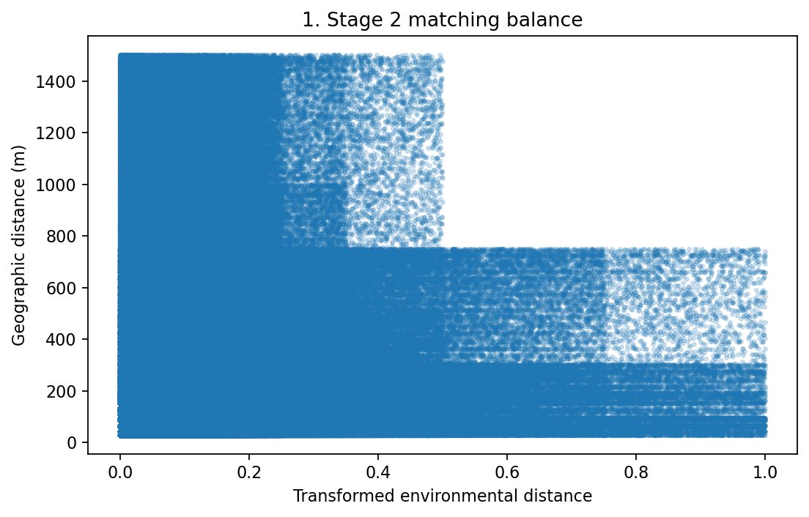
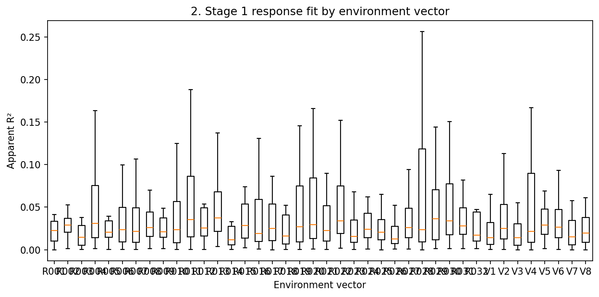
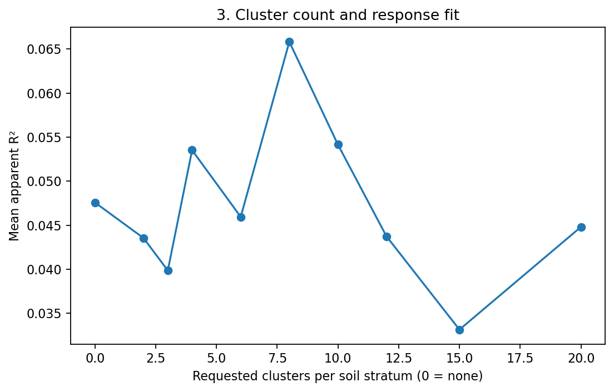
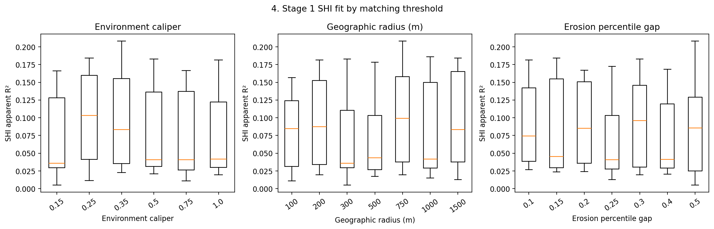
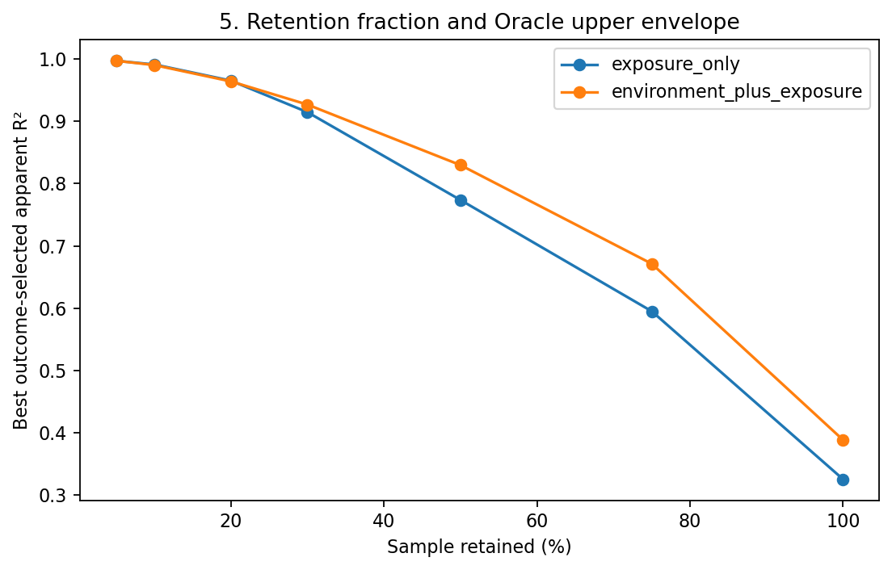
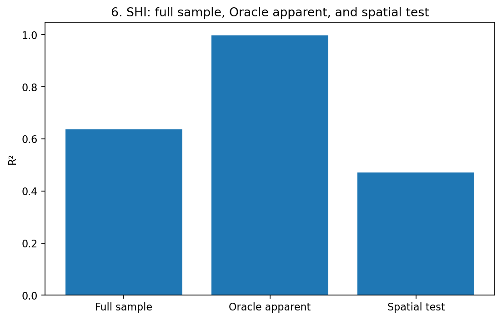
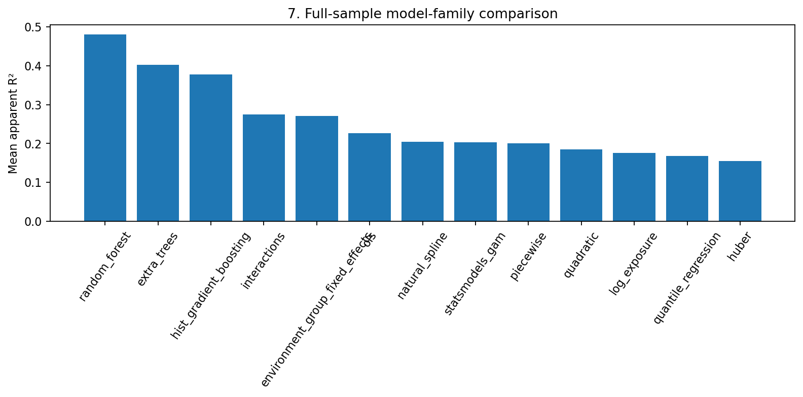
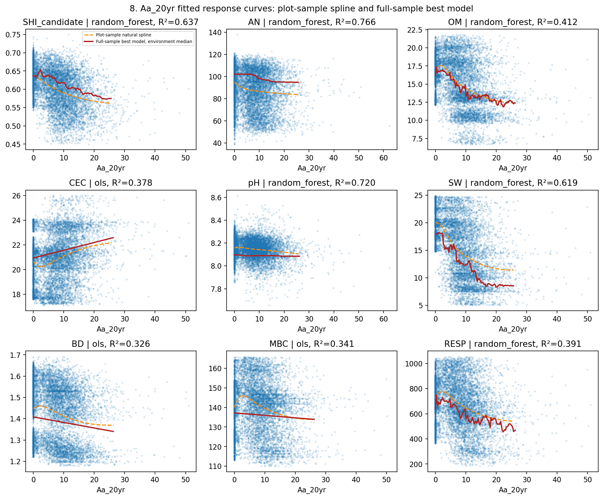
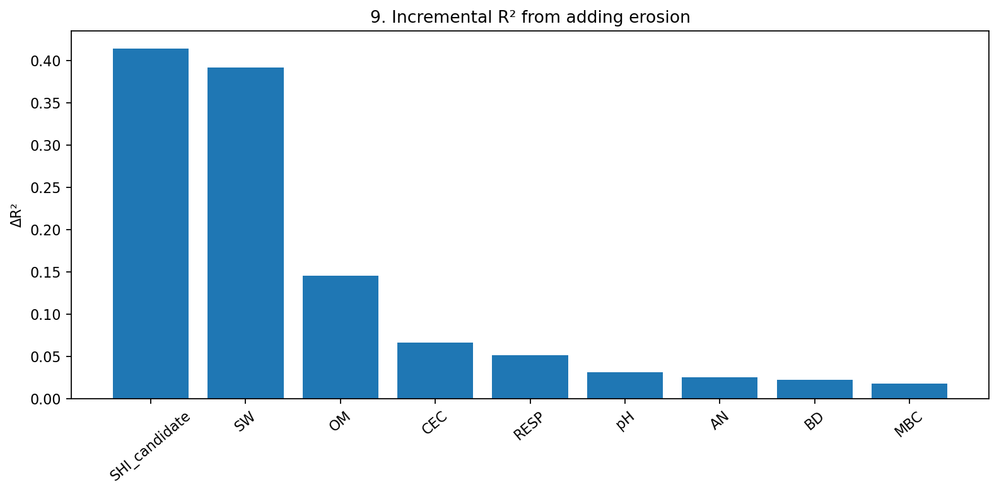
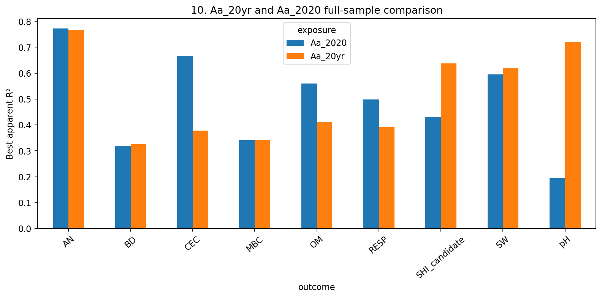

# EnvMatch-SEH探索性上限实验：环境匹配与土壤健康响应的最佳表现

- Run: oracle_20261026T041521459615Z_20261026
- Input run: run_20261025T114741_470772Z
- Git SHA: c50bd9ae6a42abc14f898e8043a79cb0c9c818e4 (working tree dirty: True)
- Mode: EXPLORATORY_ORACLE; outcome-guided results are exploratory and not formal evidence.
- Erosion inputs: reused existing Aa_20yr and Aa_2020 values; no RUSLE recalculation or verification was performed.
- PCNM: DEFERRED.

## 1. Research charter changes

The charter was revised from V1.0 to V1.1. Formal analysis keeps the result-independent matching restriction and G4/G5 gates. Oracle analysis is separate, uses its own output root and identifiers, and permits outcome-guided matching, subgroup, and model selection when every trial and objective is recorded. The user explicitly authorized this internal, non-publication exploration. Other research questions were not changed.

## 2. Experiment scale

- Source rows: 392527; Stage 1 sample: 40000; Stage 2 sample: 100000.
- Matching search used 5 distance methods (standardized_euclidean, weighted_euclidean, mahalanobis, pca_euclidean, direct_nearest_neighbor); 200 Stage 1 candidate parameter configurations ({'Aa_20yr': 100, 'Aa_2020': 100}); 40 Stage 2 configurations ({'Aa_20yr': 20, 'Aa_2020': 20}); and 8 Stage 3 matching configurations scored on withheld spatial test blocks. Search domains: environment calipers=6 levels, geographic radii=7 levels, erosion rank gaps=7 levels, cluster methods=5 levels, exposure rules=3 levels. Stage 1 sampled configurations; it did not enumerate the full Cartesian product.
- Stage 1 attempts: {'Aa_20yr': 100, 'Aa_2020': 100}; failures remain in the registry.
- Stage 2 configurations per exposure: {'Aa_20yr': 20, 'Aa_2020': 20}; role-specific attempts: 80.
- Stage 2 model family score rows: 702; common-sample time-scale comparison rows: 216 (SHI common-sample n=293146; other outcomes have outcome-specific counts in Section 8).
- Selected Aa_20yr full-sample response-curve predictions: 900 rows.
- Stage 3 matching configurations evaluated on withheld test blocks: 8.
- Model, subgroup, and retention records: 1024, 2448, and 252; in-scope subgroup trials=2430, with 18 legacy SoilType=85 water-class trials excluded from result ranking and retained in the registry for audit.
- Regression comparison covered 13 regression model families across 1,024 model trials: ols, log_exposure, quadratic, environment_group_fixed_effects, interactions, piecewise, natural_spline, statsmodels_gam, huber, quantile_regression, random_forest, extra_trees, hist_gradient_boosting.
- Total registry records: 4030; flattened score rows: 10616.
- All nine outcomes were represented when present. Missing responses use outcome-specific complete cases; no missing values were filled with zero.
- Quantile Regression emitted statsmodels iteration-limit warnings (100 iterations), and Huber fits emitted scikit-learn LBFGS iteration-limit convergence warnings. These did not stop the run; the registry does not store warning flags, so treat those model-family fits cautiously.

## 3. Best environment matching

Validation-selected SHI matching candidate: Aa_20yr_087; exposure Aa_20yr, validation R²=0.1531, vector V5, distance direct_nearest_neighbor, clusters none/0, environment caliper 0.35, radius 1000 m, rank gap 0.5; pairs=6,088, coverage=0.4762, max |SMD|=0.0078, median exposure gap=11.8017.

## 4. Best SHI result

- Full-sample unfiltered model-search apparent R²: 0.6369; n=384735.0000; model=random_forest on Aa_20yr / V5; exposure coefficient=n/a (unknown); config={"estimator": "RandomForestRegressor", "feature_importances": [0.3500667537127175, 0.4504896246212838, 0.19944362166599874], "group_column": "oracle_environment_group_01", "max_depth": 16, "min_samples_leaf": 10, "model_family": "random_forest", "n_estimators": 100, "numeric_features": ["Aa_20yr", "Elevation", "LST"], "random_state": 20261026}.
- Oracle-selected apparent R²: 0.9977; n=19237.0000; retention=0.0500; selection=maximize_apparent_ols_r2_at_fixed_retention; exposure coefficient=-0.0033 (negative).
- Validation-selected independent spatial test R²: 0.4703; validation R²=-0.0692; test n=51533.0000; model=ols on Aa_20yr / V7; exposure coefficient=-0.0024 (negative); config={"coefficients": [-0.0023901466561332893, 0.002411897959323464, 0.0321406083613905, -9.486933300522672e-05, 0.02179124225817462, -0.3813823451234561], "estimator": "LinearRegression", "fit_intercept": true, "group_column": null, "intercept": -0.17364246281768947, "model_family": "ols", "numeric_features": ["Aa_20yr", "Elevation", "Cur", "TWI", "LST", "NDWI"]}.
- Spatially selected OLS expression: `SHI_candidate = -0.173642 - 0.00239015 × Aa_20yr + 0.0024119 × Elevation + 0.0321406 × Cur - 9.48693e-05 × TWI + 0.0217912 × LST - 0.381382 × NDWI`.
- Largest same-row erosion increment ΔR² selected by validation_delta_r2: validation=0.4405; test=0.2993; exposure/outcome=Aa_20yr/SHI_candidate; evaluation source=validation.

## 5. Best results for all health indicators

| Exposure | Outcome | Full R² | n full | Oracle R² | n Oracle | Retention | Validation R² | Test R² | n test | Validation ΔR² | Test ΔR² |
| --- | --- | --- | --- | --- | --- | --- | --- | --- | --- | --- | --- |
| Aa_20yr | SHI_candidate | 0.6369 | 384735.0000 | 0.9977 | 19237.0000 | 0.0500 | -0.0692 | 0.4703 | 51533.0000 | 0.4405 | 0.2993 |
| Aa_20yr | AN | 0.7664 | 387515.0000 | 0.9954 | 19376.0000 | 0.0500 | 0.1827 | 0.4356 | 69869.0000 | 0.0673 | 0.0360 |
| Aa_20yr | OM | 0.4123 | 294841.0000 | 0.9961 | 14742.0000 | 0.0500 | 0.2269 | 0.3393 | 51816.0000 | 0.2325 | 0.3591 |
| Aa_20yr | CEC | 0.3775 | 294841.0000 | 0.9791 | 14742.0000 | 0.0500 | 0.4678 | 0.3605 | 51816.0000 | 0.0618 | 0.1203 |
| Aa_20yr | pH | 0.7204 | 294846.0000 | 0.9612 | 14742.0000 | 0.0500 | 0.0208 | -0.0231 | 51817.0000 | 0.0004 | 0.0314 |
| Aa_20yr | SW | 0.6187 | 387538.0000 | 0.9977 | 19377.0000 | 0.0500 | 0.4470 | 0.5697 | 69861.0000 | 0.3965 | 0.3491 |
| Aa_20yr | BD | 0.3256 | 294841.0000 | 0.9863 | 14742.0000 | 0.0500 | 0.3170 | 0.3324 | 51816.0000 | 0.0212 | 0.0306 |
| Aa_20yr | MBC | 0.3412 | 294841.0000 | 0.9832 | 14742.0000 | 0.0500 | 0.3137 | 0.3550 | 51816.0000 | -0.0020 | 0.0269 |
| Aa_20yr | RESP | 0.3914 | 294841.0000 | 0.9930 | 14742.0000 | 0.0500 | 0.2969 | 0.4205 | 51816.0000 | 0.0455 | 0.1124 |
| Aa_2020 | SHI_candidate | 0.4293 | 293192.0000 | 0.9954 | 14660.0000 | 0.0500 | -0.1433 | 0.2334 | 51447.0000 | 0.1722 | 0.0282 |
| Aa_2020 | AN | 0.7720 | 294454.0000 | 0.9956 | 14723.0000 | 0.0500 | 0.1902 | 0.4256 | 51757.0000 | 0.0396 | 0.0191 |
| Aa_2020 | OM | 0.5594 | 294446.0000 | 0.9933 | 14722.0000 | 0.0500 | 0.3468 | 0.3898 | 51754.0000 | 0.0503 | 0.0608 |
| Aa_2020 | CEC | 0.6669 | 294446.0000 | 0.9974 | 14722.0000 | 0.0500 | 0.6633 | 0.5694 | 51754.0000 | 0.0171 | 0.0275 |
| Aa_2020 | pH | 0.1947 | 294454.0000 | 0.9052 | 14723.0000 | 0.0500 | 0.0782 | 0.0680 | 51757.0000 | 0.0035 | -0.0013 |
| Aa_2020 | SW | 0.5945 | 294446.0000 | 0.9956 | 14722.0000 | 0.0500 | 0.3456 | 0.4948 | 51754.0000 | 0.0706 | 0.0404 |
| Aa_2020 | BD | 0.3194 | 294446.0000 | 0.9129 | 19356.0000 | 0.0500 | 0.3135 | 0.3223 | 51754.0000 | 0.0182 | 0.0146 |
| Aa_2020 | MBC | 0.3415 | 294446.0000 | 0.9112 | 19356.0000 | 0.0500 | 0.3197 | 0.3368 | 51754.0000 | 0.0074 | 0.0122 |
| Aa_2020 | RESP | 0.4983 | 294465.0000 | 0.9929 | 14723.0000 | 0.0500 | 0.3861 | 0.3787 | 51754.0000 | 0.0183 | 0.0026 |

## 6. Best selected data subset

Highest explicit subgroup apparent model: environment_group_6 for Aa_20yr/SHI_candidate; definition={"column": "oracle_environment_group_01", "op": "eq", "value": 6}; R²=0.5502, n=8,307, retention=0.0216; coefficient=-0.0022 (negative). This definition uses the environment group only; it does not additionally restrict SoilType or an erosion interval.
Highest fixed-fraction Oracle retention fit: Aa_20yr/SHI_candidate, predictor set=environment_plus_exposure, target retention=0.0500, actual retention=0.0500, n=19,237 of 384,735 complete cases, apparent R²=0.9977, baseline full-sample R²=0.3176 on n=384,735 complete cases, apparent ΔR²=0.6801, trials=20, selected by lowest_absolute_full_fit_residual, coefficient=-0.0033 (negative). It selects lowest absolute full-fit residuals across cropland with no SoilType or erosion-interval restriction; this is a post-hoc apparent fit and the test set did not participate. The baseline is for the same predictor set and differs from the separate full-sample model-search winner in Section 4.

## 7. Best full-sample models

| Exposure | Outcome | Model | Vector | R² | n | Evaluation |
| --- | --- | --- | --- | --- | --- | --- |
| Aa_20yr | SHI_candidate | random_forest | V5 | 0.6369 | 384735.0000 | apparent |
| Aa_20yr | AN | random_forest | R030 | 0.7664 | 387515.0000 | apparent |
| Aa_20yr | OM | random_forest | R019 | 0.4123 | 294841.0000 | apparent |
| Aa_20yr | CEC | ols | V8 | 0.3775 | 294841.0000 | apparent |
| Aa_20yr | pH | random_forest | R012 | 0.7204 | 294846.0000 | apparent |
| Aa_20yr | SW | random_forest | V5 | 0.6187 | 387538.0000 | apparent |
| Aa_20yr | BD | ols | V7 | 0.3256 | 294841.0000 | apparent |
| Aa_20yr | MBC | ols | V7 | 0.3412 | 294841.0000 | apparent |
| Aa_20yr | RESP | random_forest | R019 | 0.3914 | 294841.0000 | apparent |
| Aa_2020 | SHI_candidate | random_forest | V6 | 0.4293 | 293192.0000 | apparent |
| Aa_2020 | AN | random_forest | V8 | 0.7720 | 294454.0000 | apparent |
| Aa_2020 | OM | random_forest | V8 | 0.5594 | 294446.0000 | apparent |
| Aa_2020 | CEC | random_forest | V8 | 0.6669 | 294446.0000 | apparent |
| Aa_2020 | pH | interactions | R021 | 0.1947 | 294454.0000 | apparent |
| Aa_2020 | SW | random_forest | V8 | 0.5945 | 294446.0000 | apparent |
| Aa_2020 | BD | ols | V7 | 0.3194 | 294446.0000 | apparent |
| Aa_2020 | MBC | ols | V7 | 0.3415 | 294446.0000 | apparent |
| Aa_2020 | RESP | random_forest | V6 | 0.4983 | 294465.0000 | apparent |

## 8. Aa_20yr and Aa_2020 comparison

The table below compares Aa_20yr and Aa_2020 on the identical complete-case pixels for each outcome, using the same V1 environment variables and OLS specification. Separately optimized exposure configurations remain distinct and should not be read as an isolated time-scale effect.

| Exposure | Outcome | Common n | Environment R² | Environment + exposure R² | Apparent ΔR² | Validation R² | Validation ΔR² | Test R² | Test ΔR² | n test |
| --- | --- | --- | --- | --- | --- | --- | --- | --- | --- | --- |
| Aa_20yr | SHI_candidate | 293146.0000 | 0.1431 | 0.3363 | 0.1932 | -0.1905 | 0.4405 | 0.3514 | 0.2993 | 51437.0000 |
| Aa_20yr | AN | 294341.0000 | 0.2538 | 0.2749 | 0.0210 | -0.0178 | 0.0673 | 0.2563 | 0.0360 | 51718.0000 |
| Aa_20yr | OM | 294337.0000 | 0.0847 | 0.2815 | 0.1968 | 0.1668 | 0.2325 | 0.2683 | 0.3591 | 51717.0000 |
| Aa_20yr | CEC | 294337.0000 | 0.3029 | 0.3716 | 0.0688 | 0.4621 | 0.0618 | 0.3493 | 0.1203 | 51717.0000 |
| Aa_20yr | pH | 294341.0000 | 0.0156 | 0.0359 | 0.0203 | -0.0817 | -0.0421 | 0.0543 | 0.1024 | 51718.0000 |
| Aa_20yr | SW | 294337.0000 | 0.1786 | 0.4679 | 0.2894 | 0.4221 | 0.3965 | 0.5532 | 0.3491 | 51717.0000 |
| Aa_20yr | BD | 294337.0000 | 0.3016 | 0.3239 | 0.0224 | 0.3157 | 0.0212 | 0.3300 | 0.0306 | 51717.0000 |
| Aa_20yr | MBC | 294337.0000 | 0.3249 | 0.3349 | 0.0099 | 0.3100 | -0.0020 | 0.3440 | 0.0269 | 51717.0000 |
| Aa_20yr | RESP | 294337.0000 | 0.2888 | 0.3533 | 0.0644 | 0.2894 | 0.0455 | 0.4083 | 0.1124 | 51717.0000 |
| Aa_2020 | SHI_candidate | 293146.0000 | 0.1431 | 0.1916 | 0.0485 | -0.4645 | 0.1665 | 0.1156 | 0.0635 | 51437.0000 |
| Aa_2020 | AN | 294341.0000 | 0.2538 | 0.2665 | 0.0127 | -0.0455 | 0.0396 | 0.2394 | 0.0191 | 51718.0000 |
| Aa_2020 | OM | 294337.0000 | 0.0847 | 0.1179 | 0.0332 | -0.0154 | 0.0503 | -0.0299 | 0.0608 | 51717.0000 |
| Aa_2020 | CEC | 294337.0000 | 0.3029 | 0.3185 | 0.0156 | 0.4174 | 0.0171 | 0.2565 | 0.0275 | 51717.0000 |
| Aa_2020 | pH | 294341.0000 | 0.0156 | 0.0157 | 0.0001 | -0.0397 | -0.0002 | -0.0477 | 0.0004 | 51718.0000 |
| Aa_2020 | SW | 294337.0000 | 0.1786 | 0.2192 | 0.0407 | 0.0962 | 0.0706 | 0.2445 | 0.0404 | 51717.0000 |
| Aa_2020 | BD | 294337.0000 | 0.3016 | 0.3132 | 0.0117 | 0.3083 | 0.0138 | 0.3115 | 0.0121 | 51717.0000 |
| Aa_2020 | MBC | 294337.0000 | 0.3249 | 0.3317 | 0.0068 | 0.3163 | 0.0043 | 0.3259 | 0.0088 | 51717.0000 |
| Aa_2020 | RESP | 294337.0000 | 0.2888 | 0.3041 | 0.0153 | 0.2598 | 0.0158 | 0.3099 | 0.0140 | 51717.0000 |

## 9. Upper-envelope answers

1. Unfiltered full-sample best observed SHI R²: 0.6369. See the full-sample leaderboard for all indicators and exposures.
2. Outcome-selected Oracle apparent SHI R²: 0.9977. The best fixed-retention fit retained 0.0500 of complete cases (19,237 cells) at R² 0.9977.
3. Independent spatial result: validation-selected SHI model test R² 0.4703 on 51533.0000 test rows. Test outcomes were opened only to score selected models and did not select model families or matching configurations.

Oracle apparent and spatial test results answer different questions. Outcome-selected subsets can strongly inflate apparent R² and do not measure independent predictive performance.

## 10. Interpretation and next steps

Health rasters are random-forest predictions. Regressing them on environmental variables used in their source prediction can reconstruct the prediction surface; that does not establish an independent erosion contribution. Use same-row ΔR² and spatial test tables to assess whether erosion adds stable information beyond environment. SHI remains labelled SHI_candidate because its source identity is provisional.

For formal follow-up, prioritize configurations that retain validation-selected performance on held-out spatial blocks, report complete-case n and match coverage, and treat Oracle subgroup/R² results as internal hypotheses. No PCNM analysis was run.

- Matching: carry direct nearest neighbor forward as a leading sensitivity candidate. It was the Aa_20yr/SHI validation winner (validation R²=0.1531, coverage=0.4762, max |SMD|=0.0078); keep coverage visible because fewer than half of eligible cells were matched.
- Exposure and indicators: Aa_20yr has the stronger same-row spatial-test erosion increments for SHI_candidate (ΔR²=0.2993), OM (0.3591), and SW (0.3491). These are the most useful outcomes for a follow-up focused on incremental erosion information. Aa_2020 gives a higher CEC test R², but its CEC erosion increment is small (ΔR²=0.0275).
- Models: the full-sample Random Forest gives the largest apparent SHI R², while the validation-selected spatial SHI OLS has validation R²=-0.0692 and test R²=0.4703. Keep the Random Forest as a descriptive surface fit and judge follow-up models with spatial validation and same-row ΔR²; the validation/test gap for SHI needs checking on new spatial splits.
- Outcomes remain prediction surfaces, not independent field measurements. Reassess the promising Aa_20yr/OM/SW/SHI patterns against independent soil-health observations before making inferential claims; retain the provisional SHI_candidate label.

## Spatial test scores

| Exposure | Outcome | Model | Vector | Validation R² | Test R² | n test |
| --- | --- | --- | --- | --- | --- | --- |
| Aa_20yr | SHI_candidate | ols | V7 | -0.0692 | 0.4703 | 51533.0000 |
| Aa_20yr | AN | environment_group_fixed_effects | R030 | 0.1827 | 0.4356 | 69869.0000 |
| Aa_20yr | OM | extra_trees | R019 | 0.2269 | 0.3393 | 51816.0000 |
| Aa_20yr | CEC | ols | V8 | 0.4678 | 0.3605 | 51816.0000 |
| Aa_20yr | pH | ols | V4 | 0.0208 | -0.0231 | 51817.0000 |
| Aa_20yr | SW | extra_trees | V5 | 0.4470 | 0.5697 | 69861.0000 |
| Aa_20yr | BD | ols | V7 | 0.3170 | 0.3324 | 51816.0000 |
| Aa_20yr | MBC | ols | V7 | 0.3137 | 0.3550 | 51816.0000 |
| Aa_20yr | RESP | ols | V7 | 0.2969 | 0.4205 | 51816.0000 |
| Aa_2020 | SHI_candidate | interactions | V6 | -0.1433 | 0.2334 | 51447.0000 |
| Aa_2020 | AN | environment_group_fixed_effects | V8 | 0.1902 | 0.4256 | 51757.0000 |
| Aa_2020 | OM | hist_gradient_boosting | V8 | 0.3468 | 0.3898 | 51754.0000 |
| Aa_2020 | CEC | hist_gradient_boosting | V8 | 0.6633 | 0.5694 | 51754.0000 |
| Aa_2020 | pH | interactions | R021 | 0.0782 | 0.0680 | 51757.0000 |
| Aa_2020 | SW | hist_gradient_boosting | V8 | 0.3456 | 0.4948 | 51754.0000 |
| Aa_2020 | BD | ols | V7 | 0.3135 | 0.3223 | 51754.0000 |
| Aa_2020 | MBC | ols | V3 | 0.3197 | 0.3368 | 51754.0000 |
| Aa_2020 | RESP | hist_gradient_boosting | V6 | 0.3861 | 0.3787 | 51754.0000 |

## Figures

Figure 08 overlays a natural spline fitted to the fixed stratified plotting sample and the full-sample best model refit for the partial effect, with environment variables held at their medians. The latter is selected by apparent full-sample R² and is descriptive, not an independent test result.

- [01_matching_balance.png](figures/01_matching_balance.png)
- [02_environment_vector_r2.png](figures/02_environment_vector_r2.png)
- [03_cluster_count_r2.png](figures/03_cluster_count_r2.png)
- [04_matching_parameters_r2.png](figures/04_matching_parameters_r2.png)
- [05_retention_upper_envelope.png](figures/05_retention_upper_envelope.png)
- [06_shi_three_result_classes.png](figures/06_shi_three_result_classes.png)
- [07_model_family_comparison.png](figures/07_model_family_comparison.png)
- [08_health_response_curves.png](figures/08_health_response_curves.png)
- [09_erosion_increment_r2.png](figures/09_erosion_increment_r2.png)
- [10_exposure_comparison.png](figures/10_exposure_comparison.png)

## Selected figures

## Run artifacts

Experiment registry: outputs/exploratory_oracle/oracle_20261026T041521459615Z_20261026/experiments/experiment_registry.jsonl
Scope exclusions: outputs/exploratory_oracle/oracle_20261026T041521459615Z_20261026/subgroups/scope_exclusions.json
Flattened scores and leaderboards: outputs/exploratory_oracle/oracle_20261026T041521459615Z_20261026/tables/
Generated charts: outputs/exploratory_oracle/oracle_20261026T041521459615Z_20261026/figures/
Tracked review bundle beside this report: `experiment_summary.json`, `best_model_parameters.json`, `figure_index.json`, `leaderboards/*.csv`, and `figures/*.png`.
