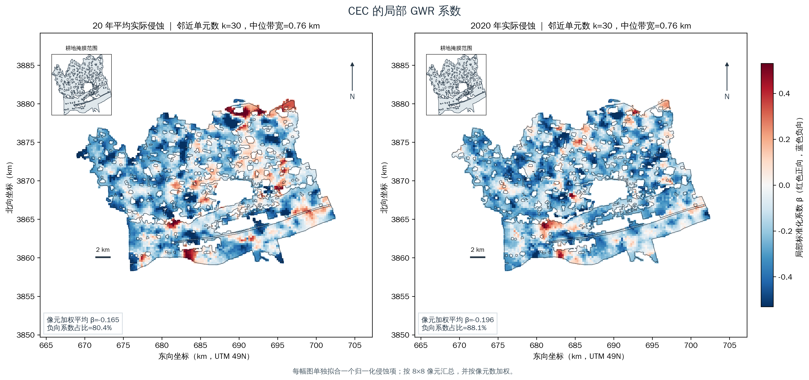

# CEC 校正与相关分析重算

**状态：** `EXPLORATORY_ORACLE`，`outcome_guided_selection=true`。本报告按用户指定的公式构造派生 CEC 响应，并更新此前依赖 CEC 的全局、匹配、异质性和空间分析。该值是公式构造结果；本轮没有独立原始 CEC 测量来验证“恢复”是否准确。

## 公式与范围

`Erosion = Aa_20yr / 143.0050354 + Aa_2020 / 48.7655754`

`CEC_corrected = (CEC - 20 × Erosion) / 2.9 + 18`

两张完整对齐栅格的有效域最大值分别为 Aa_20yr **143.0050354**、Aa_2020 **48.7655754**。原 CEC 栅格有效像元范围为 **17.0788–26.0000**（391,754 个像元）；同时具有 CEC、Aa_20yr、Aa_2020 的共同有效像元为 **387,448**，这些像元的 `CEC_corrected` 范围为 **16.7258–26.8365**。Erosion 归一化和在共同有效像元上的范围为 **0–1.2252**。栅格为 EPSG:32649、30 m、1240×977；公式重算值与已保存 float32 校正栅格最大差 **9.54×10⁻⁷**。源 CEC 及原始运行均保留未改。

校正输入与网格清单：[公式与范围元数据](formula_and_grid.json)；[校正输入包](<../../../../../outputs/exploratory_oracle/phase_i/cec_corrected_input_20_2p9_plus18_20261031>)。

## 重算结果

### 全掩膜关联（I-1）

| 暴露 | 完整像元 | Pearson r | Spearman ρ | 标准化 β（log1p Aa） | 5 km 空间块 95% CI |
|---|---:|---:|---:|---:|---:|
| Aa_20yr | 387,448 | -0.3200 | -0.2856 | -0.3052 | [-0.3825, -0.2386] |
| Aa_2020 | 387,448 | -0.2246 | -0.1659 | -0.2053 | [-0.2462, -0.1627] |

I-1 的 5 km 空间块 bootstrap 为 399 次。像元数量不是独立实测样点数量。明细：[global associations](tables/global_associations.csv)。

### 环境匹配配对（I-2）

| 暴露 | 候选 | 完整配对 / 设计配对 | Spearman ρ（配对差值） | 标准化配对斜率 | ΔCEC<0 比例 |
|---|---|---:|---:|---:|---:|
| Aa_20yr | stage2_Aa_20yr_01 | 111,278 / 111,289 | -0.1002 | -0.0964 | 69.2% |
| Aa_2020 | stage2_Aa_2020_01 | 133,082 / 133,092 | -0.1667 | -0.2132 | 61.9% |
| Aa_2020 | stage2_Aa_2020_03 | 134,590 / 134,601 | -0.1707 | -0.2155 | 61.8% |
| Aa_2020 | stage2_Aa_2020_06 | 117,779 / 117,790 | -0.2043 | -0.2398 | 67.4% |

候选配对设计、分组和配对 ID 沿用既有 Oracle 设计；校正后的共同有效性使部分端点对缺失。完整候选表：[matched pair associations](tables/matched_pair_associations.csv)。

对 M3/M4 × 两期暴露的配对差值模型族也重新拟合了 8 类模型。下表列每个组合的最高全样本表观 R²；它是 Oracle 模型搜索摘要，不是空间留出验证。

| 配对方法 | 暴露 | 表观 R²最高模型 | 表观 R² | 方向 |
|---|---|---|---:|---|
| M3 | Aa_2020 | random_forest | 0.0984 | negative |
| M3 | Aa_20yr | random_forest | 0.0856 | negative |
| M4 | Aa_2020 | random_forest | 0.0976 | negative |
| M4 | Aa_20yr | random_forest | 0.0864 | negative |

全部 32 个 CEC 家族拟合见[模型族明细](tables/paired_model_family_trials.csv)。

### 环境异质性（I-3）

M4、Aa_20yr、按高侵蚀端土类分层的配对斜率：

| 土类组 | 配对数 | 5 km 块 | ΔCEC / Δlog1p(Aa) 斜率 | 95% 聚类稳健区间 |
|---|---:|---:|---:|---:|
| soil_26 | 20,573 | 19 | -0.0712 | [-0.1206, -0.0218] |
| soil_27 | 58,319 | 24 | -0.4497 | [-0.5169, -0.3824] |
| soil_42 | 11,740 | 8 | -0.4725 | [-0.5510, -0.3940] |

土类斜率交互的全局 q=3.79e-27；该 q 值按 504 项旧非 CEC 检验与本次校正 CEC 检验合并后重新进行 log 尺度 BH 校正。低侵蚀筛选的 M4/Aa_20yr 组内空间块敏感性如下：

| 土类组 | 配对数 | Spearman ρ | 斜率 | bootstrap 块数 | 同块斜率 95% CI |
|---|---:|---:|---:|---:|---:|
| soil_26 | 20,620 | -0.0683 | -0.0712 | 19 | [-0.1086, 0.0218] |
| soil_27 | 58,532 | -0.1262 | -0.4497 | 24 | [-0.5096, -0.3843] |
| soil_42 | 11,745 | -0.1588 | -0.4725 | 8 | [-0.5609, -0.3860] |

土类标签与筛选规则沿用原分析；低侵蚀子集与全配对总体分别解释。详情见 [环境组斜率](tables/environment_group_slopes_m4_Aa20.csv)、[交互检验](tables/environment_group_interactions_m4_Aa20.csv)、[低侵蚀组结果](tables/low_erosion_group_sensitivity_m4_Aa20.csv)。

### GWR 与空间机器学习（I-4/I-5）

I-4 主 GWR 结果：

| 分析总体 / 模型 | 约240 m单元 | 来源像元/配对 | 平均局部标准化 β | 负系数占比 | 加权局部 R² |
|---|---:|---:|---:|---:|---:|
| mask_all_complete_case / GWR | 7,480 | 387,448 | -0.1488 | 78.5% | 0.1370 |
| environment_complete_unadjusted / GWR | 7,396 | 294,337 | -0.2104 | 86.6% | 0.2183 |
| environment_adjusted / GWR | 7,396 | 294,337 | -0.2910 | 98.2% | 0.5528 |
| environment_adjusted / GWR-LCR | 7,396 | 294,337 | -0.1615 | 96.7% | 0.3847 |
| matched_all / GWR | 7,010 | 111,278 | -0.1918 | 66.9% | 0.0659 |
| matched_zero_positive / GWR | 6,152 | 68,167 | -0.1427 | 69.0% | 0.0625 |
| matched_both_positive / GWR | 5,625 | 43,111 | -0.1108 | 72.2% | 0.0351 |

公式派生 CEC 的单暴露 GWR 地图使用 7,480 个约240 m空间单元；两幅图的带宽均选到候选下限 k=30，故局部尺度仍受候选范围限制。

| 单独拟合的暴露 | 加权平均局部 β | 负系数占比 | k | 中位带宽（km） |
|---|---:|---:|---:|---:|
| Aa_20yr | -0.1653 | 80.4% | 30 | 0.76 |
| Aa_2020 | -0.1959 | 88.1% | 30 | 0.76 |

简单像元级 OLS（含截距、每次仅一个归一化 Aa 预测项）：

| 暴露 | Pearson r | 每归一化单位斜率 | R² |
|---|---:|---:|---:|
| Aa_20yr | -0.3200 | -4.7898 | 0.1024 |
| Aa_2020 | -0.2246 | -13.3481 | 0.0504 |

*局部系数使用共同色标；因 CEC_corrected 同时包含两期归一化侵蚀项，单暴露地图不能作为独立公式验证。*

I-5 的全局 GAM 与 SVC-GAM 空间块测试 R²分别为 **0.686**、**0.701**；SVC-GAM 在 Aa 中位暴露处的局部标准化边际效应中位数为 **-0.0623**，负值单元比例 **73.0%**。模型比较：[I-5 表](tables/spatial_ml_model_comparison.csv)；局部效应摘要：[I-5 中位暴露表](tables/spatial_ml_marginal_effect_q50.csv)。

### 局部空间关联（I-6）

在 7,396 个约240 m单元中，100 邻居局部 Spearman 中位数为 **-0.309**（P10–P90：-0.623 至 0.010），其中 **89.3%** 为负。双变量 LISA 中 FDR 显著 HL 为 **949**；同位高 Aa—低 CEC 单元 2,571/7,396（34.8%）。这些邻域/同位空间统计量对应不同定义，不互相替代。

明细：[局部 Spearman](tables/local_spearman_summary.csv)、[LISA 类别](tables/bivariate_local_moran_cluster_counts.csv)、[同位共现](tables/same_site_colocation_summary.csv)、[Gi* 汇总](tables/local_negative_response_gistar_summary.csv)。I-7 跨阶段汇总行：[CEC crosswalk](tables/phase_i7_cec_crosswalk.csv)。

## 解释边界

代数展开为 `CEC_corrected = CEC/2.9 − 6.89655 × Erosion + 6.20690`。因此负向 Aa 项已写入派生结局；上述负相关、负斜率、GWR 系数和空间聚集部分受公式机械决定，不能单独证明侵蚀降低了真实 CEC，也不能独立证明该公式恢复了原始观测值。该结果适合标记为按给定校正公式得到的探索性关联。

预测栅格像元、匹配对和约240 m空间单元均有空间依赖，不等于独立实测样本。所有新运行保留 `outcome_guided_selection=true`；原 PCNM 未重跑，PCNM/PLS-SEM 源表未提供，相关字段继续缺失。此前报告中的 CEC 专属数值和图表请以本报告及其明细表为准。

## 可复核运行

- 校正输入：`outputs/exploratory_oracle/phase_i/cec_corrected_input_20_2p9_plus18_20261031/`
- I-1：`outputs/exploratory_oracle/phase_i/phase_i_cec_corrected_20_2p9_plus18_20261031_i1`
- I-2：`outputs/exploratory_oracle/phase_i/phase_i_cec_corrected_20_2p9_plus18_20261031_i2`
- I-3 Phase G 输入：`outputs/exploratory_oracle/phase_i/cec_corrected_phase_g_20_2p9_plus18_20261031`；I-3 汇总：`outputs/exploratory_oracle/phase_i/phase_i_cec_corrected_20_2p9_plus18_20261031_i3`
- I-4：`outputs/exploratory_oracle/phase_i/phase_i_cec_corrected_20_2p9_plus18_20261031_i4`；单暴露 GWR 图：`outputs/exploratory_oracle/phase_i/phase_i_cec_corrected_20_2p9_plus18_20261031_i4_gwr`
- I-5：`outputs/exploratory_oracle/phase_i/phase_i_cec_corrected_20_2p9_plus18_20261031_i5`
- I-6：`outputs/exploratory_oracle/phase_i/phase_i_cec_corrected_20_2p9_plus18_20261031_i6`
- I-7：`outputs/exploratory_oracle/phase_i/phase_i_cec_corrected_20_2p9_plus18_20261031_i7`
- 低侵蚀分组重算：`outputs/exploratory_oracle/low_erosion_group_heterogeneity_cec_corrected_20_2p9_plus18_20261031`
