# 温县耕地土壤侵蚀与土壤健康关联及空间差异研究

## 摘要

本研究综合考察温县耕地实际侵蚀与土壤健康预测面的总体关联、环境匹配后的配对差异、健康维度路径和空间变化。侵蚀量与土壤含水量（SW）、土壤健康指数（SHI）及有机质（OM）的全域Spearman相关分别为-0.584、-0.469和-0.415；既有配对差值分析的相应相关分别为-0.272、-0.144和-0.115。两者使用不同样本、统计单位和变量构造，数值差异不能单独归因于匹配。路径分析中，侵蚀与物理、化学和生物活动维度的标准化条件系数分别为-0.389、-0.251和-0.066；SHI方程的直接系数为-0.113，R²=0.601，侵蚀带来的条件R²增量为0.0079。局部回归和多尺度回归显示关系存在空间差异。研究使用的是随机森林预测栅格，结果受空间依赖和结果导向候选筛选影响，只支持探索性条件关联。CEC由含侵蚀项的公式计算，其关联存在代数耦合；SHI构造公式与权重尚待核实。本文不作因果解释。

**关键词：**实际侵蚀；土壤健康；环境匹配；空间异质性；局部回归；路径分析

本报告包括A–I九幅核心图和J–Z十七幅补充图，末尾附有完整图版与逐图阅读说明。补充图使用已保存的模型和空间结果表；图T沿用已保存的健康方向评分敏感性结果。

## 一、研究问题

本研究关注：侵蚀与土壤健康指标在全域是否相关；在环境近邻配对后，配对差值是否仍有关联；土类和地形湿度背景下关系是否不同；局部关系如何随位置和空间尺度变化；物理、化学和生物活动指标是否呈现不同响应；加入环境和空间背景变量后路径估计如何变化；不同结构模型的拟合和侵蚀增量如何；哪些结果值得进一步实地核验。

## 二、数据与方法

研究区为河南省温县耕地。侵蚀环境表和健康表各含392,527个栅格记录，像元编号唯一对应，行列及投影坐标逐项一致。CEC按本研究采用的全域最大值公式计算：

CEC = (原CEC − 20 × (Aa20 / 143.00503540039062 + Aa2020 / 48.76557540893555)) / 2.9 + 18。

其中Aa20和Aa2020分别表示两期实际侵蚀量。有效CEC为387,448个像元，范围16.726—26.837，与存储值的逐像元最大绝对差为0。所有图中均标作“CEC”。由于计算式直接含侵蚀量，CEC与侵蚀的统计关系有确定的代数成分，不作为独立侵蚀证据。SHI的原始计算公式和权重未能核实，因此保留现有预测面，不用新CEC重建SHI。

健康结局为随机森林预测值，不是逐像元独立实测。全健康指标完整的像元为384,211个；再要求主要环境变量完整后，进入核心控制模型的像元为293,145个。240 m空间汇总包含7,387个单元和293,633个支撑像元，并复现了既有汇总数据中的单元数、支撑数、侵蚀均值与SHI均值。汇总时各变量按自身有效像元求均值，因此不同变量的像元支持略有差异：CEC和2020年侵蚀量在162个单元中合计缺少487个支撑像元，AN与pH各缺少1个支撑像元。

环境匹配结果来自两个不同的历史版本，本文分别报告，不能合并成同一总体。第一版保留181,794个匹配端点，按高程和地表温度的环境距离卡尺0.35、地理距离上限1,000 m及组内侵蚀百分位差至少0.50构造。第二版为经过候选比较后保留的111,289对端点，共222,578个不重复端点；其环境距离卡尺为0.75、地理上限500 m、每类土壤内分8组，组内侵蚀百分位差至少0.30。两个端点总体仅有133,533个相同像元，前一版独有48,261个，后一版独有89,045个。配对差值来自第二版配对。两版本差异也意味着端点回归和配对差值回归并非同一组像元的两种表达。

正侵蚀分析包含195,013个像元；零—正侵蚀配对为68,172对，两端均正值配对为43,117对。另在三类主要土壤内部按地形湿度分为四个等级，形成12个分层组。不同统计单位各自回答不同问题，不将像元、空间单元、匹配端点和配对差值视为可互换观测。

物理维度按标准化土壤含水量（SW）减去标准化土壤容重（BD）后取平均；化学维度为标准化有机质（OM）与碱解氮（AN）的平均；生物活动维度为标准化微生物量碳（MBC）与土壤呼吸指标（RESP）的平均。RESP保留原始方向，不据此假定其越高越健康。CEC和土壤酸碱度（pH）单独分析，pH不作方向翻转。由于未找到可核验的八项指标方向、适宜范围隶属度函数和SHI权重来源，本研究没有另建“健康方向统一”的第二套指标分值；以上维度仅为透明的描述性复合值。路径回归采用5 km空间块聚类协方差；空间块数量不足时使用HC3。局部地理加权回归（GWR）允许关联随地点变化，多尺度地理加权回归（MGWR）允许不同变量呈现不同空间带宽。本研究复用已保存的GWR和MGWR结果，没有重新估计空间模型。

## 三、主要结果

### 1. 全域与配对差值关联

全域像元中，侵蚀与SW、SHI和OM的秩相关分别为-0.584、-0.469和-0.415。配对差值中，对应系数分别为-0.272、-0.144和-0.115，方向均为负。全域像元相关和配对差值相关的样本、统计单位及变量构造不同，不能把系数绝对值的差异解释为匹配削弱了多少侵蚀效应；配对结果应理解为所选匹配版本中的条件差值关系。剩余关系还可能受未测混杂、预测误差和空间依赖影响。

### 2. 健康维度与结构路径

核心环境控制下，侵蚀与物理、化学、生物活动维度的标准化条件路径分别为-0.389、-0.251和-0.066。包含这些维度并保留侵蚀—SHI直接路径的模型中，SHI直接系数为-0.113，R²为0.601，侵蚀条件R²增量为0.0079。另一条探索路径按“侵蚀—物理—化学—生物活动”次序设置维度间关联；路径乘积表示条件关联分解，不是因果中介，且未计算bootstrap区间。物理、化学、生物复合值采用等权构造，不能当作经验证的潜变量。

在相同像元总体和相同SHI路径结构下，加入空间坐标趋势的模型表观R²最高，为0.651；它更能重建预测面的空间纹理，不代表侵蚀因果结构最佳。不加环境控制的模型侵蚀条件R²增量最大，为0.017，直接系数为−0.157，但不能排除环境共变。核心环境控制模型R²为0.601、增量为0.0079、直接系数为−0.113，是当前较容易解释的候选，不能称为确认性或最优因果模型。自定义协方差路径近似在统一标准化尺度上计算描述性拟合量，但并非成熟协方差结构方程软件实现，且拟合指数没有空间稳健校正；形成性PLS没有bootstrap区间。因此这些估计用于探索模型结构，不能代替独立验证。

### 3. 空间差异与候选区域

既有GWR局部标准化系数的像元加权均值，在SHI、OM、SW上分别约为−0.330、−0.556、−0.680；局部共线性收缩模型的相应均值约为−0.218、−0.387、−0.464。770个空间均衡单元上的MGWR模型R²分别为0.869、0.696和0.822。OM与SW的带宽估计达到设定上限约23.78 km，表示模型只能支持较宽尺度变化，不能把该上界当作精确作用半径。

按既有规则识别的高侵蚀且局部负向关联较强候选区包括623个240 m单元，面积等价约18.882 km²，平均侵蚀量约15.670，SHI均值约0.549，局部GWR系数中位数约−0.567。该区域适合用于安排现场核验顺序，不是经过实测验证的危险边界或直接治理区。土壤类型、灌排、坡面和耕作条件仍须现场核实。

### 4. 九项健康结局的整体结果

为避免只依据三项相关较强的指标概括全体土壤健康结局，本研究同时检查土壤健康指数和八项指标。全域像元中，20年平均侵蚀量与九项结局的Spearman秩相关依次为：土壤健康指数（SHI） -0.469；土壤含水量（SW） -0.584；有机质（OM） -0.415；碱解氮（AN） -0.233；阳离子交换量（CEC） -0.286；酸碱度（pH） -0.109；土壤容重（BD） -0.200；微生物量碳（MBC） -0.118；土壤呼吸（RESP） -0.272。其中SW、SHI和OM的负向排序关系最明显；CEC、碱解氮、土壤容重及土壤呼吸也为负，但幅度较小；pH和微生物量碳的全域相关相对接近零。这里的系数说明侵蚀排序与预测指标排序共同变化，并没有调整所有环境背景，也不表示侵蚀导致这些变化。

第二版环境匹配配对中，九项健康差值与两端侵蚀差值的秩相关为：土壤健康指数（SHI） -0.144；土壤含水量（SW） -0.272；有机质（OM） -0.115；碱解氮（AN） -0.024；阳离子交换量（CEC） -0.100；酸碱度（pH） -0.051；土壤容重（BD） -0.032；微生物量碳（MBC） +0.056；土壤呼吸（RESP） -0.014。大部分系数靠近零，微生物量碳略为正向。匹配对内的方向并非九项指标一致，而且每对像元共享环境分组与近邻选择条件；这些配对结果代表该版本筛选后的条件差值，不可以与全域系数相减来估计所谓“匹配后衰减”。这也提醒读者：土壤健康不是单一响应，不能只用SHI代替全部物理、化学和生物指标。

CEC单项条件模型在加入核心环境变量后，侵蚀路径系数为-0.312，该方程R²为0.323。由于CEC定义中包含两期侵蚀量，该负向估计部分来自计算公式本身；无论全域秩相关、配对差值、单项路径还是局部回归，都不能把CEC结果当成独立的侵蚀效应证据。CEC仅作为单项结果列示，不放入主要化学维度合成。

### 5. 环境组差异与样本边界

在三类主要土壤内部按地形湿度划分的十二组中，最负的三条核心环境控制维度路径为：42 脱潮土、湿度最低组的物理维度 β=-0.478（n=8,688）；27 潮土、湿度最低组的物理维度 β=-0.455（n=48,163）；27 潮土、湿度最高组的物理维度 β=-0.401（n=48,163）。这些估计是对各组分别拟合后按系数排序的描述；没有进行正式的跨组系数等值检验，也没有把置信区间差异当作组间显著性检验。因此，它们可提示后续核查哪些组合，不能据此认定该土类或湿度水平已被证明更敏感。地形湿度组的样本规模亦不相等，极端组的估计精度与中间组可能不同。

补充总体还包括195,013个正侵蚀像元、68,172对零侵蚀—正侵蚀配对以及43,117对两端均为正侵蚀的配对。正侵蚀像元用于分析已有侵蚀条件下的侵蚀强度；零—正侵蚀配对用于比较无侵蚀与有侵蚀的状态差异。分析目标并不相同；其结果应回到对应的总体和模型表阅读，不能把这些像元或配对人数简单相加为新的独立样本量。无论采用哪种总体，健康结局都是空间连续预测面，邻近像元之间可能共享训练数据和环境信息。

### 6. 九项结局的局部回归概况

复用的GWR结果中，九项结局的像元加权局部标准化系数均值为：土壤健康指数（SHI） -0.330；土壤含水量（SW） -0.680；有机质（OM） -0.556；碱解氮（AN） -0.004；阳离子交换量（CEC） -0.291；酸碱度（pH） -0.030；土壤容重（BD） -0.414；微生物量碳（MBC） -0.154；土壤呼吸（RESP） -0.345。加入局部岭惩罚后的相应均值为：土壤健康指数（SHI） -0.218；土壤含水量（SW） -0.464；有机质（OM） -0.387；碱解氮（AN） +0.002；阳离子交换量（CEC） -0.162；酸碱度（pH） -0.030；土壤容重（BD） -0.293；微生物量碳（MBC） -0.096；土壤呼吸（RESP） -0.229。九项系数的空间支持量并不完全相同，CEC的GWR汇总基于7,396个240 m单元、294,337个预测像元支持；其GWR加权系数均值约−0.291，局部负系数占98.2%，局部岭收缩后的均值约−0.162、负系数占96.7%。由于公式直接带入Aa，这些CEC局部数字仍属于公式耦合下的描述。

这些系数使用同一暴露标准化方式，有利于比较各指标的局部关联方向，但不同结局的构造、测量含义和预测误差并不相同。局部共线性收缩GWR是在局部回归中加入岭惩罚、用于检查局部共线性敏感性的一种模型；它会把系数向零收缩，均值较小不等于关系不存在。图B为便于辨认，只展示SHI、OM与SW三项局部地图；它不展示CEC地图，CEC的九项汇总结果在表格中单独可查。已有MGWR在770个空间均衡单元上估计，其中OM与SW带宽达到23.78 km设定上界，所以目前只能说关系在较宽空间尺度上保持变化，不能从上界反推精确影响半径。

## 四、讨论与结论

现有预测栅格显示，侵蚀与部分健康指标存在稳定的负向空间关联；关联大小随统计单位、指标和控制变量变化。匹配差值分析提供了受限样本中的条件关联，但其与全域秩相关的差值不能被单独解释成匹配的效果。路径模型进一步描述了健康维度和SHI之间的条件关系；CEC的公式性耦合、SHI配方不确定、预测面空间依赖和结果参与候选筛选，均限制了结论强度。

1. **全域主要关系：**SW、SHI和OM与实际侵蚀的全域Spearman相关分别为-0.584、-0.469和-0.415，方向为负。
2. **配对差值关系：**所选配对版本中，SW、SHI和OM的差值相关分别为-0.272、-0.144和-0.115；这些数值不能与全域相关直接作衰减比较。
3. **环境背景差异：**不同土类与地形湿度组的路径估计不同，但尚无正式的多组等值检验，不能断言组间差异已得到验证。
4. **空间格局：**局部系数显示关联随位置变化；部分多尺度带宽达到上限，尚不能确定精确作用范围。
5. **健康维度：**核心环境控制下，侵蚀与物理、化学、生物活动维度的条件系数分别为-0.389、-0.251和-0.066。
6. **环境与空间控制：**加入不同背景变量后，侵蚀路径和拟合度发生变化；这是条件估计量变化，不表示逐层消除了混杂。
7. **拟合表现：**加入空间坐标趋势的候选模型表观R²最高（0.651），空间趋势也会吸收预测面的空间纹理，不能据此选择因果结构。
8. **侵蚀增量：**不控制环境的模型条件R²增量最大（0.017），其解释受环境共变限制。
9. **解释候选：**核心环境控制模型R²=0.601、侵蚀增量=0.0079、SHI直接路径=−0.113，可作为较易解释的比较对象，不是独立验证。
10. **管理启示：**优先对高侵蚀—强负向响应候选区开展土壤、坡面、灌排和耕作现场核查，再据实测证据确定监测和治理措施。

下一步应核实SHI隶属度方向、权重与训练数据，建立地块实测验证，并在统一空间留出设计下复核路径稳定性；同时将本研究与已有空间特征向量控制结果进行对照。治理决策应依据现场条件，而不由预测图单独指定。

## 空间差异、模型拟合与解释边界补充

全域局部系数、770个空间均衡位置的GWR/MGWR结果，以及240 m环境候选区分别从不同空间支撑回答局部关系问题。局部共线性收缩GWR对SHI、OM、SW的加权标准化系数为-0.218、-0.387、-0.464。770点上标准GWR与MGWR的局部系数符号一致，但相关分别为0.537、0.291、0.200；因此地点上的估计幅度仍受模型设定影响。OM和SW的Aa带宽达到模型搜索上限，无法从本分析给出精确的作用半径。

成熟lavaan 0.7.3用于完成代表性CB-SEM结构比较，在四类总体、三类基础路径结构和四级控制条件中共拟合48个模型。CB-SEM的CFI、TLI、RMSEA、SRMR及AIC/BIC是常规最大似然拟合指标；因预测像元存在空间依赖，这些指标不具备空间稳健解释。分段路径模型使用5 km空间块聚类协方差，适合报告路径区间，但其R²只是模型内拟合。两类方法互相补充，不能将任一者的高拟合度视为独立验证。

形成性Mode-B PLS在四类代表性总体、三种基础结构和四级环境/空间控制间进行比较；S1每个总体/控制组合拟合三条健康维度方程，S2和S3各增加一条SHI方程，共176条内生方程。S2保留侵蚀直达SHI路径，S3删除该路径。控制变量作为固定单指标构念，同一总体内所有结构与控制使用共同完整样本。该项目内权重迭代没有bootstrap区间，也没有空间稳健推断，结果仅用于描述结构与控制层级变化。

综合解释时，应优先陈述SW、OM、SHI的多方法负向关系和三类维度的条件路径，再说明匹配总体、环境控制以及局部空间带宽对结果的影响。路径系数随控制条件变化，说明土壤环境与空间背景解释了部分预测共变。候选区只能用于安排地面采样和现场踏勘的次序。建议在T1布置高侵蚀且负向局部系数明显的核查点，在T2设置较弱局部系数对照，并从T4环境候选区覆盖不同土类和湿度条件；随后用独立土壤实测、地块管理记录和独立侵蚀估计检验这些差异。当前证据不支持把候选分区直接转为治理边界或给出单一工程措施。

### 不同证据的适用范围

全域秩相关描述像元排序是否共同变化；标准化回归系数描述给定模型条件下侵蚀与结局的线性联系；GAM曲线呈现拟合总体中的非线性形态；局部回归展示系数随位置变化；环境匹配差值则对应被选中的近邻端点及其差值。它们的样本、尺度和估计对象不同，方向相同可以视为相互补充的描述，数值大小却不能直接排成一条强弱序列。特别是匹配配对由候选筛选和空间约束共同形成，配对后的相关并非将全域关系“控制到只剩侵蚀”的实验效应。

结构模型中的物理、化学与生物活动综合值用于压缩多个指标，目的是概括并比较响应维度；本次采用的组合构造尚未经过独立测量模型检验，也不能替代完整的土壤健康评价。SHI与其组成指标之间存在构造联系，因而SHI方程的高拟合不能单独证明生态过程路径。成熟协方差结构模型提供常规拟合诊断，分段模型提供空间块协方差下的路径区间，两者的推断假设并不相同；不能因模型收敛或拟合指标理想，就将预测像元视为相互独立的现场样本。

下一步的核验设计应同时覆盖响应较强和较弱的区域，并记录采样季节、灌排制度、作物轮作、地块管理及土壤采集深度。现场样本应按空间块安排，避免相邻点过密而把空间连续性误作独立重复；侵蚀暴露也应尽量通过独立估算或长期地表证据核对。首先检验SW和OM等单项测量是否复现预测面所示的空间梯度，再评估SHI指标方向、标准化和权重对总体结论的影响。这样的设计可以区分预测模型误差、管理差异和真实土壤差别，并为后续正式验证提供可复查的样本单位与变量定义。

### 主要结论

1. 全域像元、零/正侵蚀差异及所选匹配配对均显示侵蚀与SW、OM、SHI存在负向关联，但各统计单位回答不同问题。
2. 核心环境控制下侵蚀与物理、化学、生物活动维度及SHI的路径仍为负向，控制层级会改变路径大小与条件ΔR²。
3. GWR与MGWR均显示局部负向系数占主导，但宽带宽上限和局部估计幅度差异要求谨慎解释。
4. T1–T4提供互补的环境和局部关系核验候选，所有候选均需独立实测验证。
5. CEC的计算式含侵蚀项，SHI的源公式尚未核实；本研究不作因果中介解释，既有PCNM结果保留至下一阶段对照。

## 三项重点结局的局部系数与环境差异

局部地理加权回归允许侵蚀与土壤指标的关联随地点改变。对SHI、OM和SW，240 m单元上的局部系数在三个模型中的范围、分位数及负系数比例如下。负系数比例是估计单元比例，不代表统计显著比例。

| 模型 | 指标 | 最小值 | P5 | P25 | 中位数 | P75 | P95 | 最大值 | 负系数比例 |
|---|---|---:|---:|---:|---:|---:|---:|---:|---:|
| 局部共线性收缩GWR | 土壤健康指数（SHI） | -0.538 | -0.392 | -0.293 | -0.222 | -0.134 | -0.065 | +0.044 | 99.6% |
| 局部共线性收缩GWR | 有机质（OM） | -0.657 | -0.566 | -0.464 | -0.395 | -0.321 | -0.205 | -0.104 | 100.0% |
| 局部共线性收缩GWR | 土壤含水量（SW） | -0.791 | -0.633 | -0.547 | -0.486 | -0.385 | -0.227 | -0.082 | 100.0% |
| 标准GWR | 土壤健康指数（SHI） | -0.434 | -0.407 | -0.361 | -0.321 | -0.275 | -0.225 | -0.196 | 100.0% |
| 标准GWR | 有机质（OM） | -0.624 | -0.583 | -0.509 | -0.474 | -0.428 | -0.363 | -0.292 | 100.0% |
| 标准GWR | 土壤含水量（SW） | -0.721 | -0.684 | -0.641 | -0.608 | -0.568 | -0.531 | -0.457 | 100.0% |
| 标准MGWR | 土壤健康指数（SHI） | -0.408 | -0.394 | -0.351 | -0.303 | -0.272 | -0.245 | -0.224 | 100.0% |
| 标准MGWR | 有机质（OM） | -0.462 | -0.461 | -0.461 | -0.459 | -0.458 | -0.457 | -0.457 | 100.0% |
| 标准MGWR | 土壤含水量（SW） | -0.596 | -0.596 | -0.596 | -0.595 | -0.594 | -0.594 | -0.593 | 100.0% |

局部共线性收缩GWR与标准GWR在同一空间单元上的对照如下。负向系数若符号一致，表示方向格局保留；系数相关还反映空间强弱排序是否相似：

| 指标 | Pearson相关 | Spearman相关 | 符号一致率 | 平均绝对系数差 |
|---|---:|---:|---:|---:|
| 土壤健康指数（SHI） | 0.567 | 0.675 | 99.8% | 0.117 |
| 有机质（OM） | 0.343 | 0.579 | 100.0% | 0.174 |
| 土壤含水量（SW） | 0.002 | 0.259 | 100.0% | 0.220 |

在同一空间支持内，对各指标局部系数最低的10%单元进行位置比较。局部β的Spearman相关反映空间强弱排序是否相似，Jaccard率反映最低十分位的重叠程度：

| 模型 | 指标组合 | 重叠单元数 | Jaccard率 | 局部β Spearman ρ |
|---|---|---:|---:|---:|
| 局部共线性收缩GWR | 土壤健康指数（SHI）—有机质（OM） | 385 | 0.353 | 0.702 |
| 局部共线性收缩GWR | 土壤健康指数（SHI）—土壤含水量（SW） | 384 | 0.352 | 0.662 |
| 局部共线性收缩GWR | 有机质（OM）—土壤含水量（SW） | 472 | 0.470 | 0.830 |
| 标准GWR | 土壤健康指数（SHI）—有机质（OM） | 46 | 0.426 | 0.623 |
| 标准GWR | 土壤健康指数（SHI）—土壤含水量（SW） | 44 | 0.400 | 0.562 |
| 标准GWR | 有机质（OM）—土壤含水量（SW） | 62 | 0.674 | 0.944 |
| 标准MGWR | 土壤健康指数（SHI）—有机质（OM） | 28 | 0.222 | 0.268 |
| 标准MGWR | 土壤健康指数（SHI）—土壤含水量（SW） | 28 | 0.222 | 0.344 |
| 标准MGWR | 有机质（OM）—土壤含水量（SW） | 61 | 0.656 | 0.982 |

在240 m单元层面将局部共线性收缩GWR系数与高程、地形湿度、植被、水分指数、地表温度和土类连接后，最强和最弱的环境分组如下。连续环境按全域空间单元秩四分位分组。这些对照用于指出需要核查的环境背景，并非环境因素的独立因果效应。

| 指标 | 环境背景 | 系数较负组（β中位数） | 系数较弱组（β中位数） |
|---|---|---|---|
| 土壤健康指数（SHI） | 高程 | 最低四分位（-0.282，n=1,846） | 最高四分位（-0.118，n=1,847） |
| 土壤健康指数（SHI） | 地形湿度指数 | 最高四分位（-0.247，n=1,847） | 最低四分位（-0.202，n=1,846） |
| 土壤健康指数（SHI） | 植被指数NDVI | 较低四分位（-0.263，n=1,847） | 最高四分位（-0.133，n=1,847） |
| 土壤健康指数（SHI） | 水体/湿润指数NDWI | 较高四分位（-0.281，n=1,847） | 最低四分位（-0.120，n=1,846） |
| 土壤健康指数（SHI） | 地表温度 | 较高四分位（-0.241，n=1,847） | 最高四分位（-0.188，n=1,847） |
| 土壤健康指数（SHI） | 土壤类型 | 27潮土（-0.248，n=4,881） | 42脱潮土（-0.140，n=899） |
| 有机质（OM） | 高程 | 最低四分位（-0.449，n=1,846） | 最高四分位（-0.351，n=1,847） |
| 有机质（OM） | 地形湿度指数 | 最高四分位（-0.409，n=1,847） | 最低四分位（-0.383，n=1,846） |
| 有机质（OM） | 植被指数NDVI | 较低四分位（-0.427，n=1,847） | 最高四分位（-0.330，n=1,847） |
| 有机质（OM） | 水体/湿润指数NDWI | 较高四分位（-0.440，n=1,847） | 最低四分位（-0.319，n=1,846） |
| 有机质（OM） | 地表温度 | 较高四分位（-0.410，n=1,847） | 最低四分位（-0.379，n=1,846） |
| 有机质（OM） | 土壤类型 | 85其他编码（-0.427，n=144） | 26冲积土（-0.369，n=1,463） |
| 土壤含水量（SW） | 高程 | 较高四分位（-0.516，n=1,847） | 最高四分位（-0.458，n=1,847） |
| 土壤含水量（SW） | 地形湿度指数 | 最高四分位（-0.497，n=1,847） | 最低四分位（-0.474，n=1,846） |
| 土壤含水量（SW） | 植被指数NDVI | 较低四分位（-0.518，n=1,847） | 最低四分位（-0.421，n=1,846） |
| 土壤含水量（SW） | 水体/湿润指数NDWI | 较高四分位（-0.527，n=1,847） | 最高四分位（-0.402，n=1,847） |
| 土壤含水量（SW） | 地表温度 | 较高四分位（-0.515，n=1,847） | 最低四分位（-0.436，n=1,846） |
| 土壤含水量（SW） | 土壤类型 | 27潮土（-0.503，n=4,881） | 85其他编码（-0.342，n=144） |

SHI和OM的负向局部系数在较低高程、较低NDVI及较高NDWI组整体更强；SW系数大多为负，但与各环境变量的总体秩相关较弱，分组强弱没有简单一致的梯度。个别土类样本较少（85编码144个单元），该组中位数仅作探索性描述。

标准GWR与MGWR三项指标的局部系数符号一致率均为100%，但幅度空间排序相关为SHI 0.537、OM 0.291、SW 0.200。两估计绝对差最大的共同位置如下，坐标为投影坐标千米：

| 指标 | 东向、北向坐标（km） | GWR β | MGWR β | 绝对差 |
|---|---|---:|---:|---:|
| 土壤健康指数（SHI） | 676.946, 3860.776 | -0.220 | -0.408 | 0.188 |
| 有机质（OM） | 691.873, 3860.797 | -0.292 | -0.461 | 0.168 |
| 土壤含水量（SW） | 692.307, 3861.032 | -0.457 | -0.596 | 0.139 |

MGWR更支持SHI在较细的侵蚀带宽上变化；OM、SW的带宽接近当前搜索上界，表现为偏向较宽、较平滑的空间尺度。不能据此将带宽上限解释为精确的生态作用距离。

<!-- PHASE_J_FULL_FIGURE_APPENDIX_START -->

## 附录：阶段 J 完整图版（A–Z）

图A–I为核心综合图；图J–T补充跨总体敏感性、方法比较、局部空间摘要和分组路径；图U–V增加九项结局的局部系数地图及GWR/MGWR模型差值地图；图W–Z分别展示平行维度、链式维度、九项结局和两部分侵蚀的SEM结构路径。新增图只整理已有估计，不重新拟合模型。图T为方向评分敏感性分析。空间区间和样本单位按图注说明；预测像元不是独立实测样点。

### 图A｜侵蚀与土壤健康响应：全域、环境匹配与局部回归

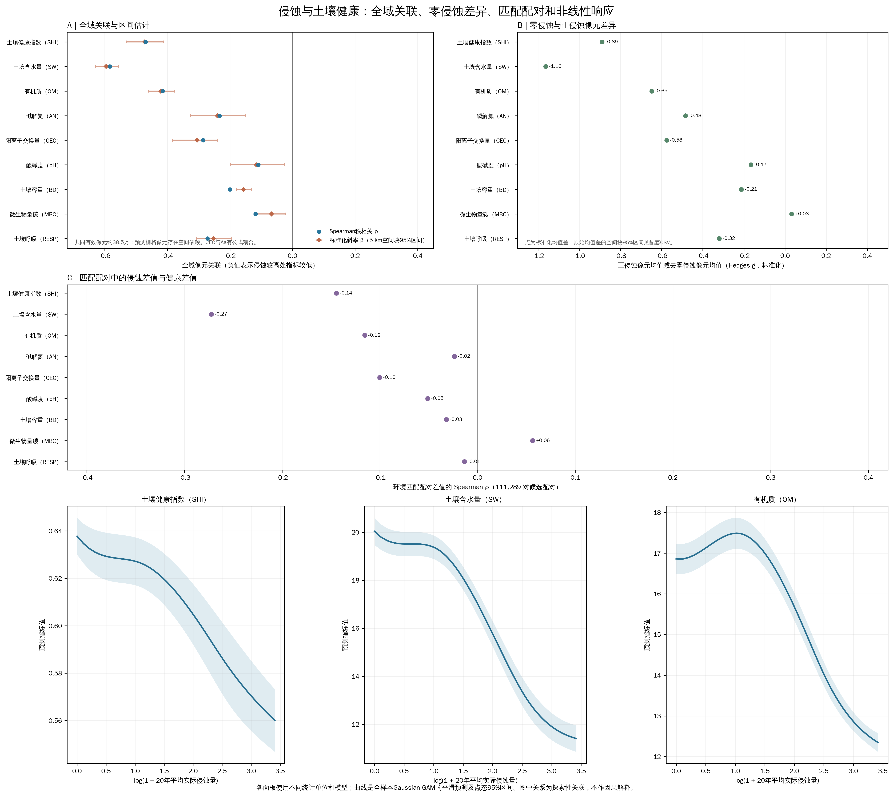{width=95%}

**阅读说明：**A面板比较全域像元中的Spearman相关和标准化斜率；B面板显示零侵蚀与正侵蚀像元的标准化均值差（Hedges g）；C面板展示第二套环境匹配方案的配对差值相关；下排为SHI、SW和OM的全样本Gaussian GAM响应曲线及点态95%区间。各统计量的单位和估计目标不同，不能直接互换。CEC按包含Aa项的原始值恢复公式计算，其相关存在代数耦合。

### 图B｜土壤健康指数、有机质和含水量的局部关系空间分布

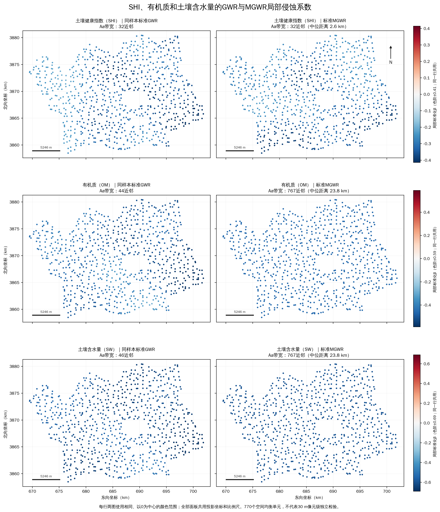{width=95%}

**阅读说明：**显示同一组770个空间均衡单元上的局部系数。每一行比较同样本标准GWR和标准MGWR，使用该指标专属且以0为中心的相同色阶；图内标出Aa暴露的近邻带宽、比例尺和指北箭头。MGWR允许各变量使用不同空间带宽。OM和SW的Aa带宽达到预设767近邻上限（中位距离约23.8 km），只能说明模型偏向较宽尺度，不能解释为精确作用半径。

### 图C｜侵蚀压力候选区及其环境特征

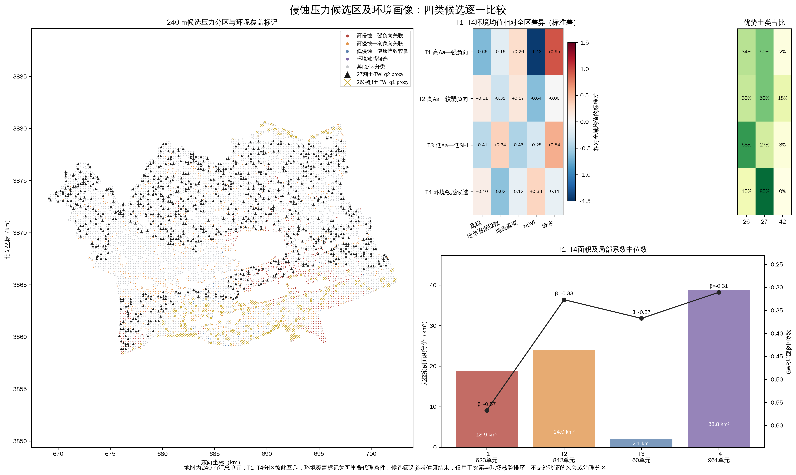{width=95%}

**阅读说明：**地图显示互斥主分区T1–T4及其他单元；三角形和叉号分别表示27潮土TWI第二组、26冲积土TWI最低组的可重叠环境代理条件。右侧逐项比较T1高侵蚀—强负向关联、T2高侵蚀—较弱负向关联、T3低侵蚀—低SHI、T4环境敏感候选四组的环境画像、优势土类比例、面积和局部GWR系数。候选筛选参考健康结果，适合安排探索性现场核查顺序，不是经验证的风险图或治理边界。

### 图D｜加入环境和空间控制后的侵蚀关联变化

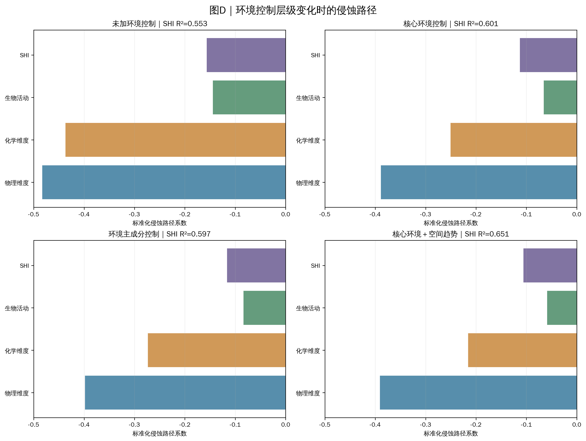{width=95%}

**阅读说明：**比较同一批环境变量完整像元中，不同控制条件下侵蚀与健康维度的标准化关联。四种条件依次为：不加入环境变量；加入高程、地形湿度、植被、地表温度和土类；用环境主成分和土类控制；在核心环境变量基础上再加入空间位置趋势。四个面板共用相同横轴范围，便于比较系数大小。SHI的R²表示预测面的拟合程度，不是因果解释比例。

### 图E｜全样本与环境匹配端点的路径比较

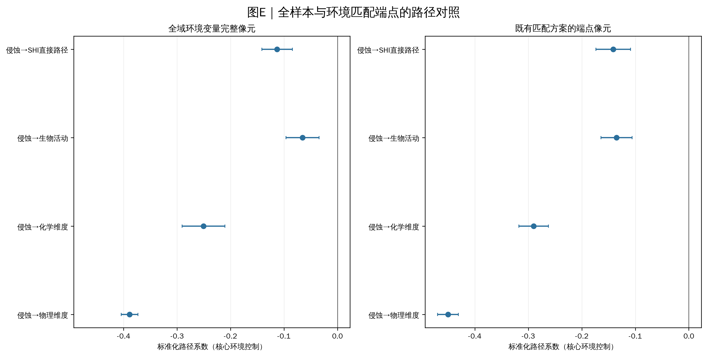{width=95%}

**阅读说明：**两侧使用相同环境变量控制：左侧为全区环境变量完整像元，右侧为既有环境匹配方案的端点像元。该方案要求环境距离不超过0.35、两端相距不超过1,000 m，且同组侵蚀百分位差至少0.50。点和线表示标准化关联及95%区间；这组端点只代表该匹配方案。

### 图F｜侵蚀与物理、化学和生物活动维度的关系

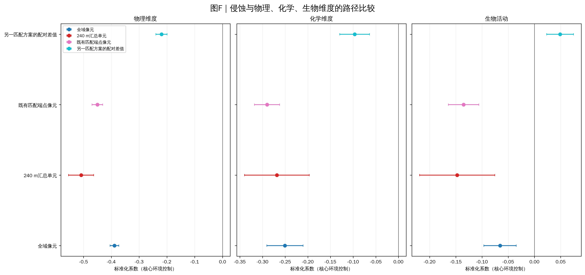{width=95%}

**阅读说明：**在相同环境变量控制下比较全域像元、240 m汇总单元、既有匹配方案端点和另一套匹配配对差值。两套匹配要求不同：第一套环境距离阈值0.35、地理距离上限1,000 m、组内侵蚀百分位差至少0.50；第二套阈值0.75、距离上限500 m、每类土壤分8组、组内侵蚀百分位差至少0.30。配对差值以每一对像元为单位，不能与端点像元回归系数直接比较。

### 图G｜SHI模型拟合、侵蚀增量与直接关联

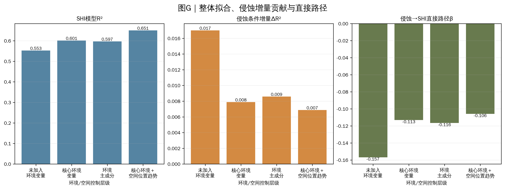{width=95%}

**阅读说明：**三幅图依次显示SHI模型拟合度、在已有控制条件上加入侵蚀后的R²增量、侵蚀与SHI的直接标准化关联。控制条件从未加入环境变量，逐步变化为核心环境变量、环境主成分，以及核心环境变量加空间位置趋势。R²增量表示当前模型内的预测变化，不代表因果贡献。

### 图H｜侵蚀与健康维度关联SHI的候选路径

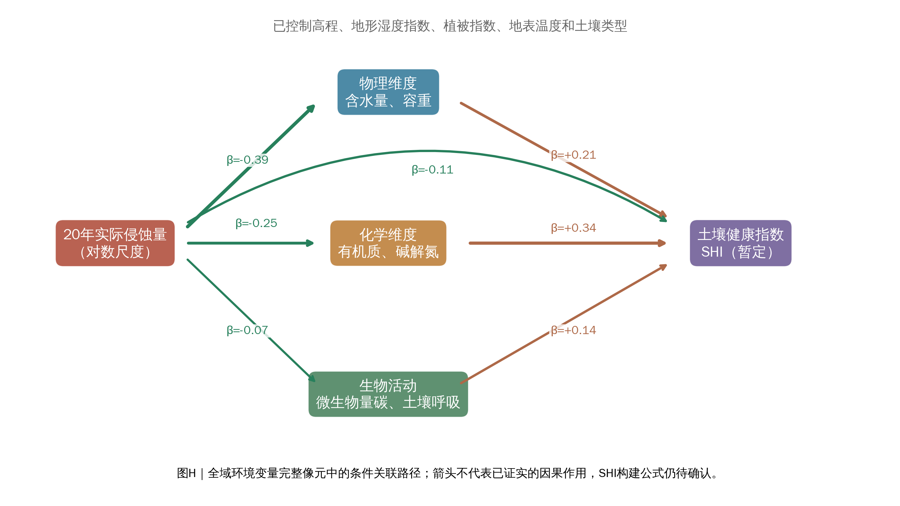{width=95%}

**阅读说明：**路径图显示在控制高程、地形湿度、植被指数、地表温度和土类后，侵蚀与三类健康维度的关联，以及这些维度与SHI的条件关联。β是标准化路径系数；箭头表示模型中设定的条件关系，不代表已经证实的因果中介。SHI原始计算配方和权重尚待确认。

### 图I｜不同土类和地形湿度分组的路径差异

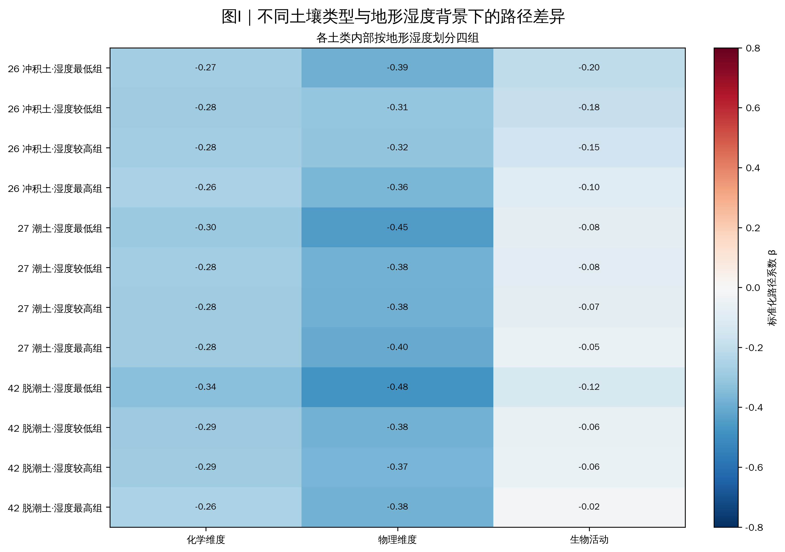{width=95%}

**阅读说明：**在冲积土、潮土和脱潮土各自内部，按地形湿度指数从低到高分成四组，再估计侵蚀与物理、化学、生物活动维度的标准化关联。图中每类土的四行依次代表湿度最低、较低、较高和最高组。分组结果受候选筛选影响，不是正式组间差异检验。

### 图J｜不同控制条件下 SHI 直接路径的跨总体比较

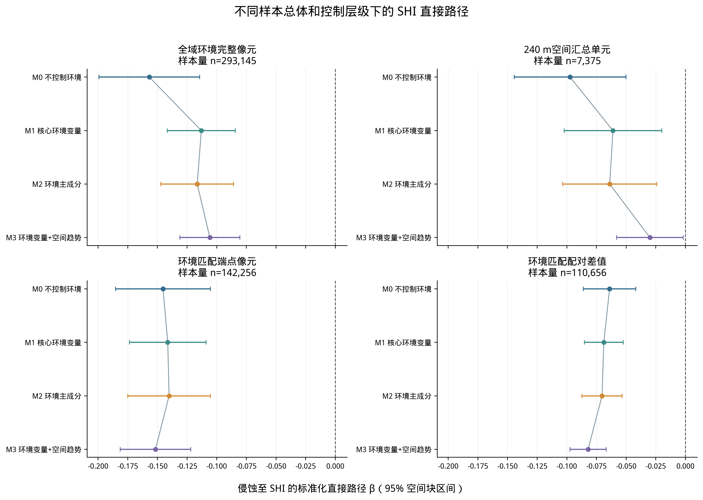{width=95%}

**阅读说明：**四个面板分别表示全域环境完整像元、240 m汇总单元、环境匹配端点和匹配对差值。M0至M3逐步改变环境/空间控制。横线为5 km空间块聚类区间；该图用于显示模型条件敏感性，不作因果解释。

### 图K｜三种结构模型方法的路径系数对照

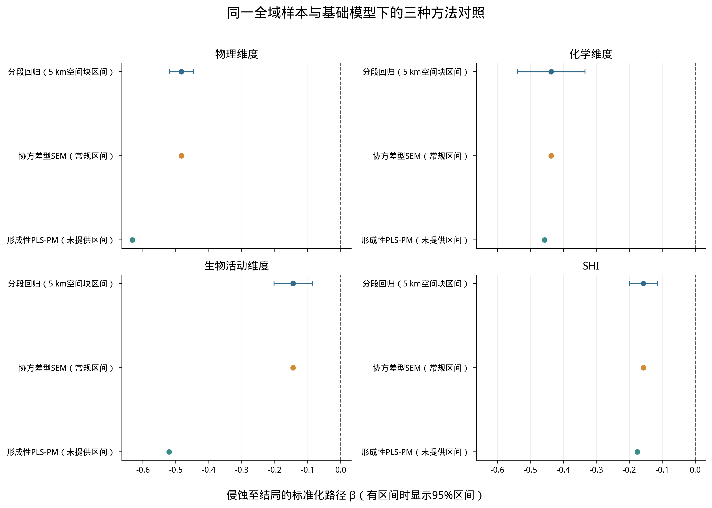{width=95%}

**阅读说明：**比较分段路径模型、协方差型SEM与形成性PLS-PM在同一全域样本上的侵蚀路径。分段模型区间按5 km空间块聚类；协方差型SEM区间按常规独立同分布假设计算；PLS-PM未提供区间，故只显示点估计。各模型的构念定义和估计假设不同，系数仅用于方向和量级的探索性对照。

### 图L｜不同总体下 SHI 模型拟合度与侵蚀增量

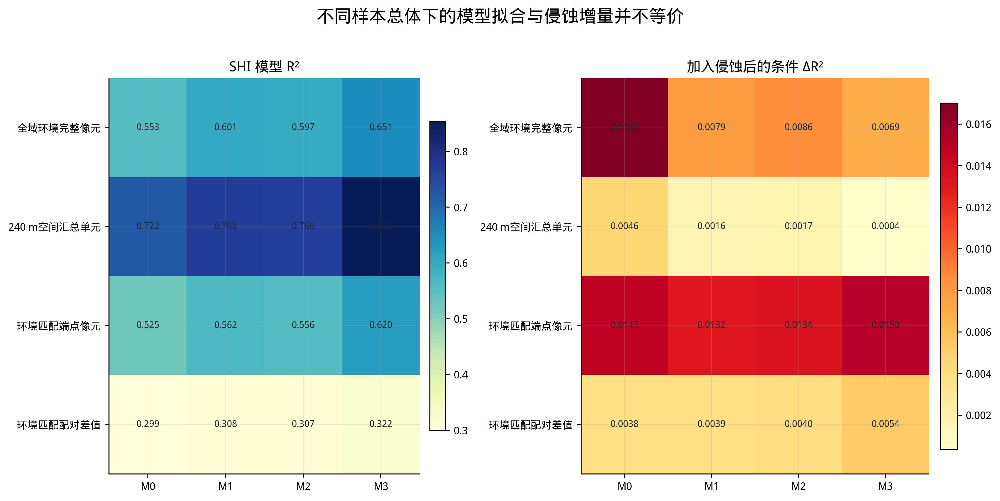{width=95%}

**阅读说明：**左图为SHI模型内R²，右图为在同一控制条件上加入侵蚀变量后得到的条件ΔR²。M0不控制环境；M1加入高程、地形湿度、植被、地表温度和土类；M2使用环境主成分；M3在核心环境变量上增加空间位置趋势。更高的总拟合度不等于侵蚀具有更大的独立增量；所有数值均为表观模型内拟合。

### 图M｜三项重点结局的局部系数空间分布

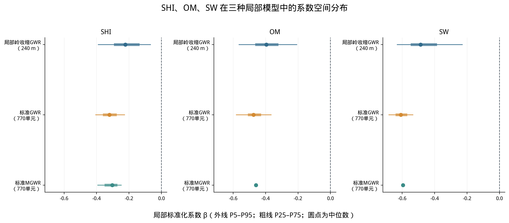{width=95%}

**阅读说明：**比较SHI、OM和SW在局部共线性收缩GWR、同样本标准GWR及标准MGWR中的局部系数分布。线段表示空间单元间的系数分位数范围，不是置信区间；三类模型使用的空间单元数和模型设定不同。

### 图N｜三项结局的强负向局部区域重合度

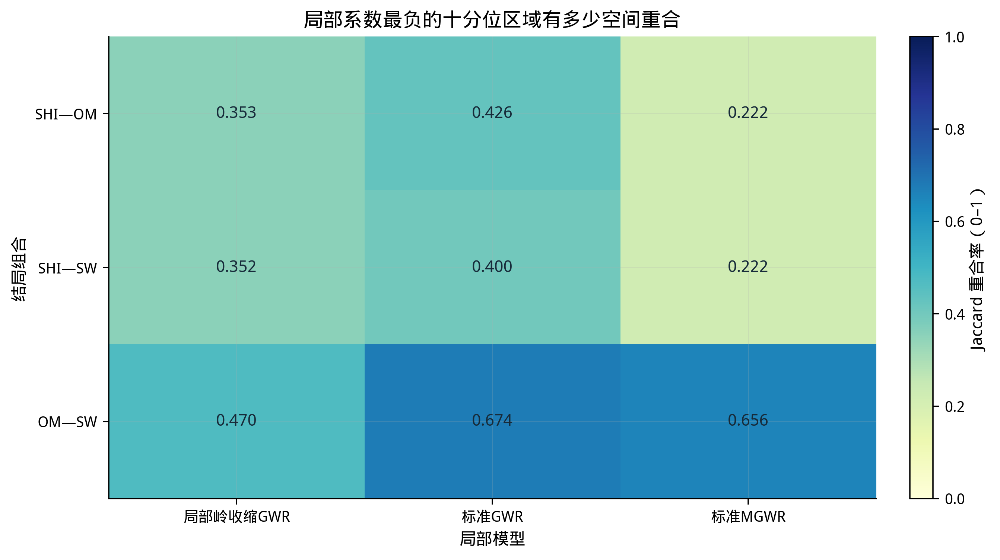{width=95%}

**阅读说明：**每格比较两个结局各自局部系数最低十分位的空间单元集合。Jaccard值越高，两个低系数区域的空间重合越多；它不表示两种结局的系数相等，也不构成显著性检验。

### 图O｜局部系数与连续环境变量的秩相关

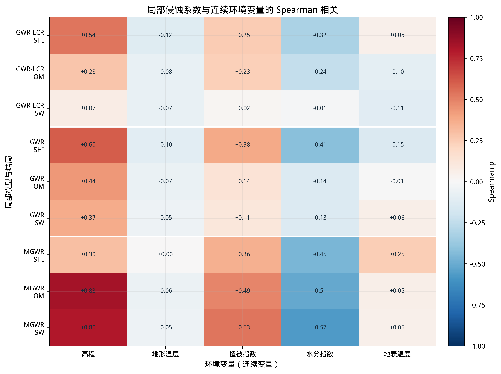{width=95%}

**阅读说明：**热图展示局部侵蚀系数与高程、地形湿度、植被、水分指数和地表温度的Spearman相关。正负号表示空间高低排序的共同方向；相关不等于环境变量造成了局部系数变化。

### 图P｜环境强弱组的局部系数描述性差异

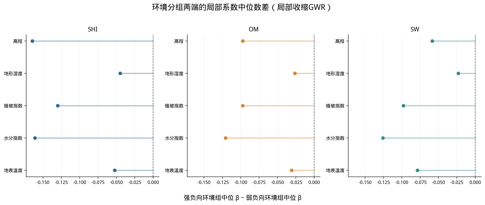{width=95%}

**阅读说明：**每个点是按各环境变量分组后，局部系数最负组与最弱负组的中位数之差。越负表示两个已挑出的组之间差异越大；分组选择参考了结果本身，因此只能作为探索性定位，不是环境因果效应或正式组间显著性检验。

### 图Q｜不同土类和地形湿度组中的健康维度路径

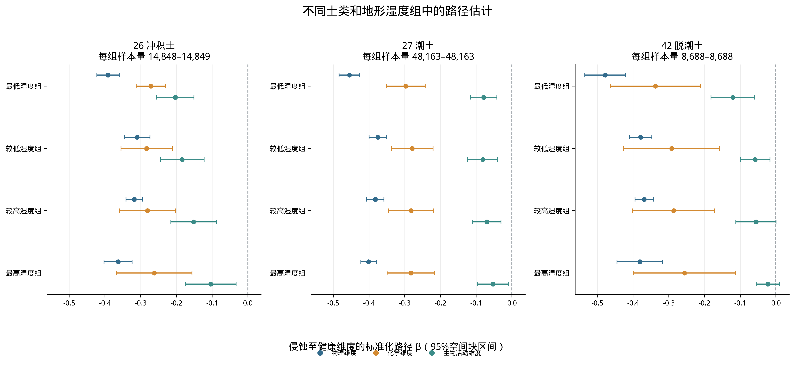{width=95%}

**阅读说明：**每个面板对应一个土类，纵向按该土类内部的地形湿度四分位从低到高排列，颜色区分物理、化学和生物活动维度。区间按5 km空间块聚类。结果来自结果导向挑选的环境组，组间差异尚未通过正式的多组系数等值检验。

### 图R｜链式维度路径的标准化关联乘积

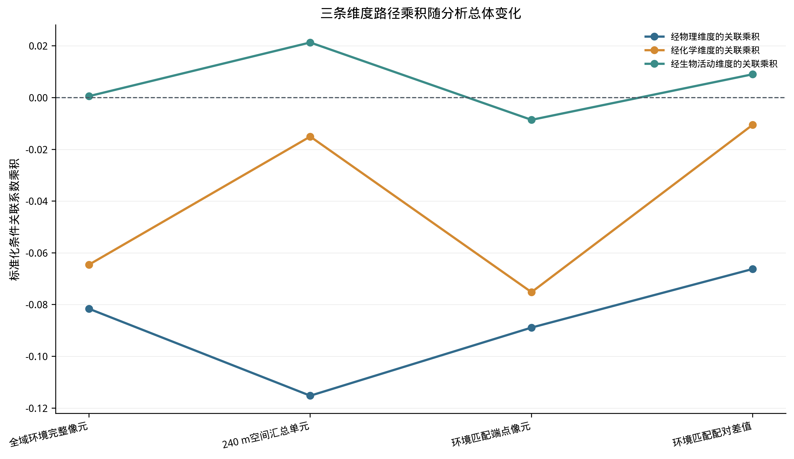{width=95%}

**阅读说明：**图中为侵蚀到单个健康维度、再到SHI的标准化条件关联系数乘积，并比较四类分析总体。它不是经因果识别的中介效应；当前没有为这些乘积计算置信区间，图线只连接不同总体的点估计。

### 图S｜侵蚀发生状态与正侵蚀强度的路径对照

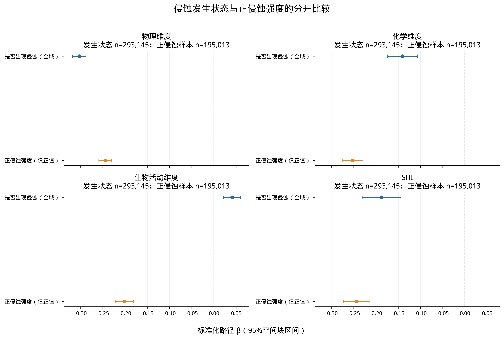{width=95%}

**阅读说明：**左侧路径表示全域像元从零侵蚀到正侵蚀的状态关联；右侧路径只在正侵蚀像元中表示侵蚀强度关联。二者的样本数与暴露定义不同，不应相减或解释为因果分解。图示SHI和三类健康维度，区间按5 km空间块聚类。

### 图T｜原始指标与健康方向统一评分的敏感性对照

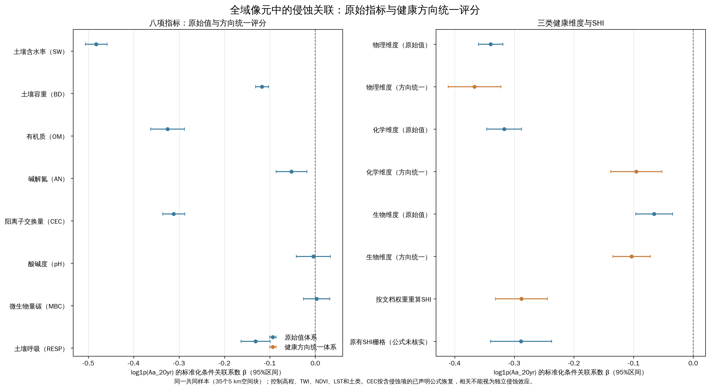{width=95%}

**阅读说明：**对比八项指标原始值、方向统一评分、健康维度和SHI的条件关联。CEC标签仍写CEC，但因恢复公式含侵蚀项，其关联不作为独立侵蚀效应；方向转换后的SHI未精确复现既有SHI栅格，所以只作敏感性比较。

### 图U｜SHI与八项土壤指标的240米局部侵蚀系数地图

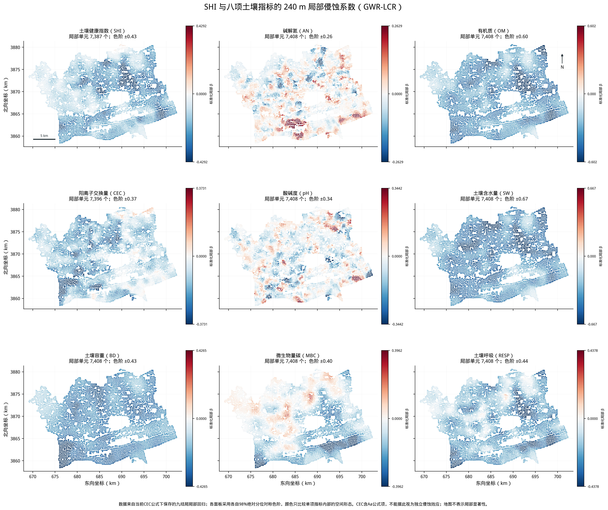{width=95%}

**阅读说明：**九个小图使用当前CEC数据版本下保存的GWR-LCR局部标准化系数和真实投影坐标。每个指标采用自己的98%绝对分位对称色阶，适合查看各指标内部的空间形态，不宜直接比较不同面板的色彩深浅。局部置信区间是模型内区间，没有用于显著性热点判定；CEC的恢复公式含侵蚀项，存在代数耦合。

### 图V｜标准MGWR相对标准GWR的局部系数差值地图

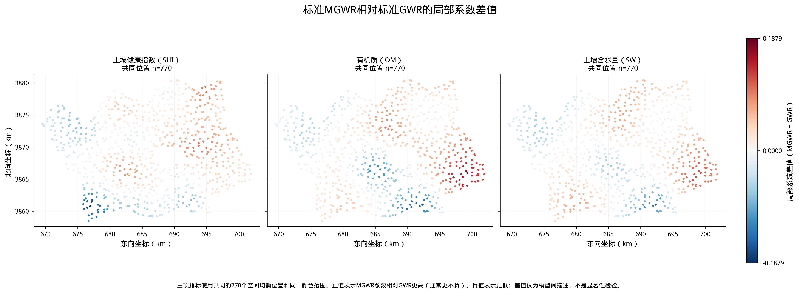{width=95%}

**阅读说明：**三幅地图显示770个共同空间位置上MGWR减去标准GWR的局部标准化系数差值，使用共同颜色范围。正值表示MGWR估计相对更高，负值表示相对更低；该差值是模型对照，不代表显著区域或因果差异。

### 图W｜侵蚀与三类土壤健康维度的平行路径图

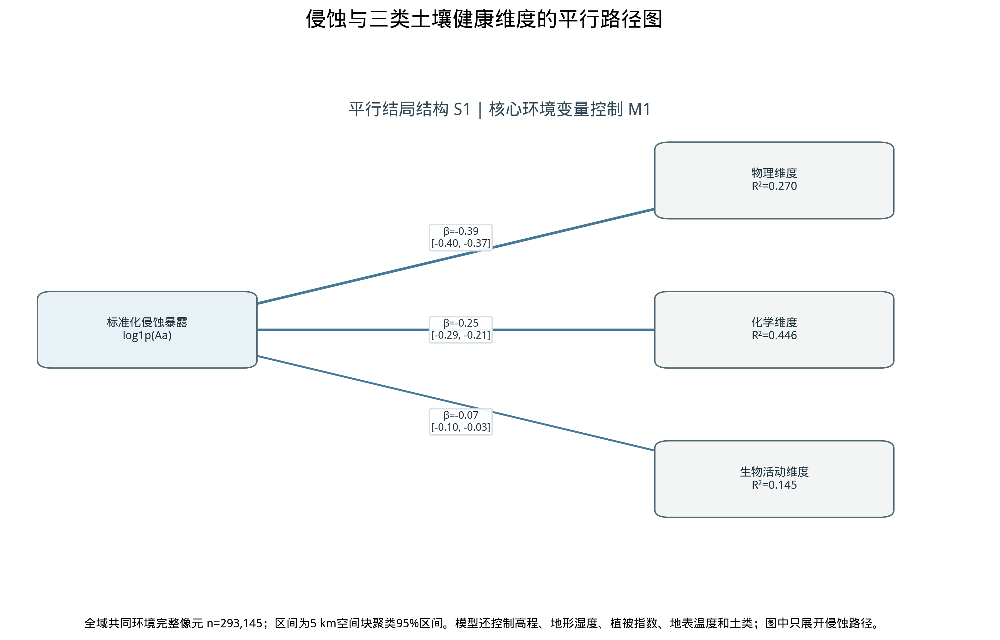{width=95%}

**阅读说明：**按已保存的S1分段路径模型绘图；箭头标签给出标准化β和5 km空间块聚类95%区间，结局框内为R²。模型控制高程、地形湿度、植被指数、地表温度和土类（M1）；图中仅画侵蚀到三类健康维度的焦点路径。箭头表示条件关联，不是已验证的因果关系。

### 图X｜侵蚀与健康维度链式路径图

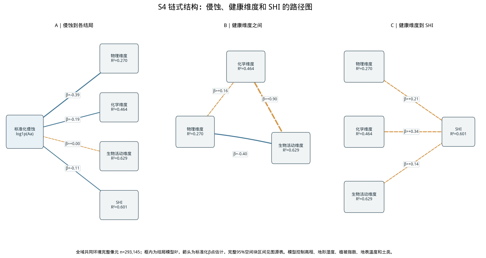{width=95%}

**阅读说明：**将S4链式结构拆成三组便于阅读的路径：侵蚀到健康结局、健康维度之间、健康维度到SHI。框内为各结局模型R²，箭头为标准化β点估计；完整95%空间块区间见图源表。模型控制核心环境变量和土类，图中箭头是条件关联，不是已证实的中介因果链。

### 图Y｜侵蚀与SHI及八项土壤指标的单结局路径图

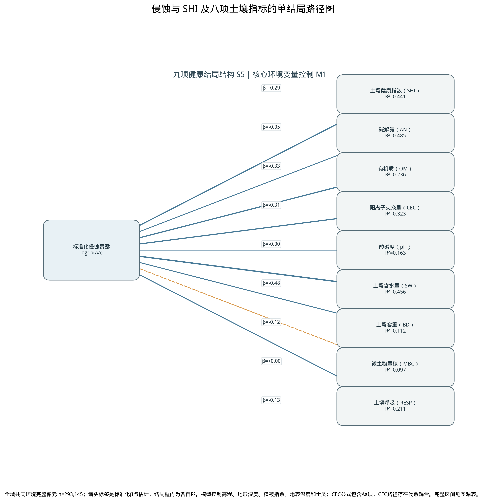{width=95%}

**阅读说明：**展示S5结构下侵蚀暴露到SHI和八项土壤指标的九条标准化条件路径；结局框中的R²来自各自单结局模型。M1控制高程、地形湿度、植被指数、地表温度和土类。CEC标签仅写CEC，但恢复公式含侵蚀项，因此该路径存在代数耦合。箭头不是因果证据，区间见源表。

### 图Z｜侵蚀发生与正侵蚀强度的两组结构路径图

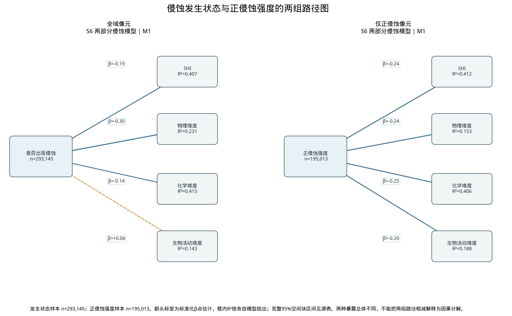{width=95%}

**阅读说明：**左右两图分别展示S6中侵蚀发生状态和正侵蚀强度到SHI及三类健康维度的标准化条件路径；左侧使用全域样本，右侧只使用正侵蚀像元。框内是各自模型R²，箭头点估计的95%空间块区间见图源表。两种暴露定义和样本不同，不能相减或视为因果分解。

<!-- PHASE_J_FULL_FIGURE_APPENDIX_END -->
